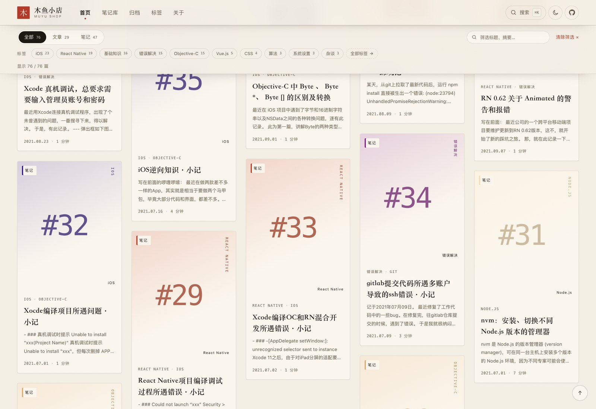
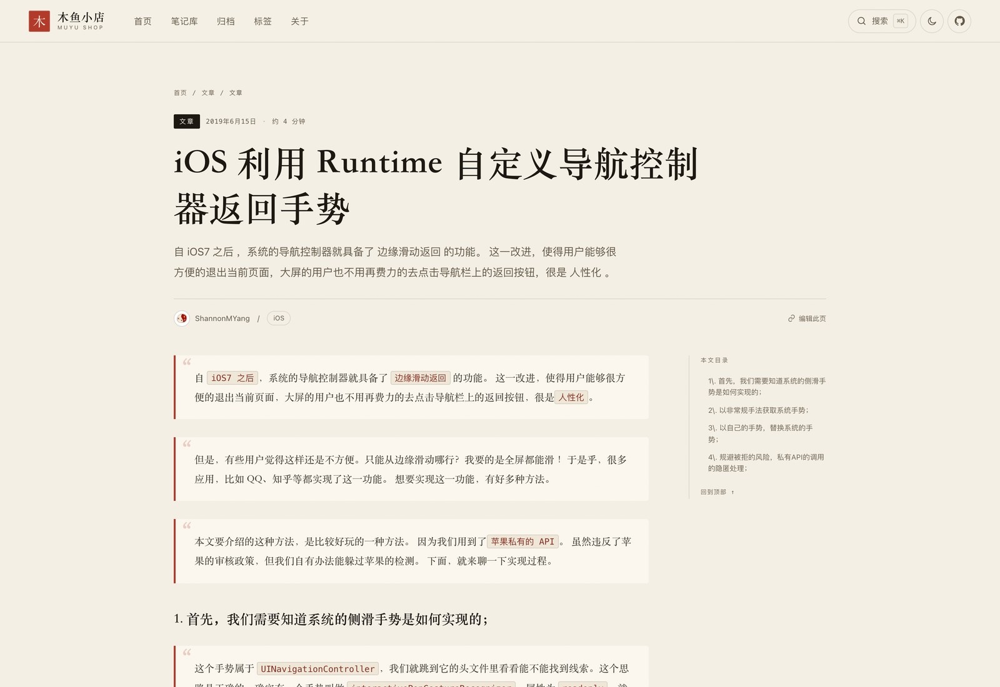
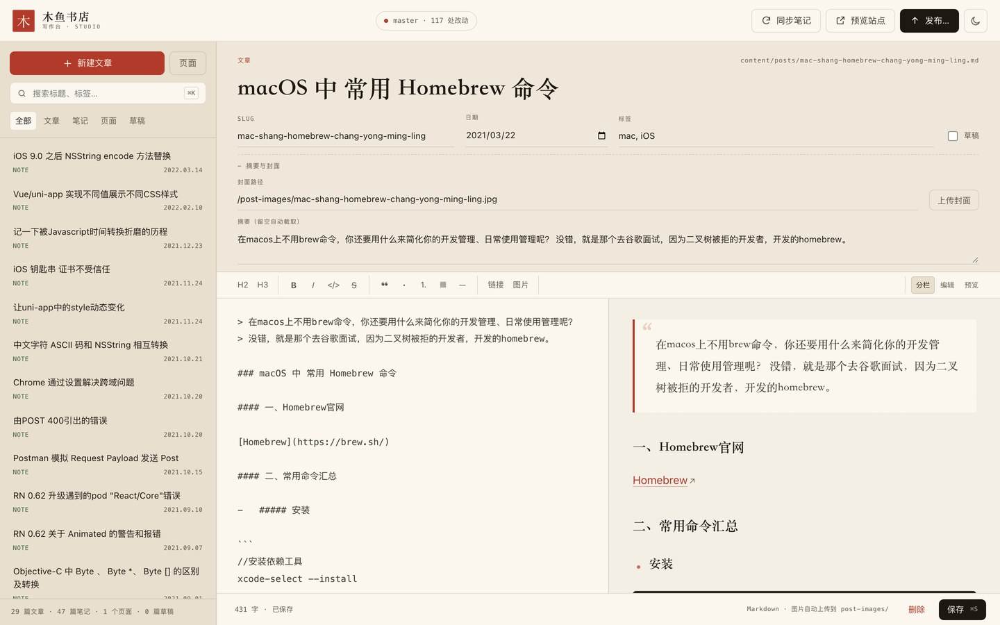

# 木鱼小店

> 温故而知新。

这是 [shannonmyang.github.io](https://shannonmyang.github.io/) 的完整内容仓库与构建系统。

过去内容散在三个地方：Gridea 生成的静态站、`MyPersonalBlog` 的 GitHub Issues，以及那个只存在于记忆里的 Hexo。现在它们合并成一套：

- **唯一展示窗口**：GitHub Pages（`master` 分支根目录），地址不变。
- **唯一内容仓库**：就是你现在看到的这个仓库，Markdown 源文件在 `content/`。
- **写作台**：本地 macOS App / 浏览器界面，写 Markdown、即时预览、上传图片、一键发布，不用碰命令行。
- **自动同步**：GitHub Issues 笔记一键拉取，图片自动下载到仓库，断链后也不会丢。
- **新外观**：纸感 + 墨色 + 朱砂印章，桌面端 **五列瀑布流拼图**（1360px 以上），向下逐级降到 4 / 3 / 2 / 1 列。

---

## 目录结构

```
.
├── 木鱼书店.app            # macOS 写作台（本地构建，不提交二进制）
├── content/                # ★ 内容源文件
│   ├── site.yml            # 站点名称、导航、作者、首页文案
│   ├── posts/              # 手写文章（Markdown + frontmatter）
│   ├── notes/              # 从 GitHub Issues 同步的笔记（只读）
│   ├── pages/about.md      # 关于页
│   └── legacy-tags.json    # 旧 Gridea 标签 id → 新标签的映射
├── theme/assets/           # 站点 CSS / JS / 图标 / OG 图
├── site/                   # 静态站点生成器（零框架，Node.js）
│   ├── build.mjs           # 构建入口
│   └── lib/                # 内容加载、Markdown 渲染、模板、RSS、Sitemap
├── studio/                 # 写作台
│   ├── server.mjs          # 本地服务（只绑定 127.0.0.1）
│   ├── ui/                 # 写作台界面
│   └── mac/main.swift      # macOS 原生窗口外壳
├── scripts/                # 迁移、同步、构建 App、发布、检查
├── post-images/            # 所有图片（旧封面 + Issue 图片）
├── images/                 # 头像等固定图片
├── index.html …            # ★ 构建产物，提交在根目录，Pages 直接托管
└── .github/workflows/      # 网页端改 Markdown 时自动重建
```

**为什么构建产物也提交？** 因为 GitHub Pages 当前从 `master` 分支根目录发布。把产物提交在根目录，不需要改任何 Pages 设置，推送即上线。源文件同样在仓库里，随时可以重新构建。

---

## 快速开始

### 方式一：macOS App（推荐）

仓库根目录里有一个 `木鱼书店.app`，双击即可：

1. 自动启动本地写作台（`127.0.0.1:4400`）并用原生窗口打开；
2. 左侧选文章 / 新建文章；
3. 右侧写 Markdown，左边预览实时更新；
4. `⌘S` 保存，右上角「发布…」构建并推送到 GitHub；
5. 关闭 App 时本地服务一起退出。

> App 必须放在仓库根目录（它通过自身位置找仓库）。换电脑后运行 `npm run app:build` 重新生成即可；`*.app` 不进 Git。

### 方式二：命令行 + 浏览器

```bash
npm install
npm run studio        # 写作台 → http://127.0.0.1:4400
```

写作台提供：文章列表、全文搜索、Markdown 编辑 + 实时预览、标签/封面/摘要/草稿、图片粘贴上传、构建预览、同步 Issues、发布。界面只监听本机，不会暴露到局域网。

### 方式三：纯命令行

```bash
npm run build         # 构建站点到仓库根目录
npm run dev           # 构建 + 预览 + 监听 content/theme/site 自动重建
npm run check:links   # 检查所有站内链接和图片
```

---

## 写作格式

`content/posts/*.md`：

```markdown
---
title: "文章标题"
slug: "my-post-slug"          # URL：/post/my-post-slug/
date: "2026-11-25T12:00:00+08:00"
kind: "post"
tags: ["iOS", "性能优化"]
cover: "/post-images/xxx.jpg" # 可留空，自动生成排版封面
excerpt: "列表页摘要，可留空自动截取"
draft: false                  # true 时不会出现在站点上
---

正文用 Markdown。支持代码高亮、表格、任务列表、脚注、KaTeX 公式、图片灯箱。
```

- 文章 URL 固定为 `/post/<slug>/`，改 slug 会改链接；写作台会阻止重复 slug。
- 封面留空时，卡片会按标题 / 标签生成一张纸感排版封面，不会出现空白卡片。
- 正文图片建议上传到 `post-images/`（写作台会自动做）。
- 标签不需要提前注册，构建时自动聚合；`Vue.js` 与 `vue.js` 会归并到同一个标签页。
- 草稿只存在于本地仓库，不进入首页、归档、RSS 和搜索索引。

---

## 发布与上线

三种方式等价，任选：

1. **写作台右上角「发布…」**：构建 → `git add -A` → commit → `git push origin master`。
2. **命令行**：`npm run publish`（可加 `-m "提交信息"`，或 `--no-push` 只本地提交）。
3. **GitHub 网页直接改 Markdown**：`.github/workflows/auto-build.yml` 会自动构建并提交产物。

推送后 GitHub Pages 约 1 分钟更新。站点设置保持「Deploy from a branch → master → / (root)」即可。

---

## 同步 GitHub Issues 笔记

- 来源：`content/site.yml` 的 `notes.repo`，当前是 `ShannonMYang/MyPersonalBlog`。
- 写作台点「同步笔记」，或 `npm run sync:issues`。
- 每篇 Issue → `content/notes/gh-<number>.md`，标题、标签、创建/更新时间、Issue 链接都会保留。
- 正文中的图片自动下载到 `post-images/issues/`，并改写为本地链接。
- 与旧文章标题重复的 Issue 自动跳过（目前只有一篇：Homebrew 命令）。
- 已删除的 Issue 对应的本地笔记会自动清理。
- 匿名 API 每小时 60 次；遇到限流可 `GITHUB_TOKEN=xxx npm run sync:issues`。

笔记在写作台里是**只读**的：要改内容请去原 Issue，重新同步后会覆盖本地文件。这样 GitHub 始终是笔记的唯一真源。

---

## 这次迁移做了什么

- **29 篇**旧 Gridea 文章从构建后的 HTML 反向还原为 Markdown，保留标题、日期、标签、封面、正文和旧 URL（`/post/<原 slug>/`）。
- **47 篇** Issue 笔记导入（原 48 篇，1 篇与旧文章重复跳过），下载 **98 张**正文图片到仓库。
- 旧标签页 URL（`/tag/5ybvI6wsF/` 这类）全部生成跳转页（meta refresh + canonical）；`/post/about/` 跳到 `/about/`。
- 丢掉了 3 个空的 Gridea 自定义页面（`books` / `friends` / `movies`，没有正文）。
- 移除了旧站正文里的 **Gitalk 评论**：它的 `clientSecret` 曾被写进公开 HTML。笔记的讨论统一回到 GitHub Issue；文章页暂时不挂第三方评论。
  > 建议顺带处理：到 GitHub → Settings → Developer settings → OAuth Apps，删除当年为 Gitalk 创建的应用（或至少重置 secret）。历史提交里仍然能翻到那串值。
- 图片图床 `poetries1.gitee.io` 已失效的 6 张图，会在正文里显示「图片已失效」占位，而不是破图。

---

## 设计说明

- 颜色、字体、间距、卡片圆角都在 `theme/assets/site.css` 顶部的 `:root` 变量里；深色模式覆盖在 `html[data-theme="dark"]`。
- 列数断点：
  - ≥ 1360px：**5 列**
  - 1080–1359px：4 列
  - 900–1079px：3 列
  - 640–899px：2 列
  - < 640px：1 列
- 瀑布流有两层：默认 CSS 多列（无 JS 也能看），加载后切换成按列计算高度的绝对定位，保证视觉顺序与「拼图」错落。
- 字体全部走系统栈（宋体 / 苹方），不依赖外部 CDN；页面离线也能完整显示。
- 文章页包含：阅读进度、目录高亮、代码复制、图片灯箱、上下篇、相关阅读、JSON-LD、RSS、Sitemap。
- 所有图片懒加载；首屏只加载可视区封面。

---

## 常用命令

| 命令 | 作用 |
| --- | --- |
| `npm run studio` | 启动本地写作台（4400） |
| `npm run app:build` | 重新编译 `木鱼书店.app` |
| `npm run build` | 构建站点 |
| `npm run dev` | 构建 + 预览 + 自动重建 |
| `npm run publish` | 构建 + 提交 + 推送 |
| `npm run sync:issues` | 同步 GitHub Issues |
| `npm run check:links` | 检查内部链接 / 资源 |
| `npm run check:layout` | Chrome 无头布局回归（桌面 5 列、移动端、筛选、搜索） |
| `npm run check:a11y` | axe-core 无障碍审计（明暗两套主题） |
| `npm run import:legacy` | 重新从旧站 HTML 迁移文章（一般不需要） |

---

## 常见问题

**发布失败：`git push` 没有权限。**
本机仓库用 SSH 克隆，确认 `ssh -T git@github.com` 正常；也可以改用带 token 的 HTTPS remote。

**想改站点名 / 导航 / 首页文案。**
改 `content/site.yml`，重新构建即可。

**想换某篇文章的封面。**
写作台打开文章 → 「摘要与封面」→ 上传封面；或直接把图片放进 `post-images/` 并在 frontmatter 写 `/post-images/文件名`。

**为什么笔记在写作台里不能编辑？**
它们是 Issues 的镜像，避免两边各改一份。点笔记里的「GitHub Issue」去原处改，再同步。

**App 提示找不到 Node.js。**
安装 Node.js 18+（`brew install node`），重新打开 App。

**GitHub Pages 没更新。**
确认推送的是 `master` 分支，且仓库 Settings → Pages 仍为 `master / (root)`；首次推送后等待 1–2 分钟。

---

## 技术栈

Node.js 18+（ESM）、markdown-it、highlight.js、KaTeX、gray-matter、turndown（仅迁移用）、Playwright（仅检查用）、Swift + WebKit（macOS 外壳）。没有前端框架，没有数据库，没有第三方博客平台。

---

## 预览





