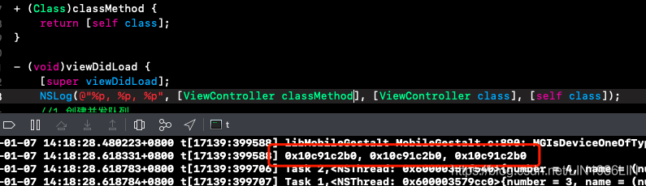

> 笔记缘由：在一次远程在线面试过程中，一位远在杭州的哥们儿问，OC中的反射机制，有做过了解或者使用么？而我，只能无奈的表示，自己仅仅是听说过这么个东西的存在。
>
> 遂，查资料琢磨一番，有此记录一篇。

------

> Objective-C 中基于 RunTime 实现的反射

##### 一、反射

> 反射，一般表现在字符串和 Class 转换，字符串和内部方法转换，字符串和属性的转换（取值和赋值）。

##### 二、Objective-C 中的反射

###### OC 的反射是基于其 Runtime 实现的。

###### 反射机制的基本概念：
> 找了好久 oc 的反射机制，只能朦胧的得到一句：跟 java 的反射机制相似
> 那么笔者就先贴上 java 语言的反射机制基本概念：在运行状态下，对于任意一个类，都能够知道这个类的所有属性和方法，对于任意一个对象，都能调用它的任意一个方法，这种动态获取信息，以及动态调用对象方法的功能叫 java 语言的反射机制；
>
> 那么 oc 语言的反射机制与之类似是什么样的呢：在 oc 语言的反射机制跟 java 反射机制很相似，在 oc 中所有 oc 对象都继承 NSObject 类，这个类为我们提供了基础的方法和协议，我们可以直接调用这个类继承过来的方法，这个对象的基本信息，这大概就是 oc 语言的反射机制；

> 以执行某个函数为例，我们知道在 OC 中执行 [pyPerson doSomething] 函数，实质上是发送了一个消息给 Runtime, 然后 Runtime 再根据这个 Class 的字符串名和这个函数的字符串名，去匹配真正相应的方法的地址，然后再执行的。所以中间我们可以利用字符串去动态的检测，甚至动态的修改（之前说到的 Method Swizzling）。 

 > `理解：`反射机制是指方法名、类名、属性名等可以和字符串相互转化（反射），而这些转化是发生在运行时的，所以我们可以用这个机制来动态的获取类、方法或属性，从而动态的创建类对象、调用方法、或给属性赋值、判断类型等。

> 现在基本有了反射机制的概念，我们平时开发过程中都怎么利用这种机制呢？

##### 反射机制的应用

###### 获取 Class 对象

> Class 对象其实本质上就是一个结构体，这个结构体中的成员变量还是自己，这种设计方式非常像链表的数据结构。

```objective-c
typedef struct objc_class *Class;
struct objc_class {
    Class isa  OBJC_ISA_AVAILABILITY;                                  
}
```

> 直接用一个实例对象或类对象，直接调用 Class 方法，都可以获取 Class 对象。我们调用下面三个方法，都可以获得 Class 对象。

```objective-c
// 在实例方法中通过self调用class实例方法获取类对象
[self class]
// 通过ViewController类直接调用class类方法获取类对象
[ViewController class]
// 在类方法中使用类对象调用class方法获取类对象
+ (Class)classMethod {
    return [self class];
}
```

我们发现调用这三个方法，获取到的类对象是同一个类对象，内存地址也是一样的： 



这是因为这三个方法调用 class 方法，打印的都是类对象的 isa 指针。

###### 反射方法

> 系统 Foundation 框架为我们提供了一些方法反射的 API，我们可以通过这些 API 执行将字符串转为 SEL 等操作。由于 OC 语言的动态性，这些操作都是发生在运行时的。

```objective-c
// SEL和字符串转换
FOUNDATION_EXPORT NSString *NSStringFromSelector(SEL aSelector);
FOUNDATION_EXPORT SEL NSSelectorFromString(NSString *aSelectorName);
// Class和字符串转换
FOUNDATION_EXPORT NSString *NSStringFromClass(Class aClass);
FOUNDATION_EXPORT Class __nullable NSClassFromString(NSString *aClassName);
// Protocol和字符串转换
FOUNDATION_EXPORT NSString *NSStringFromProtocol(Protocol *proto) NS_AVAILABLE(10_5, 2_0);
FOUNDATION_EXPORT Protocol * __nullable NSProtocolFromString(NSString *namestr) NS_AVAILABLE(10_5, 2_0);
```

通过这些方法，我们可以在运行时选择创建那个实例，并动态选择调用哪个方法。这些操作甚至可以由服务器传回来的参数来控制，我们可以将服务器传回来的类名和方法名，实例为我们的对象。

```objective-c
// 假设从服务器获取JSON串，通过这个JSON串获取需要创建的类为FBViewController，
// 并且调用这个类的getList方法。
Class class = NSClassFromString(@"FBViewController");
FBViewController *vc = [[class alloc] init];
SEL selector = NSSelectorFromString(@"getList");
[vc performSelector:selector];
```

###### 1. 字符串和 Class 转换

```objective-c
Class __nullable NSClassFromString(NSString *aClassName);
// 当前对象是否这个类或其子类的实例
- (BOOL)isKindOfClass:(Class)aClass;
// 当前对象是否是这个类的实例
- (BOOL)isMemberOfClass:(Class)aClass; 

example:

//通过这样的方式获取class
Class Person = NSClassFromString(@"FBPerson");  
FBPerson *person= [[Person alloc] init]; 
//判断是否为其子类的对象
FBPerson *person= [[FBPerson alloc] init]; 
if([person isKindOfClass:[FBStudent class]])
{ 
   NSLog(@"person是FBStudent类型或其子类");
}else{
   NSLog(@"person不是FBStudent类型或其子类");
 } 
//判断是否是该class的对象
if([person isMemberOfClass:[FBStudent class]]){
  NSLog(@"person是FBStudent类型"); 
}else{ 
  NSLog(@"person不是FBStudent类型");
}  
```

###### 2. 字符串和内部方法转换

> 在 NSObject 类中为我们提供了一些基础方法，用来做一些判断操作，这些方法都是发生在运行时动态判断的。

```objective-c
- (BOOL)respondsToSelector:(SEL)aSelector  //判断类型或对象有没有某个方法
+ (BOOL)instancesRespondToSelector:(SEL)aSelector; //判断静态方法
- (id)performSelector:(SEL)aSelector  //动态调用对象的方法
- (BOOL)conformsToProtocol:(Protocol *)aProtocol; //判断对象是否实现某个Protocol协议

example:

//动态生成方法选择器
SEL sel =  NSSelectorFromString(@"setAge:");   

//检测是否存在某方法
FBStudent *stu = [[FBStudent alloc]init];  
if([stu respondsToSelector:@selector(setAge)]){  
    NSLog(@"stu 有setAge这个方法");  
}else{  
    NSLog(@"没有");  
}  

//动态动用方法
FBStudent *stu = [[FBStudent alloc]initAge:1];  
int age = [stu performSelector:@selector(age)];  
NSLog(@"%i",age);//输出1  
```

###### 3. 字符串和属性的转换

> OC 中属性的反射通过 KVC（Key-Value Coding）机制实现，KVC 是一种间接访问对象属性的机制，不直接调用 getter 和 setter 方法，而使用 valueForKey 来替代 getter 方法，setValue:forKey 来代替 setter 方法。 

```objective-c
Example：

FBBattery *persion = [[FBBattery alloc] init];

//不使用KVC
persion.name = @"yu" ;

//使用KVC的写法
[persion  setValue:@"yu" forKey:@"name"];
//上面是利用KVC访问类里的某个属性，下面利用KVC直接访问类里的类里的某个属性

//不使用KVC
FBPersion *persion = [[FBPersion alloc] init];
FBPhone *phone = persion.phone;
FBBattery *battery = phone.battery;

//使用KVC
FBBattery *battery = [persion valueForKeyPath: @"phone.battery" ]; 
```

###### 反射机制使用技巧

> 首先需要和后台商量好返回的数据结构，以及数据格式、类型等，返回后我们按照和后台约定的格式，根据后台返回的信息，直接进行反射和调用即可。

假设约定格式如下： 
```objective-c
@{
     // 类名
     @"className" : @"UserViewController", 
     // 数据参数
     @"propertys" : @{ @"name": @"lishan", 
                       @"age": @17 },
     // 调用方法名
     @"method" : @"refreshUserInfor"
 };
 ```
 
> 定义一个 UserViewController 类，这个类用于测试，在实际使用中可能会有多个这样的控制器类。

```objective-c
#import <UIKit/UIKit.h>

// 由于使用的KVC赋值，如果不想把这两个属性暴露出来，把这两个属性写在.m文件也可以
@interface UserViewController : UIViewController
@property (nonatomic,copy) NSString *name;/*!< 用户名 */
@property (nonatomic,copy) NSNumber *age;/*!< 用户年龄 */
/** 使用反射机制反射为SEL后，调用的方法 */

- (void)refreshUserInfo;

@end
```

> 通过反射机制简单实现了控制器跳转的方法：

```objective-c
// 简单封装的页面跳转方法，只是做演示，代码都是没问题的，使用时可以根据业务需求进行修改。
- (void)remoteNotificationDictionary:(NSDictionary *)dict {
    // 根据字典字段反射出我们想要的类，并初始化控制器
    Class class = NSClassFromString(dict[@"className"]);
    UIViewController *vc = [[class alloc] init];
    // 获取参数列表，使用枚举的方式，对控制器进行KVC赋值
    NSDictionary *parameter = dict[@"propertys"];
    [parameter enumerateKeysAndObjectsUsingBlock:^(id  _Nonnull key, id  _Nonnull obj, BOOL * _Nonnull stop) {
        if ([[parameter allKeys] containsObject:key]) {
    //对于setValue forKey，需要小心的是，假如类型匹配错误的情况下，编译会通过，但运行会报错
            [vc setValue:obj forKey:key];
        }
    }];
    [self.navigationController pushViewController:vc animated:YES];
    // 从字典中获取方法名，并调用对应的方法
    SEL selector = NSSelectorFromString(dict[@"method"]);
    [vc performSelector:selector];
}
```
