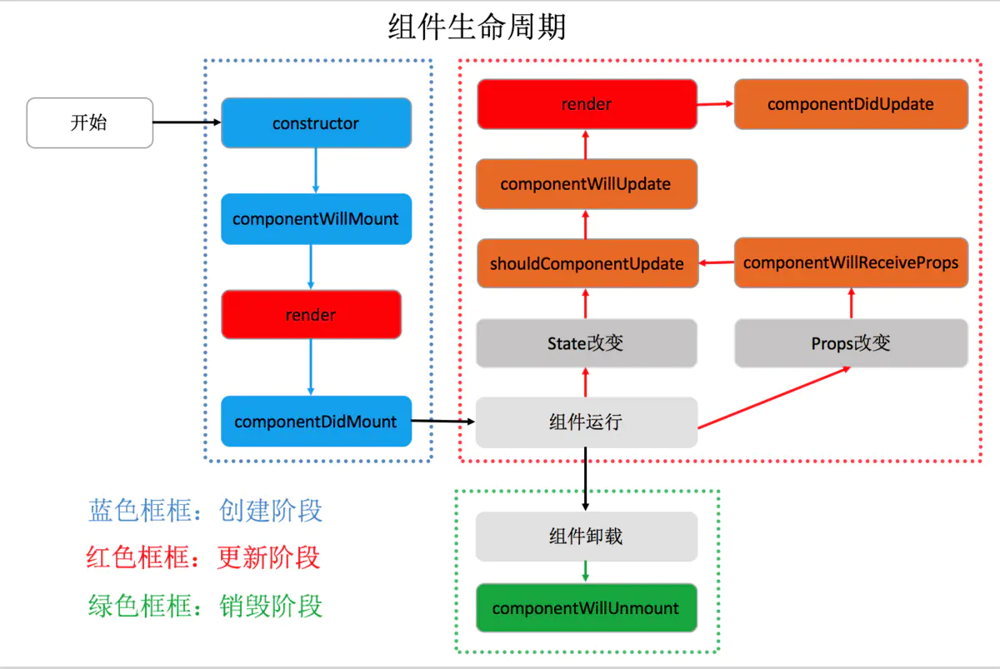
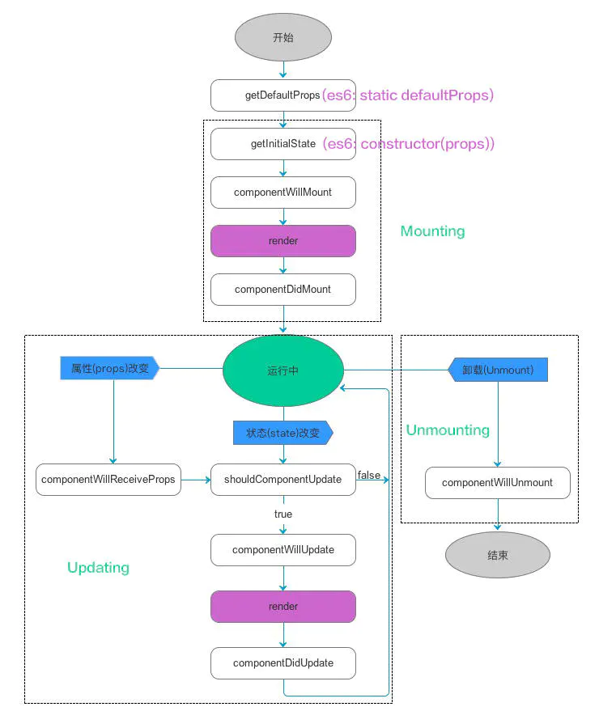
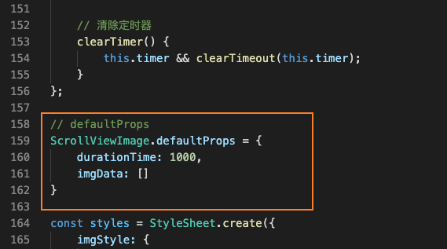

> React Native 的 组件生命周期，来源于 React 的 组件生命周期。

------

> 任何一个组件都是有生命周期的，我们经常需要在组件的生命周期中做一些事情，比如创建组件的时候或者组件销毁的时候。
>
> 组件生命周期大致分为三个阶段，实例化阶段，运行阶段，销毁阶段。

------

- #### 组件生命周期




------

- #### 在开始到实例化之间
> 在开始到constructor之间，还有一个函数的执行，static defaultProps。

> 使用方法：
```
// 在class类组件外使用此方法
// defaultProps
Children.defaultProps = {
    msg: '默认父组件传来的值'
}
// PropTypes
Children.propTypes = {
    num: propTypes.number
}
```



- #### 实例化阶段
**constructor:**
> 什么时候调用：在一开始实例化组件的时候调用
> `作用`：初始化 state.

**componentWillMount:**
> 什么时候调用：即将加载组件的时候调用
> `作用`：在 render 之前做事情

**render:**
> 什么时候调用：渲染组件的时候调用
> `作用`：通过这个方法

**componentDidMount:**
> 什么时候调用：加载组件完成的时候调用
> `作用`：在 render 之后做事情，发送请求

> 注意：`constructor`，`componentWillMount`，`componentDidMount` 只会调用一次

------

- #### 运行阶段
**componentWillReceiveProps:**
> 什么时候调用：每次传入 Props，就会调用
> `作用`：拦截 props

**shouldComponentUpdate:**
> 什么时候调用：每次 props, 或者 state 改变，就会调用
> `作用`：控制是否刷新界面

**componentWillUpdate:**
> 什么时候调用：组件即将更新调用
> `作用`：在 render 更新前做事情

**componentDidUpdate:**
> 什么时候调用：组件更新完成调用
> `作用`：在 render 更新后做事情

> 注意：绝对不要在 componentWillUpdate，componentDidUpdate 中调用 this.setState 方法，否则将导致无限循环调用，在 componentWillReceiveProps，shouldComponentUpdate 可以。

------

- #### 销毁阶段
**componentWillUnmount:**
> 什么时候调用：组件即将销毁的时候调用
> `作用`：移除观察者，清空数据
