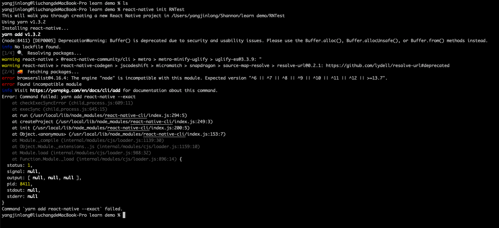
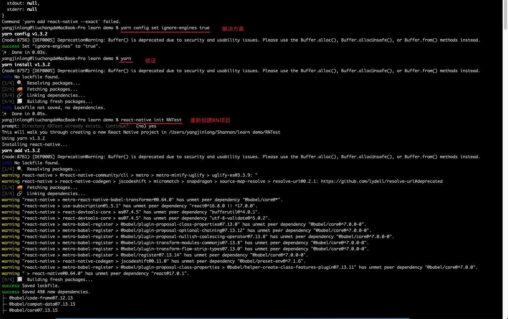
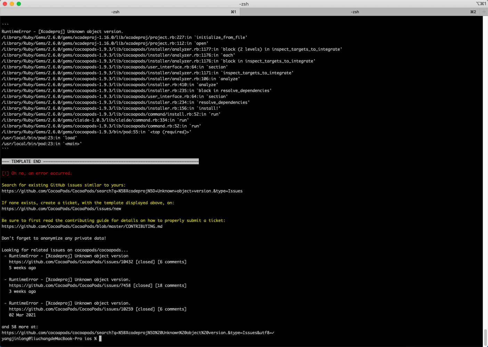
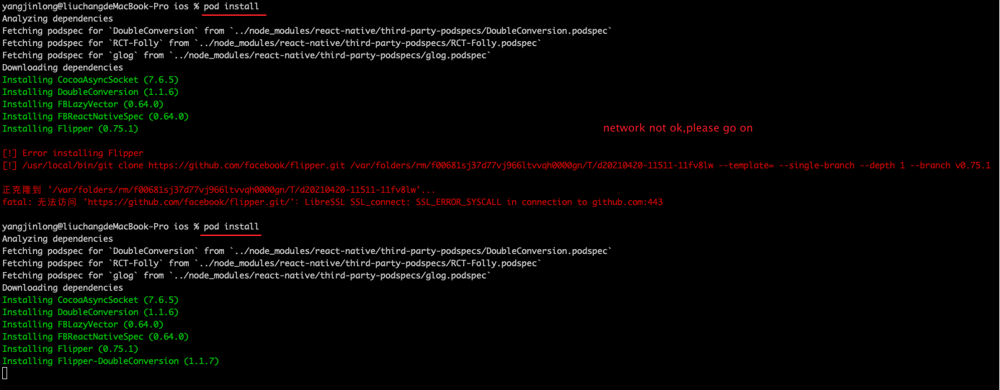
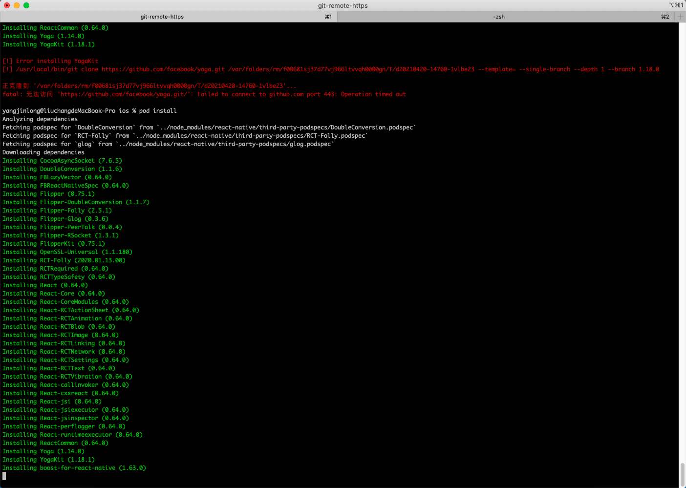

- #### 创建初始项目
> ERROR Message: Commang failed: yarn add react-native --exact
>
> 原因: node版本不兼容问题。



> Solve: 
```
// 设置忽略
yarn config set ignore-engines true
// 验证
yarn
// 余下就可以正常创建
```


> 总结：建议依据官方文档，使用 `npx react-native init`命令 创建项目。

---

- #### 导入 iOS 依赖库
> ERROR: [!] oh no, an error occurred!
>
> 原因: pod版本太低，需要升级版本



> Solve: 
```
$ sudo gem update --system  // 更新gem
Password:  // 输入密码，等待更新完成
$ gem sources --remove https://rubygems.org/
$ gem sources -a https://gems.ruby-china.org/  // https://ruby.taobao.org/ 这个源已经不在维护了
$ gem sources -l  // 查看当前源
*** CURRENT SOURCES ***

https://gems.ruby-china.org/ 
$ sudo gem install cocoapods  // 安装CocoaPods（时间稍长）
$ pod setup
```

> 但是，可能依然会导入失败，因为网络的问题。（就算你是科学上网，也可能网络出错。）


> 持续执行导入命令即可。

