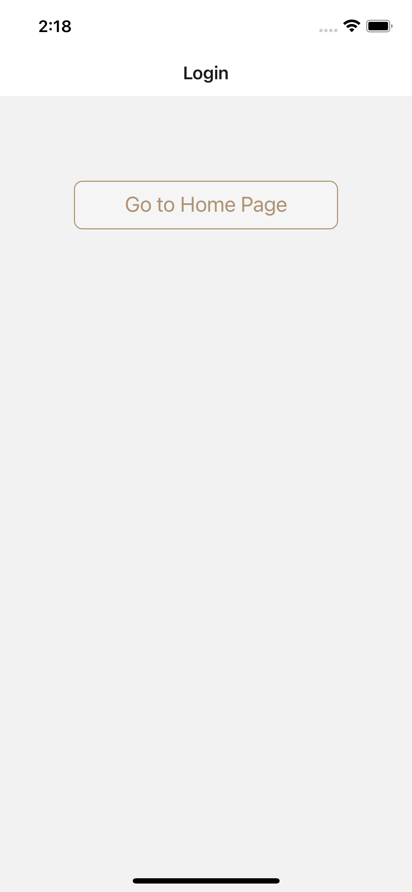
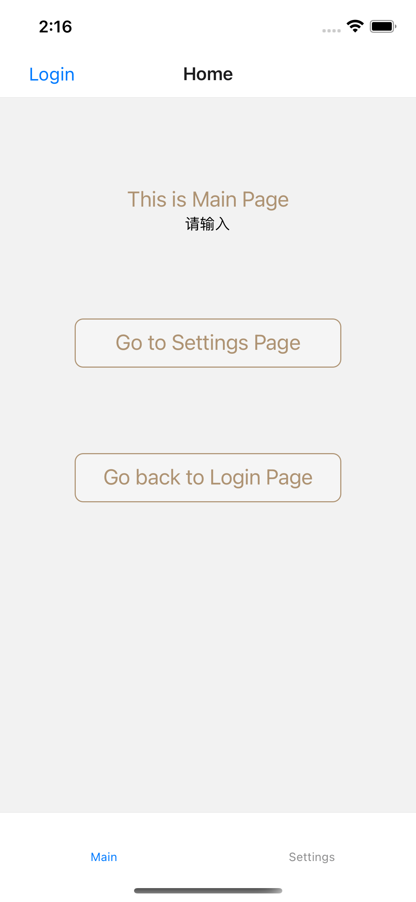
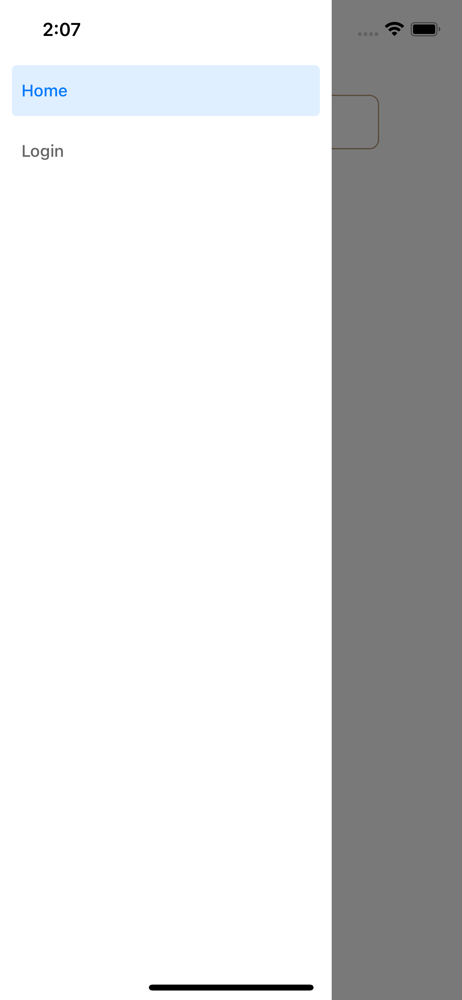

------

- #### 目录
> 1. 简介
> 2. 依赖安装
> 3. StackNavigator 栈导航
> 4. TabNavigator 标签导航
> 5. DrawerNavigator 抽屉导航
> 6. 踩坑记录
> **补充**
> 7. StackNavigator 中嵌套 TabNavigator
> 8. TabNavigator 中嵌套 StackNavigator

##### 1. 简介
> React Navigation 是 React Native 用来进行屏幕页面切换的导航方案，替代了废弃的 Navigator。配置 React Navigation 比配置 Navigator 要简单很多。React Navigation 5.x 版本是目前最新的稳定版本。
>
> 如果你是 ReactNative 新手，建议安装 0.60.0 以上的版本，可以省去很多配置操作。(小声逼逼) 其实放这个命令是为了方便以后自己看，经常忘了怎么操作。

```
npx react-native init NavStudy --version 0.60.0  //版本号自行定义
```

##### 2. 依赖安装
###### a. 安装 react-navigation/native

```
  npm install @react-navigation/native
  //使用yarn就用yarn add安装
  yarn add @react-navigation/native
```

###### b. navigation 的运行会依赖于如下依赖项，安装这些库
```
 npm install react-native-reanimated react-native-gesture-handler react-native-screens react-native-safe-area-context @react-native-community/masked-view
```

###### c. 链接 2 中的库 (0.60 版本以上的跳过此步骤)
> React Native 0.60 及更高版本开始，会自动链接，如果你版本是 0.60 及以上，这一步就可以跳过；而 React Native 0.59 以及更低版本则需要手动链接，安装 react-native link。
```
   react-native link react-native-reanimated
   react-native link react-native-gesture-handler
   react-native link react-native-screens
   react-native link react-native-safe-area-context
```

> 埋坑
>
> 按照官方的说法：React Native 0.60 及更高版本开始，会自动链接，如果你版本是 0.60 及以上，这一步就可以跳过；而 React Native 0.59 以及更低版本则需要手动链接，安装 react-native link。

我的生产环境为：“react-native”: “0.64.0”, 满足条件。
实际操作中，依赖未添加并自动链接，跑后续代码中偶尔抽风会提示：
“RNCSafeAreaProvider” was not found in the UIManager.
“RNSScreen" was not found in the UIManager. ”
>
> 总结，还是需要手动连接。并且，是逐条执行。

###### d. 在入口文件 (index.js 或 App.js) 的头部引入如下依赖
```
   // 必须放在最顶部
   import 'react-native-gesture-handler';
```
```
// index.js
import 'react-native-gesture-handler';
import {AppRegistry} from 'react-native';
import App from './App';
import {name as appName} from './app.json';

AppRegistry.registerComponent(appName, () => App);
```

###### e. 安装 navigator 库
> 有三种导航模式可以选，分别是 StackNavigator 栈导航、TabNavigator 标签导航、DrawerNavigator 抽屉导航，下面会分别说一下怎么使用。
```
   // StackNavigator
   npm install @react-navigation/stack
  
   // TabNavigator
   npm install @react-navigation/bottom-tabs
  
   // DrawerNavigator
   npm install @react-navigation/drawer
```

##### 3. StackNavigator 导航
<br/>
###### a. 引入组件
```javascript
   import { NavigationContainer } from '@react-navigation/native';
   import { createStackNavigator } from '@react-navigation/stack';
```

###### b. 创建栈导航
createStackNavigator 提供 APP 屏幕之间切换的能力，它是以栈的形式来管理屏幕之间的切换，新切换到的屏幕会放在栈的顶部。
```javascript
   const Stack = createStackNavigator();
```

###### c. 将需要进行屏幕切换的组件放入栈导航里
```javascript
   function App() {
     return (
       <NavigationContainer>
         <Stack.Navigator>
           <Stack.Screen name="Home" component={HomeScreen} />
         </Stack.Navigator>
       </NavigationContainer>
     );
   }
```

###### d. 完整代码
```javascript
// app/views/LoginScreen.js
import React, { Component } from 'react';
import { View, Text, TouchableOpacity, StyleSheet } from 'react-native';

export default class HomeScreen extends Component {
	constructor(props) {
		super(props);
	}

	render() {
		return (
			<View>
				<TouchableOpacity style={styles.button} onPress={() => this.props.navigation.navigate('Home')}>
					<Text style={styles.buttonText}>Go to Home Page</Text>
				</TouchableOpacity>
			</View>
		)
	}
}

const styles = StyleSheet.create({
	button: {
		width: 250,
		marginTop: 80,
		marginLeft: 50,
		minHeight: 46,
		paddingHorizontal: 15,
		paddingVertical: 6,
		borderStyle: 'solid',
		borderWidth: 1,
		borderRadius: 8,
		borderColor: '#ae9373',
		backgroundColor: '#f5f5f5',
		textAlign: 'center'
	},
	buttonText: {
		color: '#ae9373',
		fontSize: 20,
		lineHeight: 30,
		textAlign: 'center'
	},
})
```

```javascript
// app/views/HomeScreen.js
import React, { Component } from 'react';
import { View, Text, TouchableOpacity, StyleSheet } from 'react-native';

export default class HomeScreen extends Component {
  constructor(props) {
    super(props);
  }
  render() {
    return (
      <View>
        <TouchableOpacity style={styles.button} onPress={() => this.props.navigation.navigate('Login')}>
          <Text style={styles.buttonText}>Go to Login Page</Text>
        </TouchableOpacity>
      </View>
    )
  }
}

const styles = StyleSheet.create({
	button: {
		width: 250,
		marginTop: 80,
		marginLeft: 50,
		minHeight: 46,
		paddingHorizontal: 15,
		paddingVertical: 6,
		borderStyle: 'solid',
		borderWidth: 1,
		borderRadius: 8,
		borderColor: '#ae9373',
		backgroundColor: '#f5f5f5',
		textAlign: 'center'
	},
	buttonText: {
		color: '#ae9373',
		fontSize: 20,
		lineHeight: 30,
		textAlign: 'center'
	},
})
```

```javascript
// App.js
import 'react-native-gesture-handler';
import React, { Component } from 'react';
import { NavigationContainer } from '@react-navigation/native';
import { createStackNavigator } from '@react-navigation/stack';
//引入页面模块
import LoginScreen from './app/views/LoginScreen';
import HomeScreen from './app/views/HomeScreen';

const Stack = createStackNavigator();

function App() {
  return (
    <NavigationContainer>
      <Stack.Navigator>
        <Stack.Screen name="Login" component={LoginScreen} />
        <Stack.Screen name="Home" component={HomeScreen} />
      </Stack.Navigator>
    </NavigationContainer>
  );
}

export default App;
```

##### 4. TabNavigator 导航
> 底部导航栏，有的 app 开发的时候需要用到底部导航栏切换。使用方法跟 StackNavigator 类似。
<br/>
###### a. 安装：
```javascript
npm install @react-navigation/bottom-tabs
```
###### b. 完整代码
```javascript
App.js

import 'react-native-gesture-handler';
import React, { Component } from 'react';
import { NavigationContainer } from '@react-navigation/native';
//导入
import { createBottomTabNavigator } from '@react-navigation/bottom-tabs';
//引入页面模块
import LoginScreen from './app/views/LoginScreen';
import HomeScreen from './app/views/HomeScreen';

const Tab = createBottomTabNavigator();

function App() {
  return (
    <NavigationContainer>
      <Tab.Navigator 
        tabBarOptions={{
          activeTintColor: 'tomato',
          inactiveTintColor: 'gray',
          tabStyle : {
            backgroundColor: '#ddd',
            paddingBottom: 15,
            borderRightWidth: 1,
            borderRightColor: '#fff'
          },
        }}
      >
        <Tab.Screen name="Home" component={HomeScreen} options={{
          headerStyle: {
            backgroundColor: '#f4511e',
          },
          headerTintColor: '#fff',
          headerTitleStyle: {
            fontWeight: 'bold',
          },
        }} />
        <Tab.Screen name="Login" component={LoginScreen} />
      </Tab.Navigator>
    </NavigationContainer>
  );
}

export default App;
```

##### 5. DrawerNavigator 导航
<br/>

###### a. 安装：
```javascript
npm install @react-navigation/drawer
```
###### b. 完整代码
```javascript
// App.js
import 'react-native-gesture-handler';
import React, { Component } from 'react';
import { NavigationContainer } from '@react-navigation/native';
//导入
import { createDrawerNavigator } from '@react-navigation/drawer';
//引入页面模块
import LoginScreen from './app/views/LoginScreen';
import HomeScreen from './app/views/HomeScreen';

const Drawer = createDrawerNavigator();

function App() {
  return (
    <NavigationContainer
      drawerStyle={{
        backgroundColor: '#c6cbef',
        width: 200,
      }}
    >
      <Drawer.Navigator initialRouteName='Home'>
        <Drawer.Screen name='Home' component={HomeScreen} />
        <Drawer.Screen name='Login' component={LoginScreen} />
      </Drawer.Navigator>
    </NavigationContainer>
  );
}

export default App;
```

##### 6. 踩坑
###### a. 安装依赖导致进入系统后闪退
```javascript
npm intall react-native-screens
```

> 注意，因为在运行如上语句的时候，会自动安装最新版本。所以可能当前版本为不稳定版本，或者是 beta 测试版本。所以要注意尽量安装稳定的依赖版本。

###### b. cnpm 安装依赖失败
> 一般我们都习惯使用淘宝镜像 cnpm install 代替 npm install 下载依赖，下载速度更快；我在用 cnpm install 下载发现 package.json 文件中并没有增加依赖项，node_modules 中却成功下载依赖文件，导入文件的时候由于找不到文件报错，再重新使用 npm install 安装会报错，无法安装成功。

##### 7. TabNavigator 中嵌套 StackNavigator
> 在 TabNavigator 中调用 this.props.navigation.navigate('Login') 就可以跳回到 Login 页面，此时就从 TabNavigator 回到 StackNavigator 导航啦。
```javascript
// App.js
import 'react-native-gesture-handler';
import React, { Component } from 'react';
import { NavigationContainer } from '@react-navigation/native';
//导入
import { createStackNavigator } from '@react-navigation/stack';
import { createBottomTabNavigator } from '@react-navigation/bottom-tabs';
//引入页面模块
import LoginScreen from './app/views/LoginScreen';
import MainScreen from './app/views/MainScreen';
import SettingsScreen from './app/views/SettingsScreen';

//嵌套路由，需要嵌套的类型都要创建
const Stack = createStackNavigator();
const Tab = createBottomTabNavigator();

function Home() {
  return (
    //Tab页面home中有Main和Settings两个Stack导航页面
    //注意要引入MainScreen和SettingsScreen
    <Stack.Navigator>
      <Stack.Screen name="Main" component={MainScreen} />
      <Stack.Screen name="Settings" component={SettingsScreen} />
    </Stack.Navigator>
  );
}

function App() {
  return (
    <NavigationContainer>
      <Tab.Navigator>
        <Tab.Screen name="Home" component={Home} />
        <Tab.Screen name="Login" component={LoginScreen} />
      </Tab.Navigator>
    </NavigationContainer>
  );
}

export default App;
```

##### 8. StackNavigator 中嵌套 TabNavigator
修改上面的 Home 和 App 如下，其实嵌套路由的写法都是类似的，其它就不多说啦。
```javascript
function Home() {
  return (
    //Stack页面home中有Main和Settings两个Tab导航页面
    <Tab.Navigator>
      <Tab.Screen name="Main" component={MainScreen} />
      <Tab.Screen name="Settings" component={SettingsScreen} />
    </Tab.Navigator>
  );
}

function App() {
  return (
    <NavigationContainer>
      <Stack.Navigator>
        <Stack.Screen name="Login" component={LoginScreen} />
        <Stack.Screen name="Home" component={Home} />
      </Stack.Navigator>
    </NavigationContainer>
  );
}
```

------

[主要参考链接 1](https://blog.csdn.net/cream66/article/details/104650082)
[次要参考链接 2](https://blog.csdn.net/weixin_42219468/article/details/106224181)
[次要参考链接 3](https://blog.csdn.net/average17/article/details/79132007)
