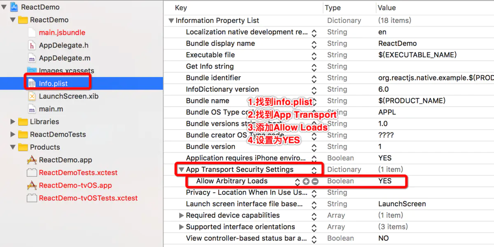

### React Native 之基本组件

------

- #### View
> View 组件在 RN 开发中是最常用的
>> 一般常用于容器，往里面添加子控件，任何子组件都可以，View 里面也可以在放 View.
>> 没有点击事件，不能监听点击。

------

- #### TouchableOpacity
> TouchableOpacity 点击控件
>> 如果想让一个没有点击事件的组件，能点击，就需要在外层包装一个 TouchableOpacity，这个 View, 就能点击了。
>> 一个 View, 被 TouchableOpacity 包装后，点击这个 View, 就会有透明效果，这个效果可以通过 activeOpacity 属性调整
>> activeOpacity: 不透明度，0~1，1 表示不透明，点击就没透明效果了。
>> 注意：TouchableOpacity 默认点击区域，就是所有子控件的区域，因为默认一个组件的尺寸由子控件绝对，因此 TouchableOpacity 也是一样。

> 使用
```javascript
<TouchableOpacity activeOpacity={0.7}>
  <View style={styles.childSytle}>
  </View>
</TouchableOpacity>
```

- ###### 如何监听 TouchableOpacity 点击
> 注意：onPress 与 onPressIn，onPressOut，有冲突，不要同时实现
```javascript
onLongPress function  // 长按的时候调用

onPress function  // 点击的时候调用

onPressIn function  // 手指按下的时候调用

onPressOut function  // 手指抬起的时候调用
```

- ###### disabled 属性
> 如果设为 true，则禁止此组件的一切交互
> 通过 disabled，可以控制一个被 TouchableOpacity 包装的组件什么时候能点击。

------

- #### Text
> Text: 用于展示一段文字
> 常用属性：
```javascript
numberOfLines  // 最大行数，超出最大行数，就不会完全显示，超出部分显示...
selectable  // 决定用户是否可以长按选择文本，以便复制和粘贴,默认false
suppressHighlighting  // 默认情况下，文本被按下时会有一个灰色的阴影，如果想取消就设置为true
```

> 监听文字点击
>> onPress

> 常用样式属性
```javascript
color  // 字体颜色

fontSize  // 字体

fontWeight enum('normal', 'bold', '100', '200', '300', '400', '500', '600', '700', '800', '900')
// 指定字体的粗细。大多数字体都支持'normal'和'bold'值。并非所有字体都支持所有的数字值。如果某个值不支持，则会自动选择最接近的值。

lineHeight  // 行高

textAlign enum('auto', 'left', 'right', 'center', 'justify')
// 指定文本的对齐方式。其中'justify'值仅iOS支持，在Android上会变为left
```

> 使用
```javascript
            <View style={styles.mainViewStyle}>
                <Text style={styles.textStyle}
                      numberOfLines={1}
                      selectable={true}
                      onPress={()=>{alert('点击文字')}}
                >
                    文本
                </Text>
            </View>
```

------

- #### Button
> Button: 按钮，当一个文字想要点击效果，可以使用按钮

> 注意：Button 没有样式，设置样式无效，最大的弊端，开发中一般不使用，一般自定义按钮，自己包装一个 Text 用于按钮.

> 常用属性
```javascript
color color  // 文本的颜色(iOS)，或是按钮的背景色(Android)

disabled bool  // 设置为true时此按钮将不可点击

onPress function  // 用户点击此按钮时所调用的处理函数

title string  // 按钮内显示的文本
```

> 使用
```javascript
 <View style={styles.mainViewStyle}>
                <Button style={styles.buttonSytle} title="按钮" color="red"/>
 </View>
```

------

- #### TextInput
> TextInput: 文本输入框
>> 默认没有边框，需要自己添加 borderWidth

> 常用属性
```javascript
autoFocus  // 自动获取焦点,如果为true，在componentDidMount后会获得焦点。默认值为false

blurOnSubmit  // 点击键盘，右下角return,或者按回车的时候，是否自动退出键盘，true:是。注意：键盘必须是英文输入键盘，数字键盘无效.

editable  // 文本框是否可以编辑，默认值为true，如果为false，文本框是不可编辑的

keyboardType enum("default", 'numeric', 'email-address', "ascii-capable", 'numbers-and-punctuation', 'url', 'number-pad', 'phone-pad', 'name-phone-pad', 'decimal-pad', 'twitter', 'web-search')  // 键盘类型

maxLength  // 最大字符数，显示输入文本长度

multiline  // 是否是多行输入框，默认文本输入框只能一行，true,就能多行输入

placeholder  // 占位文字

placeholderTextColor  // 占位字符串显示的文字颜色

returnKeyType enum('done', 'go', 'next', 'search', 'send', 'none', 'previous', 'default', 'emergency-call', 'google', 'join', 'route', 'yahoo')   // 决定键盘右下角按钮显示的内容

secureTextEntry  // 是否安全输入,注意：多行无效果

selectionColor  // 设置光标颜色

clearButtonMode enum('never', 'while-editing', 'unless-editing', 'always')  // 是否要在文本框右侧显示“清除”按钮

clearTextOnFocus  // 每次重新输入文本框，是否清空之前的文本

enablesReturnKeyAutomatically  // 如果为true，键盘会在文本框内没有文字的时候禁用确认按钮。默认值为false
常用方法

clear()   // 清空输入框的内容。
```

> 监听文本框事件
```javascript
onBlur  // 监听文本框失去焦点
onChange  // 当文本框内容变化时调用此回调函数
onChangeText  // 当文本框内容变化时调用此回调函数。改变后的文字内容会作为参数传递
onEndEditing  // 当文本输入结束后调用此回调函数
onFocus  // 当文本框获得焦点的时候调用此回调函数
onSubmitEditing  // 此回调函数当软键盘的确定/提交按钮被按下的时候调用此函数。如果multiline={true}，此属性不可用
onKeyPress  // 当一个键被按下的时候调用此回调。传递给回调函数的参数为{ nativeEvent: { key: keyValue } }，其中keyValue即为被按下的键。会在onChange之前调用
```

> 使用
```javascript
            <View style={styles.mainViewStyle}>
                <TextInput placeholder={'占位文字'}
                           style={styles.textStyle}

                           //multiline={true}
                           clearButtonMode="always"
                           secureTextEntry={true}
                           autoFocus={true}
                           blurOnSubmit={true}
                           selectionColor="red"
                           clearTextOnFocus="true"
                           onBlur={()=>{
                               console.log('文本框失去焦点');
                           }}
                           onChangeText={(text)=>{
                               console.log('文字改变'+text)
                           }}
                           onEndEditing={()=>{
                               console.log('文本框结束编辑');
                           }}
                           onFocus={()=>{
                               console.log('获取焦点');
                           }}
                           onSubmitEditing={()=>{
                               console.log('点击提交按钮');
                           }}
                />
            </View>
```

------

- #### Image
> Image: 用于加载图片
>> 图片可以是本地图片也可以是网络中的图片

> Image 常用属性
```javascript
source {uri: string}, number  // 设置Image图片资源

blurRadius number  // 让图片模糊

defaultSource  {uri: string, width: number, height: number, scale: number}, number 
// 占位图片，在读取图片时默认显示的加载提示图片

resizeMode enum('cover', 'contain', 'stretch', 'repeat', 'center') 
// 决定图片尺寸大小。

cover  // 在保持图片宽高比的前提下缩放图片，直到宽度和高度都大于等于容器视图的尺寸（如果容器有padding内衬的话，则相应减去）。译注：这样图片完全覆盖甚至超出容器，容器中不留任何空白。

contain  // 在保持图片宽高比的前提下缩放图片，直到宽度和高度都小于等于容器视图的尺寸（如果容器有padding内衬的话，则相应减去）。译注：这样图片完全被包裹在容器中，容器中可能留有空白

stretch  // 拉伸图片且不维持宽高比，直到宽高都刚好填满容器。

repeat  // 重复平铺图片直到填满容器。图片会维持原始尺寸。仅iOS可用。

center  // 居中不拉伸。
```

> 本地图片存放在哪
>> 1. 可以直接存放在 RN 项目中
>> 2. 可以存放到iOS项目中，打开iOS项目，存入到Images.xcassets文件中
>> 3. 可以存放到安卓项目中,必须放入drawable-xxhdpi文件中
>>> 注意安卓的图片名称，不能以数字开头，也不能有大写字母
>>> 自己生成drawable-xxhdpi文件夹，把图片放进去，然后把文件夹drawable-xxhdpi存放到安卓文件中res文件夹中
          
> 如何加载本地图片
>> RN 中加载资源:require (文件路径), 用于加载 RN 中的资源，不管是图片，还是 json 都是一样的
>> uri: 指定一个资源路径，就会自动加载
>> uri 加载注意：通过 uri 加载资源，必须设置图片尺寸，否则不显示
>> 如果网络加载 http 图片，iOS 默认不支持，需要做配置



```javascript
<View style={styles.mainViewStyle}>
                <Text>1.加载RN项目的资源</Text>
                <Image source={require('./Img/chaolan.jpeg')} style={styles.imageSytle}/>
                <Text>2.加载App中的资源</Text>
                <Image source={{uri:'wukong'}} style={styles.imageSytle}/>
                <Text>3.加载网络中的资源</Text>
                {/*https*/}
                {/*<Image source={{uri:'https://timgsa.baidu.com/timg?image&quality=80&size=b9999_10000&sec=1493026646896&di=b77d170bbb31db812fced6d3b2f24499&imgtype=0&src=http%3A%2F%2Fcnews.chinadaily.com.cn%2Fimg%2Fsite1%2F20170410%2F448a5bd66cd11a556e112b.jpeg'}} style={styles.imageSytle}/>*/}
                {/*http*/}
                <Image source={{uri:'http://img01.youxiaoshuo.com/portal/201703/21/083647y43dl1j14s8s3g99.jpg'}} style={styles.imageSytle}/>
</View>
```

> 监听图片加载方法
```javascript
onLoad  // 图片加载完成时调用此函数
onLoadStart  // 图片加载开始时调用
onLoadEnd  // 加载结束后，不论成功还是失败，调用此回调函数
onError  // 当加载错误的时候调用此回调函数，参数为{nativeEvent: {error}}
onProgress  // 在加载过程中不断调用，参数为{nativeEvent: {loaded, total}}
```

> Image 类方法，通过类调用的方法，叫做类方法
```javascript
static getSize(uri: string, success: (width: number, height: number) => void, failure: (error: any) => void) 

// 在显示图片前获取图片的宽高(以像素为单位)。如果图片地址不正确或下载失败,此方法也会失败。

// 一般在componentDidMount调用，先获取图片尺寸，然后在设置图片尺寸。

// 要获取图片的尺寸,首先需要加载或下载图片(同时会被缓存起来)。这意味着理论上你可以用这个方法来预加载图片,虽然此方法并没有针对这一用法进行优化,而且将来可能会换一些实现方案使得并不需要完整下载图片即可获取尺寸。所以更好的预加载方案是使用下面那个专门的预加载方法。
```

> 使用
```javascript
constructor(props){
        super(props)
        Image.getSize('http://img01.youxiaoshuo.com/portal/201703/21/083647y43dl1j14s8s3g99.jpg',(width,height)=>{
                console.log('获取图片尺寸')
                console.log(width,height)
        },(error,)=>{

        })
    }

    render() {

        return (
            <View style={styles.mainViewStyle}>
                <Text>1.加载RN项目的资源</Text>
                <Image source={require('./Img/chaolan.jpeg')}
                       style={styles.imageSytle}
                       blurRadius={10}
                />
                <Text>2.加载App中的资源</Text>
                <Image source={{uri:'wukong'}} style={styles.imageSytle}/>
                <Text>3.加载网络中的资源</Text>
                {/*https*/}
                {/*<Image source={{uri:'https://timgsa.baidu.com/timg?image&quality=80&size=b9999_10000&sec=1493026646896&di=b77d170bbb31db812fced6d3b2f24499&imgtype=0&src=http%3A%2F%2Fcnews.chinadaily.com.cn%2Fimg%2Fsite1%2F20170410%2F448a5bd66cd11a556e112b.jpeg'}} style={styles.imageSytle}/>*/}
                {/*http*/}
                <Image source={{uri:'http://img01.youxiaoshuo.com/portal/201703/21/083647y43dl1j14s8s3g99.jpg'}}
                       style={styles.imageSytle}
                       defaultSource={{uri:'wukong'}}
                       onLoad={()=>{
                           alert('图片加载完成');
                       }}
                       onProgress={(e)=>{
                           console.log(e.nativeEvent);
                       }}
                />
            </View>

        );
    }
```
------
