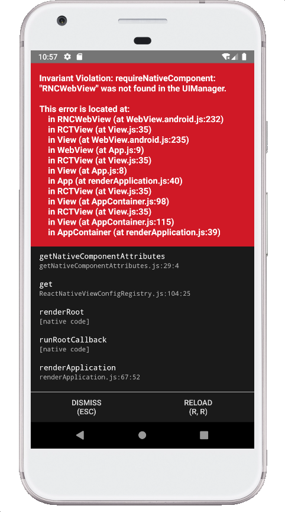
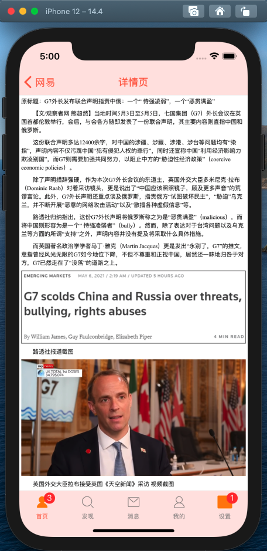
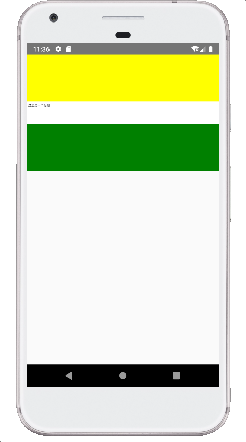
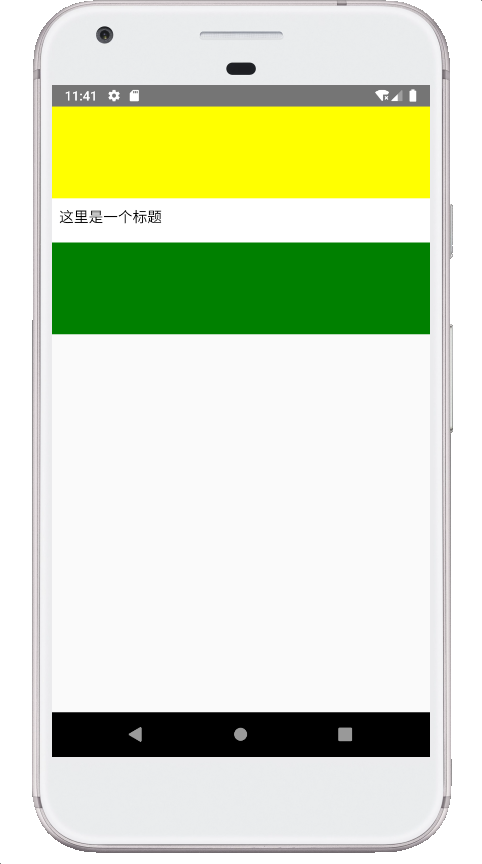

在 App 中，渲染 HTML 是一个非常常见的功能，有可能是直接渲染 HTML 字串或是通过 URL 渲染 HTML 页面。

React Native 提供了一个 WebView 组件以供我们实现 HTML 的渲染。

> 早期 WebView 是在 React Native 核心包中，随后为了分解 React Native 核心包的体积，便将其单独提出到react-native-webview元素中。

话不多说，让我们来试试这个组件。

------

#### 渲染URL HTML 内容
在开始之前，你需要使用 `yarn` 或者 `npm` 来安装它：
```javascript
yarn add react-native-webview
// 或者
npm install react-native-webview --save
```

安装完成后，我们就可以在程序代码中使用它：
```javascript
import React, { Component } from 'react';
import { View } from 'react-native';
import { WebView } from 'react-native-webview';

export default class NewsDetail extends Component {
  render() {
    return (
      <View>
        <WebView source={{ uri: 'https://www.baidu.com' }} />
      </View>
    )
  }
}
```
需要注意的是：第一次安装完成后，需要重新执行一次 `npx react-native run-ios` 或者 `npx react-native run-android` 让 rn 帮我们自动链接一次，否则会抛出以下错误：
<br/>

> 实际上，还需要在ios目录下，执行`pod install`，否则，依旧会出现异常提示。

重新执行 `npx react-native run-ios` 或者 `npx react-native run-android`后，报错没了，但是页面上一片空白：

**这是什么原因呢？** 在查看了一下文件之后，发现 WebView 预设为不会自动设置其高度，所以这个时候高度为 0，我们才无法在页面中找到它。需要注意的是，如果 WebView 的父级元件是View，使用直接style给的 WebView 元件设定高度是无效的，需要给这个View组件设定高度才能正常显示。然而在ScrollView中，则是需要给的 WebView 本身设定的高度。其它几个组件，例如SafeAreaView 我没有去尝试，需要你自己亲自去检验。

知道原因后，我们将 WebView 父元素 style 设置为 flex: 1，让其铺满整个萤幕，在 reload 一次看看效果：
<br/>

搞定，我们已经成功的把百度页面展现到我们的 RN App 中了。

------

#### 渲染 HTML 字串
有时候我们需要将 API 中返回的 HTML 字串解析出来。渲染 HTML 字串的时候，我们需要将源中的 uri 替换为 html，它的值就是我们的 HTML 字串。与 uri 不同的是，渲染 HTML 字串的时候，我们需要设定 originWhitelist，某些可以设定 [“*”] 来允许执行原生程序代码。
```javascript
{/* ... */}
<WebView
  originWhitelist={['*']}
  source={{ html: `<h1>這裡是一個標題</h1>` }}
/>
{/* ... */}
```

这样，我们就成功的把标题给渲染出来了。

```javascript
import React, { Component } from 'react';
import { StyleSheet, Text, View } from 'react-native';
import { WebView } from 'react-native-webview';

class NewsDetail extends Component {
    constructor(props) {
        super(props);
        // 接收父页面传递的参数
        const id = this.props.route.params.id;
        // 设定url
        let url_api = 'http://c.m.163.com/nc/article/' + id + '/full.html';
        // console.log('id: ', id);
        this.state = {
            html: '正在加载网页',
            id: id,
            url: url_api,
            webViewHeight: 0
        }
        // console.log(this.state.url);
    }

    render() {
        return (
            <View style={{ flex: 1 }} >
                {/* <WebView source={{ uri: 'https://www.baidu.com' }} /> */}
                <WebView source={{ html: this.state.html, baseIrl: '' }}/>
            </View>
        )
    }

    componentDidMount() {
        // console.log(this.state.url);
        // 请求数据
        fetch(this.state.url)
            .then((response) => response.json())
            .then((responseData) => {
                // 取出所有的数据
                let allData = responseData[this.state.id];
                // console.log(allData);

                // 取出body中的数据
                var body = allData['body'];

                // 取出图片数组
                let img = allData['img'];

                // 遍历图片数组
                if (img.length == 0) {
                    return;
                }
                for (let index = 0; index < img.length; index++) {
                    // 取出单个对象
                    const element = img[index];
                    // 取出src
                    let src = element.src;
                    // 取出ref
                    let ref = element.ref;
                    // 生成html标签
                    var imgHtml = ''
                    // 替换body中的占位标签
                    body = body.replace(ref, imgHtml);
                }

                // 更新UI
                this.setState({
                    html: body
                })
            })
    }
}

export default NewsDetail;
```

<br/>

---

#### 根据内容自动计算高度
往往我们无法提前预知 HTML 内容的高度，所以我们无法给其设置一个固定的高度，而是需要根据内容来设置其高度。

为了达到这个目的，我们需要用到 `injectedJavaScript` 和 `onMessage`，

**injectedJavaScript**
> 这个属性的作用是设定一个在网页载入之前执行的 js 程序代码。

**onMessage**
> 在 `webview` 内部的网页中调用 `window.postMessage` 方法时可以触发此属性对应的函式，从而实现网页和 RN 之间的资料交换。设置此属性的同时会在 `webview` 中注入一个 `postMessage` 的全域性函式并发覆盖可能已经存在的同名实现。

网页端的 `window.postMessage` 只传送一个引数 `data`，此引数封装在 RN 端的 `event` 对象中，即 `event.nativeEvent.data`。`data` 只能是一个字串。
```javascript
import React, { Component } from 'react';
import { View, ScrollView, SafeAreaView } from 'react-native';
import { WebView } from 'react-native-webview';

export default class App extends Component {
  constructor(props) {
    super(props);

    this.state = { webViewHeight: 0 };
  }

  {/* 根據內容計算 WebView 高度 */}
  onWebViewMessage = (event) => {
    this.setState({ webViewHeight: Number(event.nativeEvent.data) });
  }

  render() {
    return (
      <View style={{ flex: 1 }}>
        <View style={{ height: 100, backgroundColor: 'yellow' }}></View>
        <View style={{ height: this.state.webViewHeight }}>
          <WebView
            originWhitelist={['*']}
            source={{ html: `<p>這裡是一個標題</p>` }}
            injectedJavaScript='window.ReactNativeWebView.postMessage(document.documentElement.scrollHeight)'
            onMessage={this.onWebViewMessage}
          />
        </View>
        <View style={{ height: 100, backgroundColor: 'green' }}></View>
      </View>
    )
  }
}
```

<br/>
从上图可以抛光我们的 WebView 已经根据其中内容动态的计算了其高度。但是还是有一个问题，这里的文字太小了，要解决这个问题我们需要用到meta - viewport。

------

#### 采用响应式布局
这个其实很简单，只需要在 header 中定义 meta 标签即可。
```javascript
<WebView
  originWhitelist={['*']}
  source={{ html: `
  <html>
    <head>
      <meta name="viewport" content="width=device-width, initial-scale=1.0">
    </head>

    <body>
      <p>這裡是一個標題</p>
    </body>
  </html>
  ` }}
  injectedJavaScript='window.ReactNativeWebView.postMessage(document.documentElement.scrollHeight)'
  onMessage={this.onWebViewMessage}
/>
```

<br/>

------

**总结**
> 到此，关于 React Native 的基础使用已经讲完了，更多细节请参考RN中文网或者RN官网。
