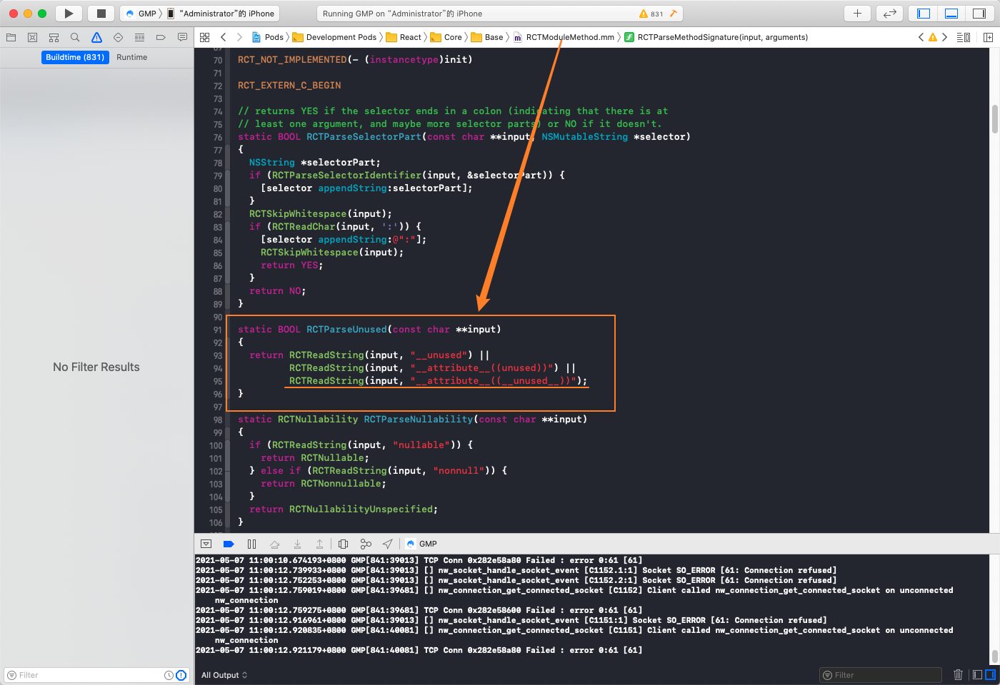
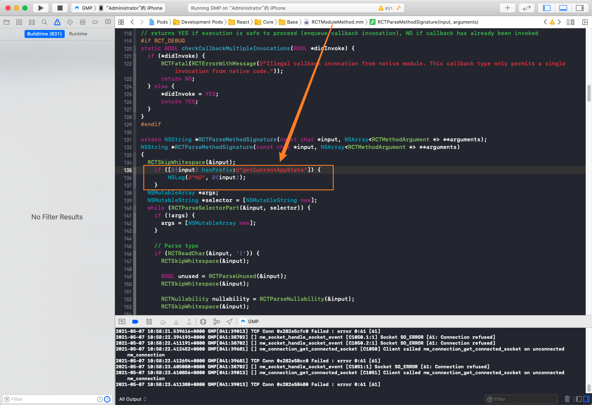

> 今天遇到了，用Xcode 11 与真机调试 RN程序，启动后，遇到了报错有二。
> 遂，有此记录。

------

#### 报错1⃣️
> Unknown arguments type '__attribute__' in method -[RCTUIManager set JSResponder:blockNativeResponder] 

**解决方案**
> 添加框中划线代码，即可解决问题。

------

#### 报错2⃣️
> Unknown argument type 'attribute' in method -[RCTAppState getCurrentappState:error:].
Extend RCTConvert to support this type

**解决方案**
> 添加框中代码，即可解决问题。

#### 总结
> 建议，把1⃣️和2⃣️提到的，都添加上，以解决问题。
