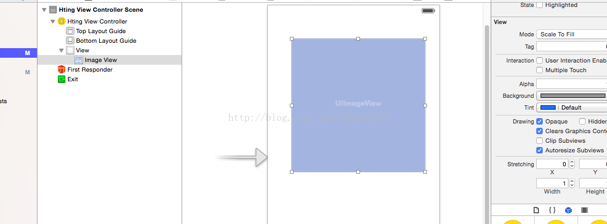
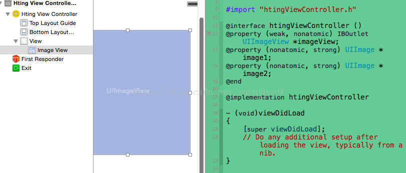
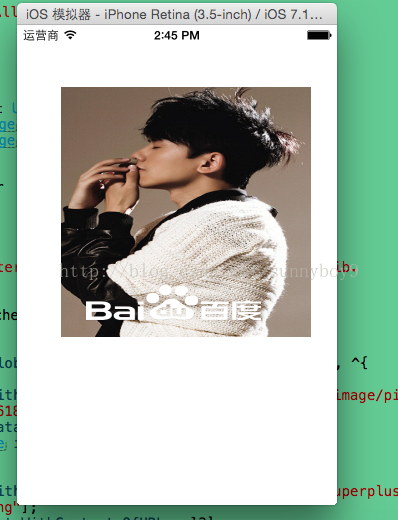
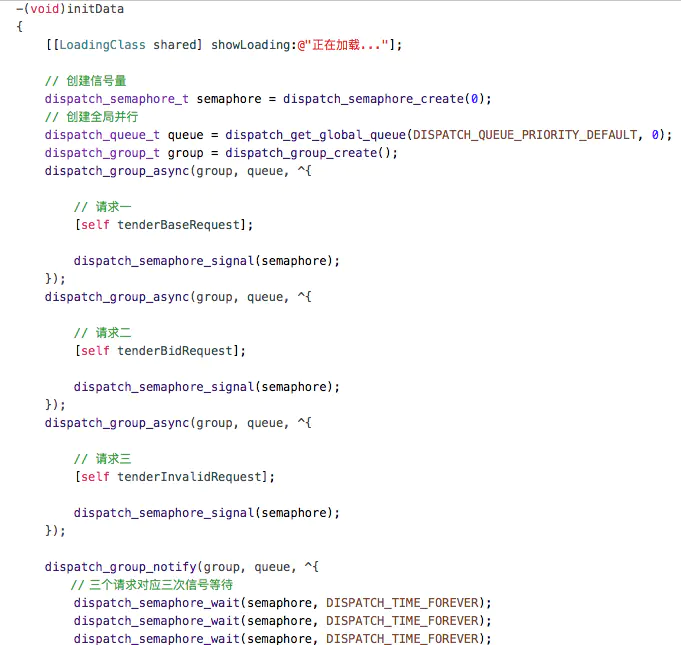

- #### 如何用 GCD 同步若干个异步调用？（如根据若干个 url 异步加载多张图片，然后在都下载完成后合成一张整图）
使用 Dispatch Group 追加 block 到 Global Group Queue, 这些 block 如果全部执行完毕，就会执行 Main Dispatch Queue 中的结束处理的 block。
```objective-c
dispatch_queue_t queue = dispatch_get_global_queue(DISPATCH_QUEUE_PRIORITY_DEFAULT, 0);
dispatch_group_t group = dispatch_group_create();
dispatch_group_async(group, queue, ^{ /*加载图片1 */ });
dispatch_group_async(group, queue, ^{ /*加载图片2 */ });
dispatch_group_async(group, queue, ^{ /*加载图片3 */ }); 
dispatch_group_notify(group, dispatch_get_main_queue(), ^{
        // 合并图片
});
```

------

#### iOS 开发多线程之队列组 —— 下载合并图片

##### 1. 设计思路
要合并两张图片，用 Quartz2D 的知识，则要先要搞一个空的大图片，然后再把两张小图片画到那张大图片上面


##### 2. 实现（由一般实现再过度到队列组）
##### 2.1 方法1⃣️（先下载第 1 张图片，然后下载第 2 张图片，最后合并图片）弊病：由于图片比较耗时，一张一张的下载图片更耗时。
###### 2.1.1 首先创建一个 project，然后拖一个 imageview


###### 2.1.2 连线监听 imageview


###### 2.1.3 代码
```objective-c
//  htingViewController.h
 
#import <UIKit/UIKit.h>
 
@interface htingViewController : UIViewController
 
@end
```

```objective-c
//
//  htingViewController.m
 
 
#import "htingViewController.h"
 
@interface htingViewController ()
@property (weak, nonatomic) IBOutlet UIImageView *imageView;
@property (nonatomic, strong) UIImage *image1;
@property (nonatomic, strong) UIImage *image2;
@end
 
@implementation htingViewController
 
- (void)viewDidLoad
{
    [super viewDidLoad];
	// Do any additional setup after loading the view, typically from a nib.
}
 
- (void)touchesBegan:(NSSet *)touches withEvent:(UIEvent *)event
{
    // 异步下载
    dispatch_async(dispatch_get_global_queue(DISPATCH_QUEUE_PRIORITY_DEFAULT, 0), ^{
        // 1.下载第1张
        NSURL *url1 = [NSURL URLWithString:@"http://g.hiphotos.baidu.com/image/pic/item/f2deb48f8c5494ee460de6182ff5e0fe99257e80.jpg"];
        NSData *data1 = [NSData dataWithContentsOfURL:url1];
        UIImage *image1 = [UIImage imageWithData:data1];
        
        // 2.下载第2张
        NSURL *url2 = [NSURL URLWithString:@"http://su.bdimg.com/static/superplus/img/logo_white_ee663702.png"];
        NSData *data2 = [NSData dataWithContentsOfURL:url2];
        UIImage *image2 = [UIImage imageWithData:data2];
        
        // 3.合并图片
        // 开启一个位图上下文
        UIGraphicsBeginImageContextWithOptions(image1.size, NO, 0.0);
        
        // 绘制第1张图片
        CGFloat image1W = image1.size.width;
        CGFloat image1H = image1.size.height;
        [image1 drawInRect:CGRectMake(0, 0, image1W, image1H)];
        
        // 绘制第2张图片
        CGFloat image2W = image2.size.width * 0.5;
        CGFloat image2H = image2.size.height * 0.5;
        CGFloat image2Y = image1H - image2H;
        [image2 drawInRect:CGRectMake(0, image2Y, image2W, image2H)];
        
        // 得到上下文中的图片
        UIImage *fullImage = UIGraphicsGetImageFromCurrentImageContext();
        
        // 结束上下文
        UIGraphicsEndImageContext();
        
        // 4.回到主线程显示图片
        dispatch_async(dispatch_get_main_queue(), ^{
            self.imageView.image = fullImage;
        });
    });
}
 
@end
```

###### 2.1.4 运行结果


##### 2.2. 方法2⃣️（由于上面的设计中下载图片比较耗时，可以同事开启两个线程同事下载两张图片  ）弊病：要搞两个额外的属性
```objective-c
#import <UIKit/UIKit.h>
 
@interface htingViewController : UIViewController
 
@end
```

```objective-c
//
//  htingViewController.m
 
 
#import "htingViewController.h"
 
@interface htingViewController ()
@property (weak, nonatomic) IBOutlet UIImageView *imageView;
@property (nonatomic, strong) UIImage *image1;
@property (nonatomic, strong) UIImage *image2;
@end
 
@implementation htingViewController
 
- (void)viewDidLoad
{
    [super viewDidLoad];
	// Do any additional setup after loading the view, typically from a nib.
}
 
- (void)touchesBegan:(NSSet *)touches withEvent:(UIEvent *)event
{
    
    // 异步下载
    dispatch_async(dispatch_get_global_queue(DISPATCH_QUEUE_PRIORITY_DEFAULT, 0), ^{
        // 1.下载第1张
        NSURL *url1 = [NSURL URLWithString:@"http://g.hiphotos.baidu.com/image/pic/item/f2deb48f8c5494ee460de6182ff5e0fe99257e80.jpg"];
        NSData *data1 = [NSData dataWithContentsOfURL:url1];
        self.image1 = [UIImage imageWithData:data1];
        
        [self bindImages];
    });
    dispatch_async(dispatch_get_global_queue(DISPATCH_QUEUE_PRIORITY_DEFAULT, 0), ^{
        // 2.下载第2张
        NSURL *url2 = [NSURL URLWithString:@"http://su.bdimg.com/static/superplus/img/logo_white_ee663702.png"];
        NSData *data2 = [NSData dataWithContentsOfURL:url2];
        self.image2 = [UIImage imageWithData:data2];
        
        [self bindImages];
    });
    
}
- (void)bindImages
{
    if (self.image1 == nil || self.image2 == nil) return;
    
    // 3.合并图片
    // 开启一个位图上下文  （相当于创建了一个空的图片）
    // UIGraphicsBeginImageContextWithOptions(<#CGSize size#>（新的图片有多大）, <#BOOL opaque#>（NO代表透明，YES代表不透明）, <#CGFloat scale#> （缩放比例）)
    UIGraphicsBeginImageContextWithOptions(self.image1.size, NO, 0.0);
    
    // 绘制第1张图片 （绘制到上面创建的那个位图上下文上面 也就是那张空的图片上面）
    CGFloat image1W = self.image1.size.width;
    CGFloat image1H = self.image1.size.height;
    [self.image1 drawInRect:CGRectMake(0, 0, image1W, image1H)];
    
    // 绘制第2张图片
    CGFloat image2W = self.image2.size.width * 0.5;
    CGFloat image2H = self.image2.size.height * 0.5;
    CGFloat image2Y = image1H - image2H;
    //把image2 绘制到后面的那个区域
    [self.image2 drawInRect:CGRectMake(0, image2Y, image2W, image2H)];
    
    // 得到上下文中的图片
    UIImage *fullImage = UIGraphicsGetImageFromCurrentImageContext();
    
    // 结束上下文
    UIGraphicsEndImageContext();
    
    // 4.回到主线程显示图片
    dispatch_async(dispatch_get_main_queue(), ^{
        self.imageView.image = fullImage;
    });
}
 
@end
```

##### 2.3 方法3⃣️  队列组
```objective-c
#import <UIKit/UIKit.h>
 
@interface htingViewController : UIViewController
 
@end
```

```objective-c
//
//  htingViewController.m
 
 
#import "htingViewController.h"
 
@interface htingViewController ()
@property (weak, nonatomic) IBOutlet UIImageView *imageView;
//@property (nonatomic, strong) UIImage *image1;
//@property (nonatomic, strong) UIImage *image2;
@end
 
@implementation htingViewController
 
- (void)viewDidLoad
{
    [super viewDidLoad];
	// Do any additional setup after loading the view, typically from a nib.
}
 
- (void)touchesBegan:(NSSet *)touches withEvent:(UIEvent *)event
{
    
    // 1.队列组
    dispatch_group_t group = dispatch_group_create();
    dispatch_queue_t queue = dispatch_get_global_queue(DISPATCH_QUEUE_PRIORITY_DEFAULT, 0);
    
    // 2.下载图片1
    __block UIImage *image1 = nil;  //要加一个 __block因为 block代码默认不能改外面的东西（记住语法即可）
    dispatch_group_async(group, queue, ^{
        NSURL *url1 = [NSURL URLWithString:@"http://g.hiphotos.baidu.com/image/pic/item/f2deb48f8c5494ee460de6182ff5e0fe99257e80.jpg"];
        NSData *data1 = [NSData dataWithContentsOfURL:url1];
        image1 = [UIImage imageWithData:data1];
    });
    
    // 3.下载图片2
    __block UIImage *image2 = nil;
    dispatch_group_async(group, queue, ^{
        NSURL *url2 = [NSURL URLWithString:@"http://su.bdimg.com/static/superplus/img/logo_white_ee663702.png"];
        NSData *data2 = [NSData dataWithContentsOfURL:url2];
        image2 = [UIImage imageWithData:data2];
    });
    
    // 4.合并图片 用Quartz2D的知识，则要先要搞一个空的大图片，然后再把小图片画上去(保证执行完组里面的所有任务之后，再执行notify函数里面的block)
    //队列组：要把队列组里面的所有任务都执行完后调用dispatch_group_notify(group, queue, ^{ }
    dispatch_group_notify(group, queue, ^{
        // 开启一个位图上下文
        UIGraphicsBeginImageContextWithOptions(image1.size, NO, 0.0);
        
        // 绘制第1张图片
        CGFloat image1W = image1.size.width;
        CGFloat image1H = image1.size.height;
        [image1 drawInRect:CGRectMake(0, 0, image1W, image1H)];
        
        // 绘制第2张图片
        CGFloat image2W = image2.size.width * 0.5;
        CGFloat image2H = image2.size.height * 0.5;
        CGFloat image2Y = image1H - image2H;
        [image2 drawInRect:CGRectMake(0, image2Y, image2W, image2H)];
        
        // 得到上下文中的图片
        UIImage *fullImage = UIGraphicsGetImageFromCurrentImageContext();
        
        // 结束上下文
        UIGraphicsEndImageContext();
        
        // 5.回到主线程显示图片
        dispatch_async(dispatch_get_main_queue(), ^{
            self.imageView.image = fullImage;
        });
    });
    
}
 
@end
```


##### 2.4 方法4⃣️  队列组、信号量

