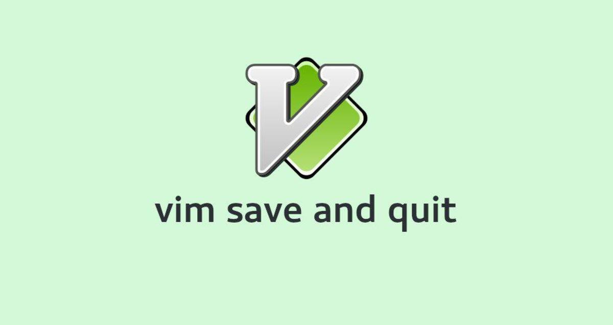

------

Vim 是许多在命令行上花费大量时间的用户的首选文本编辑器。与其他编辑器不同，Vim 具有几种操作模式，这对于新用户来说可能有点吓人。

Vim 或其早期版本 Vi 预装在 macOS 和几乎所有 Linux 发行版中。当您遇到无法使用自己喜欢的编辑器的情况时，了解 Vim 的基础知识将对您有所帮助。

本篇笔记介绍了如何在 Vim / Vi 中保存文件并退出编辑器。

------

### Vim 模式

启动 Vim 编辑器时，您处于正常模式。在这种模式下，您可以使用 vim 命令并浏览文件。

要输入文字，您需要按 `i` 键进入插入模式。使用此模式，您可以像在常规[文本编辑器](https://www.myfreax.com/how-to-use-nano-text-editor/)中一样插入和删除字符。

要从其他任何模式返回正常模式，只需按 `Esc` 键。

### 在 Vim / Vi 中打开文件

要使用 Vim 打开文件，请键入 `vim`，然后输入要编辑或创建的文件的名称：

```bash
vim file.text
```

另一种打开文件的方法是启动编辑器，然后键入`:e file_name`，其中 `file_name` 是要打开的文件的名称。

### 在 Vim / Vi 中保存文件

在 Vim 中保存文件的命令是`:w`。

要保存文件而不退出编辑器，请按 `Esc`，键入`:w`，然后按 `Enter`，切换回普通模式。

1. 按 `Esc`
2. 类型`:w`
3. 按 `Enter`

还有一个更新命令`:up`，该命令仅在未保存更改的情况下才将缓冲区写入文件。

要使用其他名称保存文件，请键入`:w new_filename` 并点击 `Enter`。

### 保存文件并退出 Vim / Vi

在 Vim 中保存文件并退出编辑器的命令是`:wq`。

要保存文件并同时退出编辑器，请按 `Esc` 切换到普通模式，键入`:wq` 并按 `Enter`。

1. 按 `Esc`
2. 类型`:wq`
3. 按 `Enter`

另一个保存文件并退出 Vim 的命令是`:x`。

这两个命令之间的区别是`:x` 仅在未保存更改时才将缓冲区写入文件，而`:wq` 总是将缓冲区写入文件并更新文件修改时间。

### 退出 Vim / Vi 而不保存文件

要退出编辑器而不保存更改，请按 `Esc`，键入`:q!`，然后按 `Enter`，切换到普通模式。

1. 按 `Esc`
2. 键入`:q!`
3. 按 `Enter`

### 结论

在本篇笔记中，展示了如何在 Vim 中保存文件并退出编辑器。如果你不熟悉 Vim，可以访问[ Open Vim ](https://www.openvim.com/)网站，你可以在此通过交互式教程练习 Vim。
