> 本文意在示例 `React-Native` 与 `iOS 原生` `混合开发` 从创建 `demo` 到成功运行的过程，以及在这之间遇到的问题，其解决方案。
>
> RN 也是由来已久，所以很多网上的文章或者源码，都已经很老旧了。有的甚至在RN 0.64这个版本下，直接就是错误的。
>
> 所以，别人说的怎样，都是不真实的，只有自己能跑起来的，才是最有效的。
>
> 所以，有此篇记录。

------

> 本篇记录前提是，你已经安装好了所有的RN开发所依赖环境。如果你没有安装好，可参照RN中文网进行配置。

#### 1. 创建一个`RN` `初始Demo`
```zsh
npx react-native init BaseRNDemo
```

> 为了保证是创建一个 `没有` `Android` 和 `iOS` `模块` 的 `React Native` 项目。可以如上执行命令创建后，将里面的 android 和 ios 目录删除，`替换` 成已存在 Android 和 iOS 项目。
>
> 在尝试过程中发现，如果是自己创建`package.json` 来创建没有 `android` 和 `ios` 模块的RN项目，会出现错误。（可能是我这里网速不好的缘故）

#### 2. 创建一个iOS空Demo
> 打开Xcode，选择 `Create A New Xcode Project`，然后就是你日常创建iOS空项目那一套流程。
> 
> 打开命令行，`cd` 到 iOS demo所在目录，然后进行 `pod` 初始化和导入。
```zsh
// 初始化
pod init
// 导入依赖库
pod install
```

#### 3. 编辑 podfile 文件内容
用 VSCode 打开 RN初始Demo —— `BaseRNDemo` ，然后，将 ios 目录下的 podfile 文件打开，复制不相同的部分，也就是需要导入的依赖包。粘贴到iOS demo 的 podfile 文件内，保存。执行 `pod install`。

_**复制前的**_
```
# Uncomment the next line to define a global platform for your project
# platform :ios, '9.0'

target 'baseRNDemo' do
  # Comment the next line if you don't want to use dynamic frameworks
  use_frameworks!

  # Pods for baseRNDemo

end
```

_**复制后的**_
```
require_relative '../node_modules/react-native/scripts/react_native_pods'
require_relative '../node_modules/@react-native-community/cli-platform-ios/native_modules'

platform :ios, '10.0'

target 'baseRNDemo' do
  config = use_native_modules!

  use_react_native!(
    :path => config[:reactNativePath],
    # to enable hermes on iOS, change `false` to `true` and then install pods
    :hermes_enabled => false
  )

  # Enables Flipper.
  #
  # Note that if you have use_frameworks! enabled, Flipper will not work and
  # you should disable the next line.
  use_flipper!()

  post_install do |installer|
    react_native_post_install(installer)
  end
end
```

#### 4. 移动、拷贝文件，执行命令行
> 将 `BaseRNDemo`下的 `ios目录` 内的文件，全部删除，将 `iOS demo` 内的文件全部拷贝过来。
> 
> 在 `BaseRNDemo` 文件内，执行 `npm install`；
>
> 在iOS目录内执行 `pod install `。

此时的目录结构大概是这样子的：
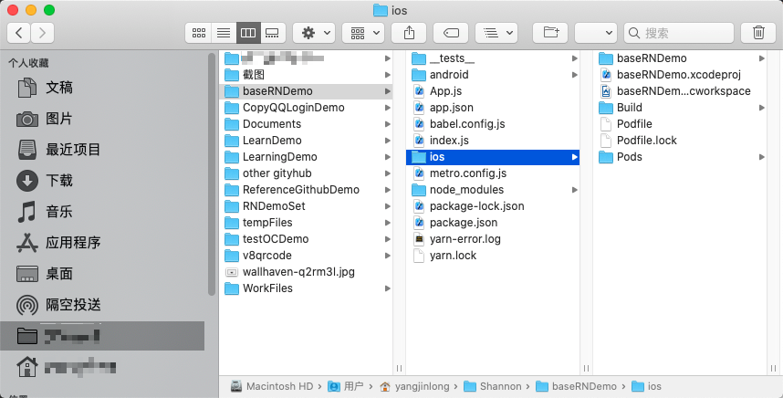

#### 5. 编写RN部分的代码
> 在打开的 `VSCode` 中在 `app.js` 内编写代码。

```javascript
 import React, { Component } from 'react';
 import {
   Platform,
   StyleSheet,
   Text,
   View
 } from 'react-native';
 
 export default class App extends Component {
   render() {
     return (
       <View style={styles.container}>
         <Text style={styles.welcome}>
           this is App, this is RN Page
         </Text>
       </View>
     );
   }
 }
 
 const styles = StyleSheet.create({
   container: {
     flex: 1,
     justifyContent: 'center',
     alignItems: 'center',
     backgroundColor: '#F5FCFF',
   },
   welcome: {
     fontSize: 20,
     textAlign: 'center',
     margin: 10,
   }
  });
```

#### 6. 编写iOS部分的代码
> 在用 `Xcode` 打开的 `iOS项目` 里， 在 `viewcontroller.m` 内编写如下代码。

```Objctive-C
// ViewController.m
#import "ViewController.h"

#import "RNPageController.h"

@interface ViewController ()

@end

@implementation ViewController

- (void)viewDidLoad {
    [super viewDidLoad];
    // Do any additional setup after loading the view.
}

// 此处是拖拽按钮生成的方法
- (IBAction)pushRNPage:(id)sender {
    RNPageController *rnPage = [[RNPageController alloc] init];
    [self.navigationController pushViewController:rnPage animated:YES];
}

@end
```

```objective-c
// RNPageController.h
#import <UIKit/UIKit.h>

NS_ASSUME_NONNULL_BEGIN

@interface RNPageController : UIViewController

@end

NS_ASSUME_NONNULL_END
```

```objctive-c
// RNPageController.m
#import "RNPageController.h"

#import <React/RCTRootView.h>

#import <React/RCTBundleURLProvider.h>

#import <React/RCTEventEmitter.h>

@interface RNPageController ()

@end

@implementation RNPageController

- (void)viewDidLoad {
    [super viewDidLoad];
    
    [self initRCTRootView];
}

- (void)initRCTRootView{
    
    self.title = @"RN Hybrid";
    
    NSURL *jsCodeLocation;

     jsCodeLocation = [NSURL URLWithString:@"http://localhost:8081/index.bundle?platform=ios"];
    //手动拼接jsCodeLocation用于开发环境
    
//    jsCodeLocation = [[NSBundle mainBundle] URLForResource:@"main" withExtension:@"jsbundle"];
//    release之后从包中读取名为main的静态js bundle

//    jsCodeLocation = [[RCTBundleURLProvider sharedSettings] jsBundleURLForBundleRoot:@"index" fallbackResource:nil];
//     通过RCTBundleURLProvider生成，用于开发环境

    // 这个 moduleName参数的名字 一定要和我们在index.js中注册的名字保持一致
    // 也就是项目名。否则会报错。

    RCTRootView *rootView =[[RCTRootView alloc] initWithBundleURL:jsCodeLocation moduleName: @"baseRNDemo" initialProperties:nil
                                                    launchOptions: nil];
    self.view=rootView;
}

@end
```

#### 7. 运行（解决完如下错误后，即可运行）
> 在VSCode中，执行 `npm start` 开启本地 `node 服务` 。

> 在Xocde中，点击运行按钮，即可运行起来。但是，你会收到如下的一个个错误，需要一个个解决。

#### 8. 解决错误
#### 错误解决1: 未添加桥接文件的报错
```
// error 
"linker command failed with exit code 1 (use -v to see invocation)"

// warnings:
ld: warning: Could not find auto-linked library 'swiftFoundation'
ld: warning: Could not find auto-linked library 'swiftDarwin'
ld: warning: Could not find auto-linked library 'swiftCoreFoundation'
ld: warning: Could not find auto-linked library 'swiftCore'
ld: warning: Could not find auto-linked library 'swiftCoreGraphics'
ld: warning: Could not find auto-linked library 'swiftObjectiveC'
ld: warning: Could not find auto-linked library 'swiftDispatch'
ld: warning: Could not find auto-linked library 'swiftSwiftOnoneSupport'
```

> 未添加桥接文件时的报错

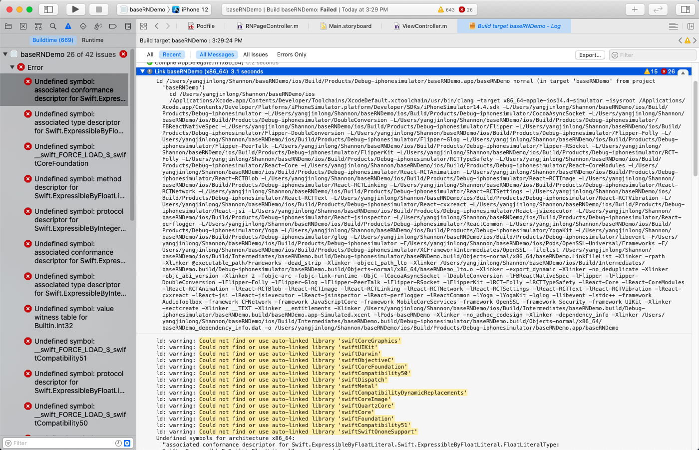

_**解决方法：**_

> 原因：用了Swift的库，所以需要添加桥接文件
In my case it was a React-Native project after adding a Swift Pods library. Maybe just the step 2 can work:

> 添加具体步骤如下：
Adding a new Swift file and a Brigde header:
1) File -> New -> File <code>File -> New -> File</code>
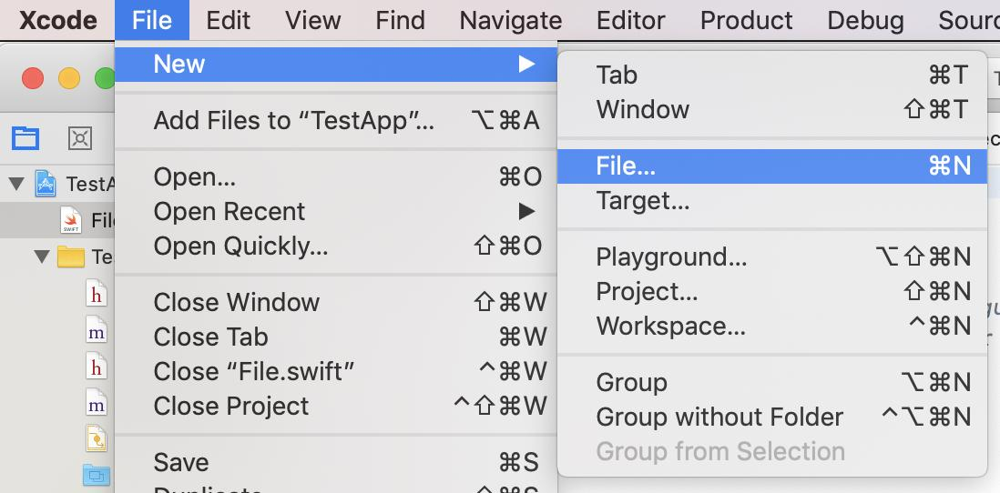

2) Select Swift File Select <code>Swift File</code>
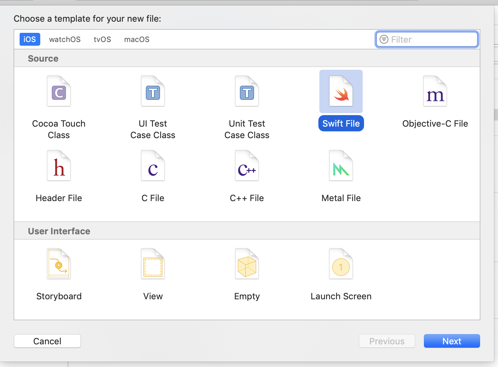

3) Confirm Create Bridging Header enter image description here
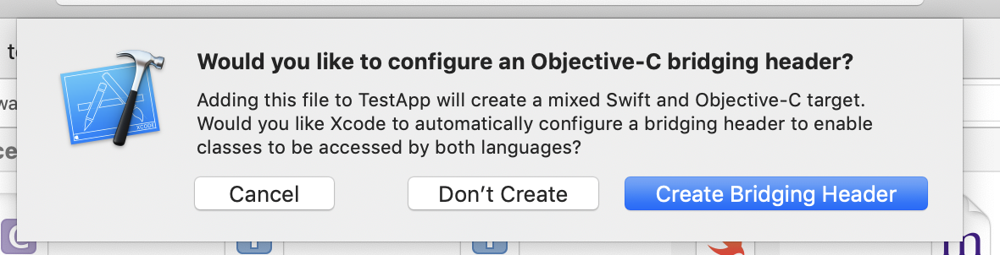

Go to Build Settings and set Always Embed Swift Standard Libraries to YES Always Embed Swift Standard Libraries
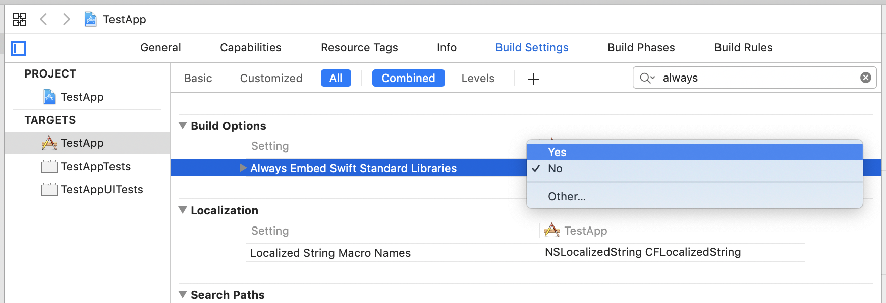

------

#### 错误解决2:  网络不设置前的报错
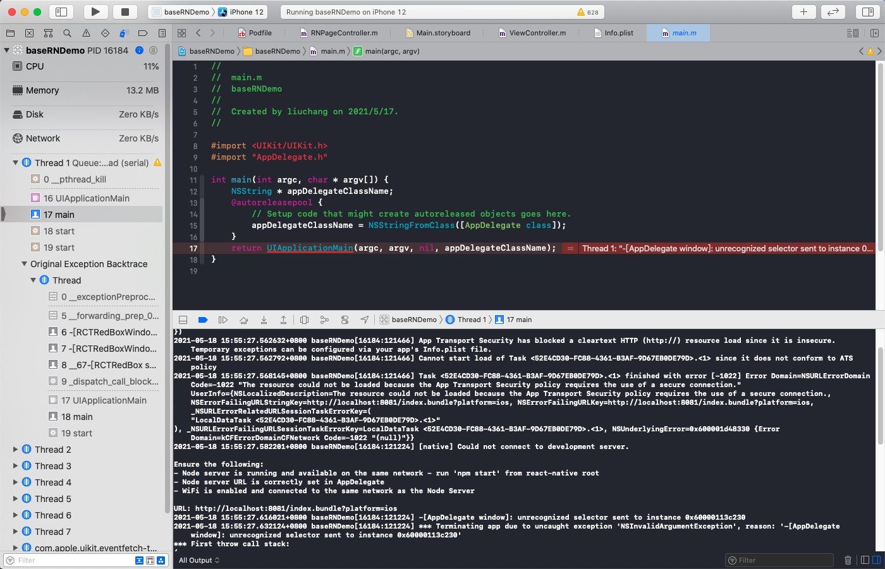

_**解决方法：**_
> 当 `Xcode` 内的 `info.plist` ，添加如下配置，允许网络访问

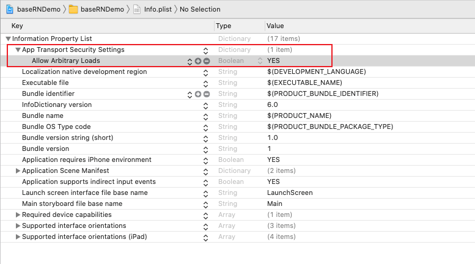

------

#### 错误解决3:  modulem名字不正确时报错

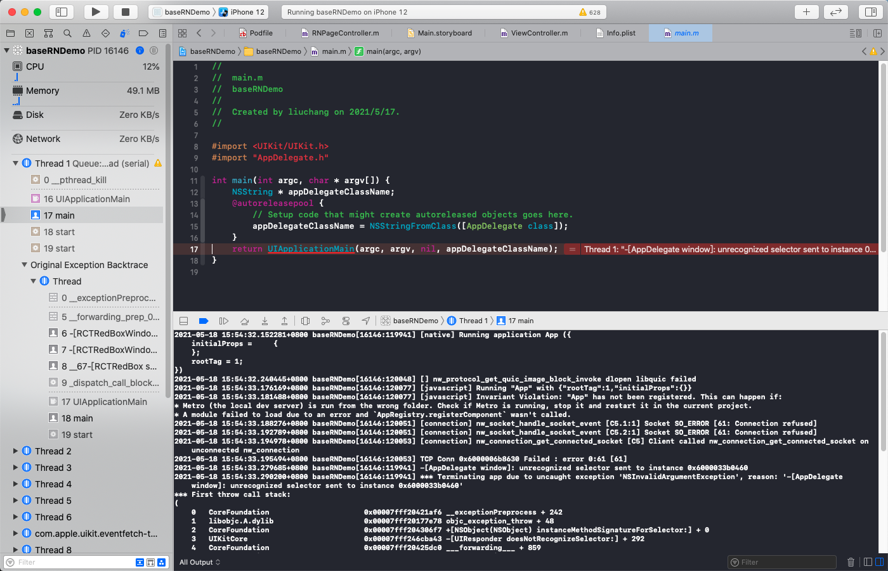

_**解决方法：**_
> 改成正确的RN项目名字

```objctive-c
    RCTRootView *rootView =[[RCTRootView alloc] initWithBundleURL:jsCodeLocation
                                                       moduleName: @"baseRNDemo"
                                                initialProperties:nil
                                                    launchOptions: nil];
```

------

> pod install持续报错

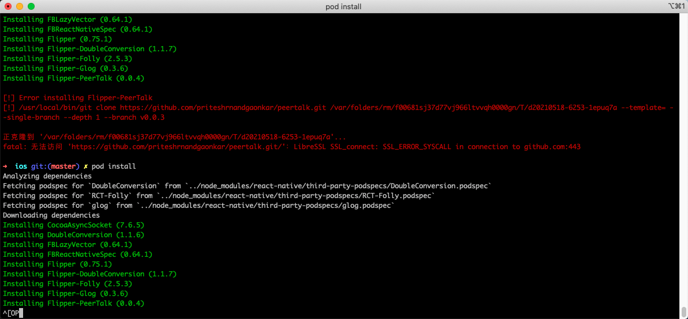

_**解决方法：**_
> 网络原因，持续执行 `pod install` 命令即可。

------

#### 当解决完所有错误后，即可成功运行、跳转页面

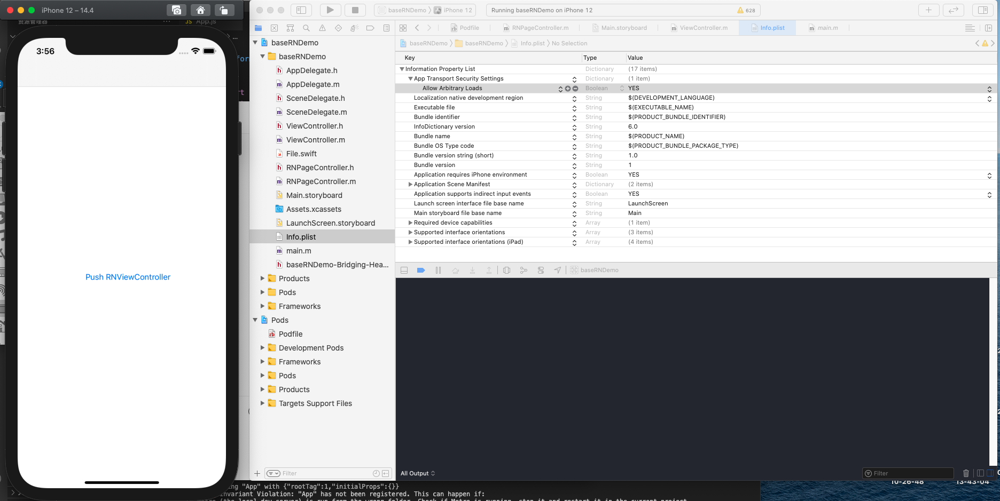
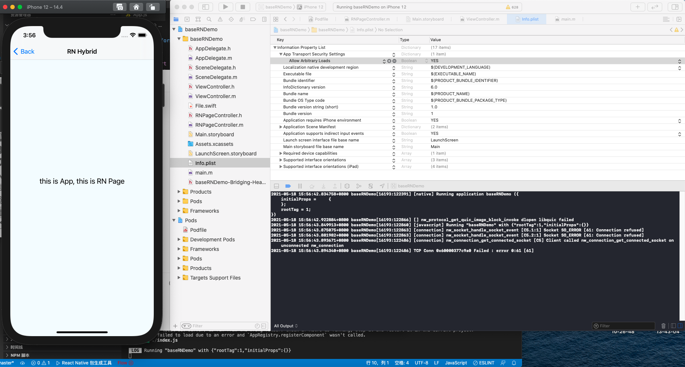
