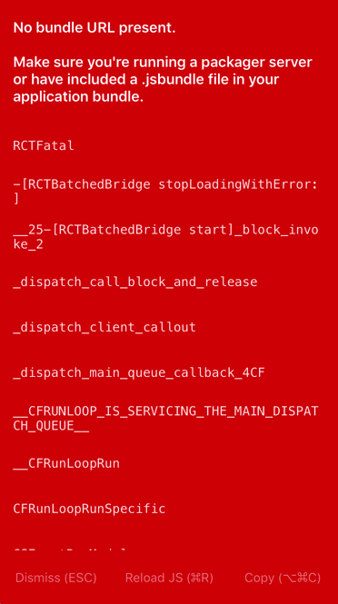
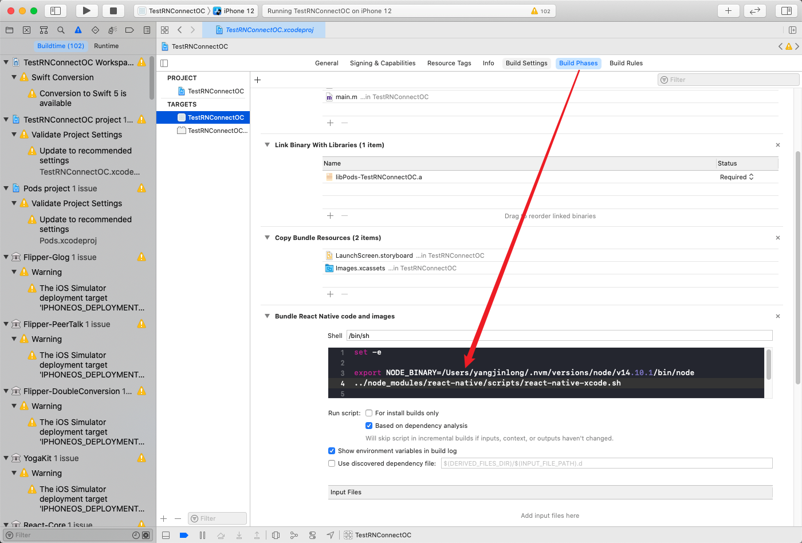

- ### Could not launch “xxx” Security

  > 环境：Xcode 12.4 (12D4e)
  > 真机：iPhone 6s 12.5.1 未联网

- [x] **解决方法**
  
  > 报错提示信息 app 启动被 ios 的安全机制阻挡了。
  >
  > 设置 –> 通用 –> 设备管理 –> 信任，重新在 XCode 上运行 app 就好了。(这里我主要的问题就是没有联网所致)

------

- ### [Application] The app delegate must implement the window property if it wants to use a main storyboard file.

  > 环境：Xcode 12.4 (12D4e)
  > 真机：iPhone 6s 12.5.1 Wi-Fi连接网络

- [x] **解决方法**

  > 报错提示的信息具现在真机上是啥样呢？就是启动黑屏的问题。
  >
  > 根据提示打开 AppDelegate.h 文件时候发现确实没有声明 UIWindow 属性
  > 补充缺失的代码即可：
  > ```objective-c
  > #import <UIKit/UIKit.h>
  > @interface AppDelegate : UIResponder <UIApplicationDelegate>
  > @property (strong, nonatomic) UIWindow * window;
  > @end
  > ```
  > 重新 Run 一遍，即可看到正常的启动页，也就是启动白屏（假使你什么都没做，就是个原模原样的初创demo）

------

- ### Unknown argument type '__attribute__' in method -[RCTAppState getCuttentAppState:error:]. Extend RCTConvert to support this type.

  > 环境：Xcode 12.4 (12D4e)
  > 真机：`iPhone 6s` 12.5.1 Wi-Fi连接网络
  > `node` 14.10.1  `npm` 6.14.8

- [x] **解决方法**

  > 首先要说明的是，这是React 0.59 版本的 bug。
  >
  > 需要编辑一下下面这个文件里的内容:
  > ```
  > react-native/React/Core/Base/RCTModuleMethod.mm
  > ```
  > 在第 94 行 添加如下内容:
  > ```objective-c
  > RCTReadString(input, "__attribute__((__unused__))") ||
  > ```

------

- ### [!] No podspec found for `JCoreRN` in `../node_modules/jcore-react-native`
- ### [!] No podspec found for `JPushRN` in `../node_modules/jpush-react-native`

  > 环境：Xcode 12.4 (12D4e)
  > 真机：`iPhone 6s` 12.5.1 Wi-Fi连接网络
  > `node` 14.10.1  `npm` 6.14.8

- [x] **解决方法**

  > 首先要说明的是，这是JPush的React Native库升级所导致的 bug。
  > 可否再具体？报错原因是因为 pod install 时没有找到对应 node_moudles 下 react-native 目录下的 .podspec 文件
  > 
  > 其次说最直接的解决方案，直接拖来老版本的做替换就好。
  >
  > 更为细致的解决方案：
  > 先说说这里可以导致错误的两种可能：
  >
  > 1⃣️  node_mudules/react-native 目录下有.podspec 文件，但和 Podfile 依赖文件里定义的名字不符
  > 2⃣️  node_modules/react-native 目录下没有.podspec 文件
  > 
  > 针对第一种情况：需要将 Podfile 中的文件，改成 react-native 目录下的.podspec 文件名。改完之后，重新执行命令 `pod install`，倒入成功，即可解决错误。
  > 
  > 针对第二种情况：自己在 react-native 目录下新建.podspec 文件，然后根据其他目录下的.podpec 文件内容进行添加。（一般这种情况的概率不大，如果真这样，更建议直接重新通过 npm 导包）
  > 
  > 解决方案参考链接： [[!] No podspec found for 'react-native' in ./node_modules/react-native 报错解决](https://blog.csdn.net/judgejames/article/details/103927033)
------

- ### Showing Recent Messages Undefined symbol: _OBJC_CLASS_$_ATTrackingManager

  > 环境：Xcode 12.4 (12D4e)
  > 真机：`iPhone 6s` 12.5.1 Wi-Fi连接网络
  > `node` 14.10.1  `npm` 6.14.8

- [x] **解决方法**

  > 首先要说明的，这是缺少 `AppTrackingTransparency.framework` 库所导致的 bug。
  > 
  > 最直接有效的解决方案就是拖过来这个缺失的库到项目里，然后 在 XCode 中配置即可： `Build Phases` -> `Link Binary With Libraries`
  > 
  > 由这个引发的类似经典错误的解决方案参考链接：[iOS 经典错误 Undefined symbols for architecture XXX:](https://cloud.tencent.com/developer/article/1143313)

------ 

- ### SentryError: Native Client is not available, can't start on native. 

  > 环境：Xcode 12.4 (12D4e)
  > 真机：`iPhone 6s` 12.5.1 Wi-Fi连接网络
  > `node` 14.10.1  `npm` 6.14.8

- [x] **解决方法**

  > 首先要说明的，Sentry 是一个开源的实时错误报告工具，支持 web 前后端、移动应用以及游戏，支持 Python、OC、Java、Go、Node.js、Django、RoR 等主流编程语言和框架 ，还提供了 GitHub、Slack、Trello 等常见开发工具的集成。
  > 
  > 最简单直接的解决方案，(当然，这个前提是，你用不到这个 `Sentry`) 那就可以选择移除掉，并移除掉相关的调用。
  >
  > 更为细致的解决方案如下，在调用代码初始化的地方，新增对 `enableNative` 属性的设置。（到不到的话，可以选择用`VSCode` 全局搜索 `Sentry.init({` ） 
  > ```javascript
  > Sentry.init({
  >    dsn: '...',
  >    enableNative: false
  > })
  > ```

------

- ### source file is not valid utf-8
- ### too many errors emitted, stopping now 

  > 环境：Xcode 12.4 (12D4e)
  > 真机：`iPhone 6s` 12.5.1 Wi-Fi连接网络
  > `node` 14.10.1  `npm` 6.14.8

- [x] **解决方法**

  > 首先要说明的，这两个错误都是乱码所导致的 bug。`Xcode`编译器的话，会告诉你 不是 utf-8，然后报错。
  > 第一个错误是主要错误，第二个错误是因为第一个错误大范围大批量出现导致的报错。
  > 我这里的错误主要是因为在传输文件的过程中，被加密软件进行改动。
  > 
  > 解决方案：直接将正确的代码复制过来就好。

-----

- ### No bundle URL present.  Make sure you're running a packager server or have included a .jsbundle file in your application bundle. 



> 由于笔者一直挂着科学上网的缘故，所以，不稳定的时候，也会造成这个错误。不过，此处，更多的原因是未执行 `npm install `，执行完之后，就好了。
> 另外要说的话，由于笔者 是用 `npx react-native init xxx` 创建的项目，所以，也是执行的 `npx react-native run-ios`运行项目。其实更建议执行，`npm start`，然后通过 Xcode 运行项目。

[参考链接](https://www.crifan.com/react_native_ios_run_again_error_no_bundle_url_present/)

------

- ### error: Can't find the 'node' binary to build the React Native bundle. If you have a non-standard Node.js installation, select your project in Xcode, find 'Build Phases' - 'Bundle React Native code and images' and change NODE_BINARY to an absolute path to your node executable. You can find it by invoking 'which node' in the terminal. logout

> 由于此处，笔者使用的是 nvm 进行的 node 版本的管理，所以，找到当前运行的 node版本所在目录的命令是 `nvm which 14.10.1`。
> 随后，将目录地址，复制到如图所示位置即可。



[参考链接 a](https://www.jianshu.com/p/033db05fca5a)  
[参考链接 b](https://stackoverflow.com/questions/44492197/react-native-ios-build-cant-find-node)

------
