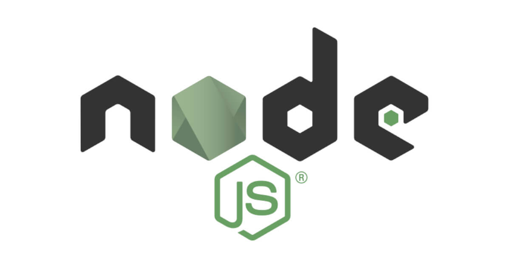
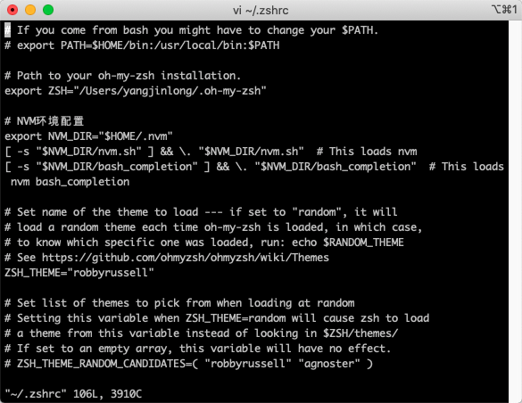
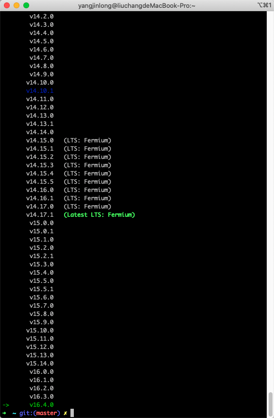
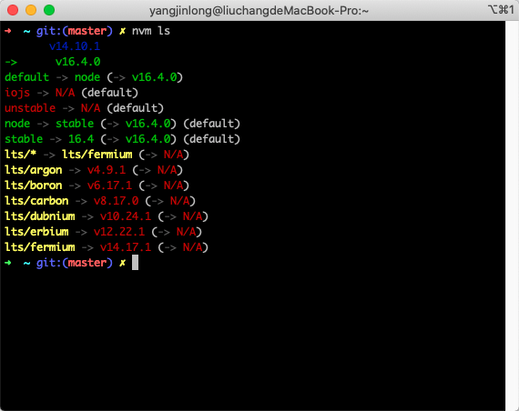

nvm 是 Node.js 的版本管理器 (version manager)，可在同一台主机上安装多个版本的 Node.js 环境，因为不同专案可能会使用不同的 Node.js 版本，那就需要透过一个版本管理器来切换不同的 Node.js 版本。

> 为什么记录这篇笔记.因为在编译RN项目的时候,遇到报错.
>
>```
> npm ERR! code ERESOLVE  
> npm ERR! code EACCES
> npm ERR! errno: -13,
>```
> 
>错误原因是啥呢?是因为node的版本太高了.所以,想来还是用node版本管理工具方便一些.

## 安装 NVM

> 说明：这里没使用brew安装nvm。是因为，安装之后，执行 `nvm --version` 是没有反应的，也就是安装失败的。所以采用如下命令进行 nvm 的安装。

可用`cURL`或`wget`指令使用安装脚本安装或更新 nvm：

```JavaScript
$ curl -o- https://raw.githubusercontent.com/nvm-sh/nvm/v0.34.0/install.sh | bash
```

或

```JavaScript
$ wget -qO- https://raw.githubusercontent.com/nvm-sh/nvm/v0.34.0/install.sh | bash
```

此安装脚本会将 nvm repo clone 到`~/.nvm`，并且将 source line 新增至你的 profile 设定 ( `~/.bash_profile`、`~/.zshrc`、`~/.profile`或`~/.bashrc`)：

```JavaScript
export NVM_DIR="$HOME/.nvm"
[ -s "$NVM_DIR/nvm.sh" ] && \. "$NVM_DIR/nvm.sh"  # This loads nvm
[ -s "$NVM_DIR/bash_completion" ] && \. "$NVM_DIR/bash_completion"  # This loads nvm bash_completion
```

> 由于笔者使用的是 oh-myzsh, 所以执行了命令 `vi ~/.zshrc`, 进行了编辑.


如果在 Linux 执行安装脚本后，执行下面指令会显示以下讯息或没有任何讯息时，建议重开一个新的终端机 (terminal) 再重新执行一次`nvm`指令：

```JavaScript
$ command -v nvm
nvm: command not found
```

如果还是无法使用 nvm，可执行下面指令立即应用 ZSH 的设定：

```JavaScript
$ source .zshrc
```

注意：

- 使用`nvm`时，不需要`sudo`即可使用`npm -g`全域安装模组，所以与其执行`sudo npm i -g`，不如执行`npm i -g`
- 若你有`~/.npmrc`，请确保里面不包含任何`prefix`的设定 (因为与`nvm`不相容)
- 你可以 (但不应该) 保留以前在 “系统” 安装的 Node.js，但`nvm`只对你的使用者帐户 (用于安装`nvm`的使用者帐户) 可用。可能会导致版本不 match，因为其他使用者会使用`/usr/local/lib/node_modules/*`，而使用者帐户会使用`~/.nvm/versions/node/vX.X.X/lib/node_modules/*`

## `--version`：确认 NVM 是否安装成功

```JavaScript
$ nvm --version
0.34.0
```

## `install`：利用 NVM 安装 Node.js

安装 NVM 后，其实还没安装 Node 环境：

```JavaScript
$ node  
zsh: command not found: node
```

如果执行下面指令，会提醒你需要执行`install`指令才能安装 Node.js：

```JavaScript
$ nvm use node
N/A: version "node -> N/A" is not yet installed.

You need to run "nvm install node" to install it before using it.
```

安装最新版的 Node.js：

```JavaScript
$ nvm install node
Downloading and installing node v12.8.1...
Downloading https://nodejs.org/dist/v12.8.1/node-v12.8.1-linux-x64.tar.xz...
#################################################################################################### 100.0%
Computing checksum with sha256sum
Checksums matched!
Now using node v12.8.1 (npm v6.10.2)
Creating default alias: default -> node (-> v12.8.1)
```

如果要指定安装版本，可以直接指定版本号：

```JavaScript
$ nvm install 8.9.1
```

安装的第一个版本的 Node.js 会成员 nvm 的预设版本，新的 shell 就会以预设版本的 Node.js 来使用 (例如：`nvm alias default`)。

查看目前安装 Node.js 的版本：

```JavaScript
$ node -v
v12.8.1
```

## `ls-remote`：察看可用的安装版本

可以看目前有哪些可用版本可安装，在版本号前面的`->`箭头符号代表目前 nvm 正在使用的 Node.js 版本：

```JavaScript
$ nvm ls-remote
...
       v10.16.1   (LTS: Dubnium)
       v10.16.2   (LTS: Dubnium)
       v10.16.3   (Latest LTS: Dubnium)
...
        v12.7.0
        v12.8.0
->      v12.8.1
```

不过刚刚的`ls-remote`指令会把所有可用的版本都列出来，但通常会选择安装 LTS (Long-term support，长期支援) 版，所以只要加上`-lts`参数就可以指列出可用的 LTS 版：

```JavaScript
$ nvm ls-remote --lts
...
       v10.16.1   (LTS: Dubnium)
       v10.16.2   (LTS: Dubnium)
       v10.16.3   (Latest LTS: Dubnium)
```

如果版本号的文字有特殊颜色 (不是白色字)，则代表该版本的 Node.js 有透过 nvm 安装过，例如：我的电脑就安装了`v14.10.1`和`v16.4.0`：



## `ls`：查看目前安装了哪些版本

`ls` 指令可以查看目前安装了哪些版本：

```JavaScript
$ nvm ls
       v10.16.3
->      v12.8.1
default -> node (-> v12.8.1)
node -> stable (-> v12.8.1) (default)
stable -> 12.8 (-> v12.8.1) (default)
iojs -> N/A (default)
unstable -> N/A (default)
lts/* -> lts/dubnium (-> N/A)
lts/argon -> v4.9.1 (-> N/A)
lts/boron -> v6.17.1 (-> N/A)
lts/carbon -> v8.16.1 (-> N/A)
lts/dubnium -> v10.16.3
```

## `use`：切换 Node.js 版本

如果要使用 nvm 切换正在使用的 Node.js 版本，可用`use`指令：

```JavaScript
$ nvm use v10.6.3
Now using node v10.16.3 (npm v6.9.0)
```

如果切换的目标版本还没安装，nvm 会提醒你要安装：

```JavaScript
$ nvm use lts/carbon 
N/A: version "lts/carbon -> N/A" is not yet installed.

You need to run "nvm install lts/carbon" to install it before using it.
```

透过 nvm 安装 Node.js 时，nvm 会将不同的 Node.js 版本储存在`~/.nvm/versions/node/vX.X.X`，然后再修改`$PATH`，将指定版本的 Node.js 路径加入：

```JavaScript
$ nvm current
v10.16.3
$ echo $PATH             
/home/titan/.nvm/versions/node/v10.16.3/bin:/usr/local/sbin:/usr/local/bin:/usr/sbin:/usr/bin:/sbin:/bin

$ use v12.13.1
$ nvm current
v12.13.1
$ echo $PATH             
/home/titan/.nvm/versions/node/v12.13.1/bin:/usr/local/sbin:/usr/local/bin:/usr/sbin:/usr/bin:/sbin:/bin
```

在 nvm 的各个 Node.js 版本安装的全域套件都会在各自版本的目录内安装，所以在切换至新安装的 Node.js 版本后需要重新安装，也因为如此，不同版本间的套件就不会有冲突问题。

## `current`：察看目前使用版本

如果忘记自己切换到哪个版本，可以用`current`指令：

```JavaScript
$ nvm current
v10.6.3
```

## `run`：直接执行 Node.js

如果要直接执行 Node.js，可以使用下面指令：

```JavaScript
$ nvm run node
Running node v12.8.1 (npm v6.10.2)
Welcome to Node.js v12.8.1.
Type ".help" for more information.
>
```

## `exec`：指定要执行的 Node.js 版本

```JavaScript
$ nvm exec 12.8.1 node
Running node v12.8.1 (npm v6.10.2)
Welcome to Node.js v12.8.1.
Type ".help" for more information.
>
```

## `which`：察看 Node.js 的安装路径

执行下面指令可以查看特定版本的 Node.js 的安装路径：

```JavaScript
$ nvm which 12.8.1
/home/titan/.nvm/versions/node/v12.8.1/bin/node
```

## alias

如下图有些版本的文字是红色或是显示`N/A`，就代表该版本未在电脑安装：



预设 alias 可以取代版本号：

- `node`：安装最新版的 Node.js
- `iojs`：安装最新版的 io.js
- `stable`：此 alias 已弃用，仅适用于 v0.12 以及更旧版，目前改为`node`alias
- `unstable`：此 alias 为 v0.11，最后一个 “unstable” (不稳定) Node release，在 v1.0 之后的版本都是稳定版 (in SemVer, versions communicate breakage, not stability)

可在下面这些指令使用以上预设别名：

- `nvm install`
- `nvm use`
- `nvm run`
- `nvm exec`
- `nvm which`
- … 等

## `alias`：察看别名、设定别名

### 察看别名

```JavaScript
$ nvm alias                                                                    * ?
default -> v10.16.3
node -> stable (-> v12.8.1) (default)
stable -> 12.8 (-> v12.8.1) (default)
iojs -> N/A (default)
unstable -> N/A (default)
lts/* -> lts/erbium (-> N/A)
lts/argon -> v4.9.1 (-> N/A)
lts/boron -> v6.17.1 (-> N/A)
lts/carbon -> v8.16.2 (-> N/A)
lts/dubnium -> v10.17.0 (-> N/A)
lts/erbium -> v12.13.0 (-> N/A)
```

### 设定别名

```JavaScript
$ nvm alias titan-test v10.15.3                                                  * ?
titan-test -> v10.15.3
```

接着用`nvm alias`指令就会看到刚刚新增的别名所对应的 Node.js 版本：

```JavaScript
$ nvm alias                                                                    * ?
titan-test -> v10.15.3
default -> v10.16.3
node -> stable (-> v12.8.1) (default)
stable -> 12.8 (-> v12.8.1) (default)
iojs -> N/A (default)
unstable -> N/A (default)
lts/* -> lts/erbium (-> N/A)
lts/argon -> v4.9.1 (-> N/A)
lts/boron -> v6.17.1 (-> N/A)
lts/carbon -> v8.16.2 (-> N/A)
lts/dubnium -> v10.17.0 (-> N/A)
lts/erbium -> v12.13.0 (-> N/A)
```

## 资料来源

- [nvm-sh/nvm: Node Version Manager](https://github.com/nvm-sh/nvm#install--update-script)
