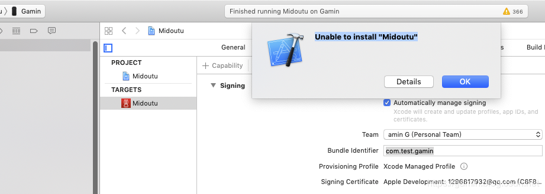
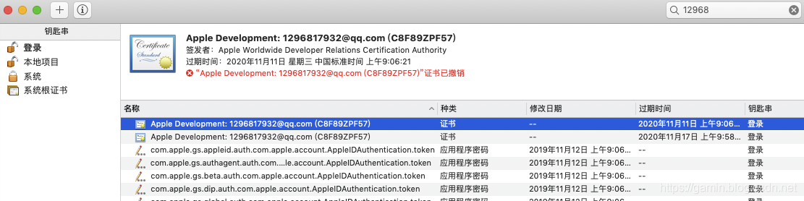
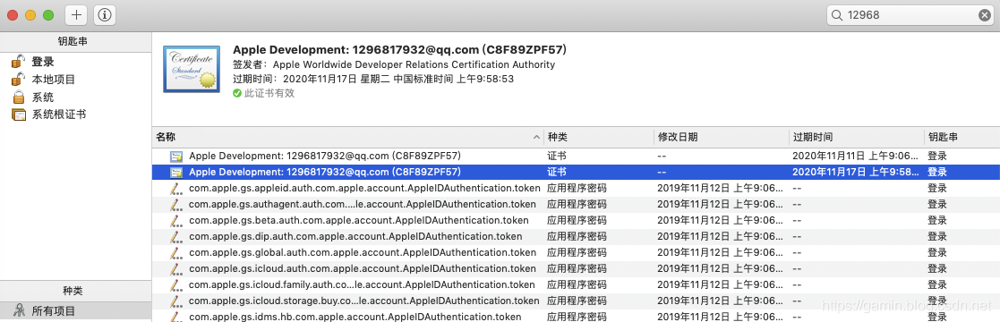
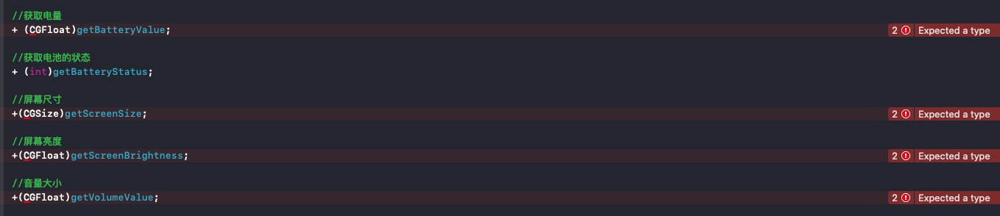
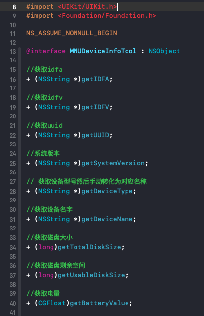

- ### 真机调试时提示 Unable to install "xxx(Project Name)"

> 真机调试时提示 Unable to install "xxx"，但每次删掉 APP 第一次都能安装。

> 查看钥匙串发现之前的证书过期

> 删掉过期的证书后运行，仍然提示 Unable to install "xxx"。去 `设置 - 通用 - 描述文件与设备管理` 中将之前信任的 APP 删除，再重新真机运行，就没得问题了。

------

- ### Xcode 编译时报错 Expected a type

> 明明代码写的完全没毛病，却偏偏给你报个错，就莫名奇妙出现这样一个错误。查阅资料+尝试后发现，是需要包含 UIKit 框架，在上面#import <UIKit/UIKit.h> 后问题就解决了。

------
