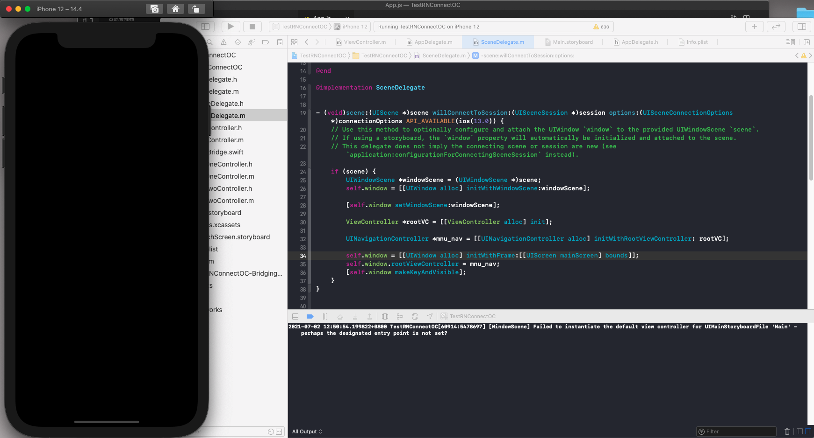
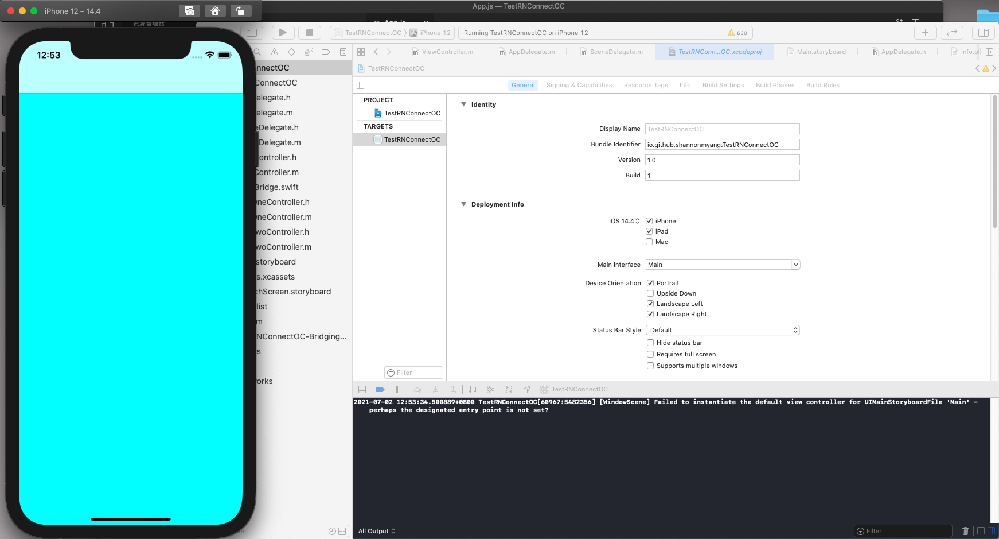

- ### -[AppDelegate setWindow:]: unrecognized selector sent to instance

> Xcode 11之后，由于对iPad分屏的适配要求，多出了SceneDelegate这么个文件。

```objective-c
// AppDelegate.m
- (BOOL)application:(UIApplication *)application didFinishLaunchingWithOptions:(NSDictionary *)launchOptions {
    // Override point for customization after application launch.
    if (@available(iOS 13.0, *)) {
      
    } else {
        ViewController *rootVC = [[ViewController alloc] init];
        
        UINavigationController *mnu_nav = [[UINavigationController alloc] initWithRootViewController: rootVC];
        
        self.window = [[UIWindow alloc] initWithFrame:[[UIScreen mainScreen] bounds]];
        self.window.rootViewController = mnu_nav;
        [self.window makeKeyAndVisible];
    }
    
    return YES;
}
```

> 如果不加`[self.window setWindowScene:windowScene];`，会有报错：[WindowScene] Failed to instantiate the default view controller for UIMainStoryboardFile 'Main' - perhaps the designated entry point is not set?
> 另外，`self.window = [[UIWindow alloc] initWithFrame:[[UIScreen mainScreen] bounds]];` 的出场顺序，一定要注意，否则，会出现不理想的效果。



```objective-c
// SceneDelegate.m
- (void)scene:(UIScene *)scene willConnectToSession:(UISceneSession *)session options:(UISceneConnectionOptions *)connectionOptions API_AVAILABLE(ios(13.0)) {
    // Use this method to optionally configure and attach the UIWindow `window` to the provided UIWindowScene `scene`.
    // If using a storyboard, the `window` property will automatically be initialized and attached to the scene.
    // This delegate does not imply the connecting scene or session are new (see `application:configurationForConnectingSceneSession` instead).
    
    if (scene) {
        UIWindowScene *windowScene = (UIWindowScene *)scene;
        self.window = [[UIWindow alloc] initWithWindowScene:windowScene];
        self.window = [[UIWindow alloc] initWithFrame:[[UIScreen mainScreen] bounds]];
        [self.window setWindowScene:windowScene];
        
        ViewController *rootVC = [[ViewController alloc] init];
        
        UINavigationController *mnu_nav = [[UINavigationController alloc] initWithRootViewController: rootVC];
        
        self.window.rootViewController = mnu_nav;
        [self.window makeKeyAndVisible];
    }
}
```

> 正确的效果图：



[参考链接 1 ](https://www.codenong.com/js1efc37e5d7dc/)
[参考链接 2 ](https://blog.csdn.net/u010713935/article/details/104754971)
