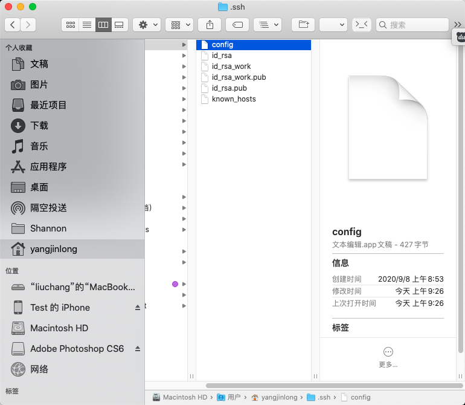
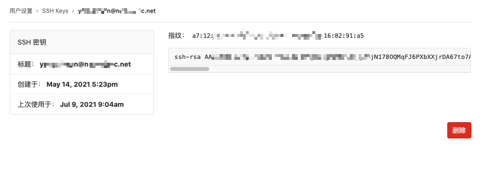
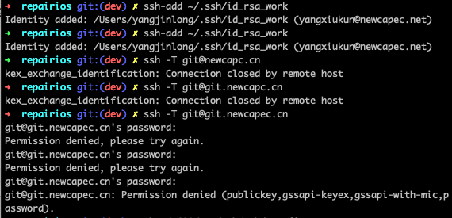
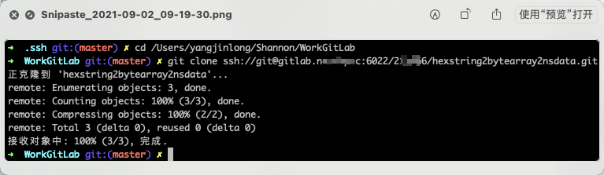
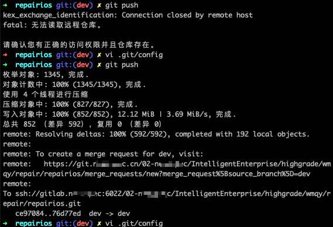

> 记于2021年07月09日。

> 最近修复了工作代码中的一些bug。在修复完，往gitlab仓库提交的时候，遇到了错误。
> 于是我就很纳闷了，上个月中旬提交的时候还是好好的。
> 身为程序猿，当然是遇到问题解决问题了。于是着手查资料，开始解决。

---

##### 执行`git push` 命令后，报错如下：
```
kex_exchange_identification: Connection closed by remote host
[core]
fatal: 无法读取远程仓库。

请确认您有正确的访问权限并且仓库存在。
```

##### 查了好多资料，整体都是在说，你本地的`ssh目录`下，没有以`rsa`、`pub`结尾的文件。
> 然而，实际情况是。



> 不仅如此，我连gitlab上的ssh keys都是配置过的。



##### 所以，证明问题的症结不在此。继续找。有说是`本地的git`没有和`ssh key`链接起来。
> 基于有两个`rsa文件`，于是我将它们连接起来，但是，似乎依旧没任何效果。 
```
Permission denied (publickey,gssapi-keyex,gssapi-with-mic,password).
```


##### 看来，问题依旧不是这个。继续寻找下去。等等，好像上面提到有两个`rsa文件`，会不会是多账户问题。
> 有了方向，继续琢磨尝试。
> 在 ssh目录 下创建 config 文件，然后编辑，做多账户的配置。
```
# 该文件用于配置私钥对应的服务器
# Default gitlab user(xxx001@nxxxxc.net)
Host git.nxxxxc.cn
 HostName git.nxxxxc.cn
 User git
 IdentityFile /Users/yxxxxg/.ssh/id_rsa

 # second user(xxx002@nxxxxc.net)
 # 建一个github别名，新建的帐号使用这个别名做克隆和更新
Host gitlab.nxxxxc
 HostName git.nxxxxc.cn
 User git
 IdentityFile /Users/yxxxxg/.ssh/id_rsa_work
```

> 其规则就是：从上至下读取 config 的内容，在每个 Host 下寻找对应的私钥。这里将 GitHub SSH 仓库地址中的 git.nxxxxc.cn 替换成新建的 Host 别名如：gitlab.nxxxxc，那么原地址是：git.nxxxxc.cn:sxxxlxxxv/yxxaxx.git，替换后应该是：git.nxxxxc:sxxxlxxxv/yxxaxx.git

------

> 2021-09-02，更新，新增如下内容

**测试**

```
$ ssh -T git.nxxxxc.cn``Hi BeginMan! You've successfully authenticated, but GitHub does not provide shel``l access.
$ ssh -T git.nxxxxc 
Hi shannon! You've successfully authenticated, but GitHub does not provide shell access. 
```

**应用**

测试成功，那么我尝试在我的 work 目录下克隆我的账号下的远程仓库。如下：



------

> 然后，在需要上传代码的本地仓库，执行命令`vi .git.config` 对其进行编辑 。(主要是url那一行)
```
[core]
        repositoryformatversion = 0
        filemode = true
        bare = false
        logallrefupdates = true
        ignorecase = true
        precomposeunicode = true
[remote "origin"]
        url = ssh://git@gitlab.nxxxxc:6022/02-nxxxxc/IntelligentEnterprise/highgrade/wmqy/repair/repairios.git
        fetch = +refs/heads/*:refs/remotes/origin/*
[branch "master"]
        remote = origin
        merge = refs/heads/master
[branch "dev"]
        remote = origin
        merge = refs/heads/dev
```

##### 执行`git push`，成功提交，问题解决。


---

#### 小结：碰到的问题，和找到的资料，并不一定百分百的完全吻合，需要多做尝试。
#### 切焦切躁。
#### 毕竟，程序猿遇到问题太正常。能解决问题，但也会需要新的问题。

---

[参考链接1 ssh方式 - ssh-key 与 git 账户配置以及多账户配置](https://www.cnblogs.com/dubaokun/p/3550870.html)
[参考链接2 http方式 - git push 上传代码到 gitlab 上，报错 401/403 (或需要输入用户名和密码)](https://www.cnblogs.com/kevingrace/p/6118297.html)
