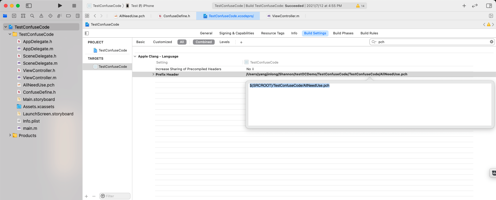
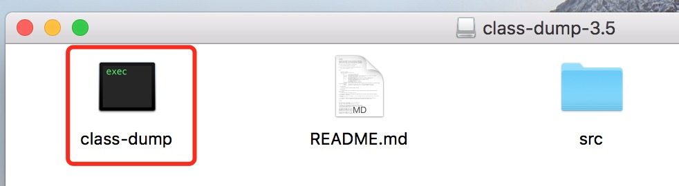
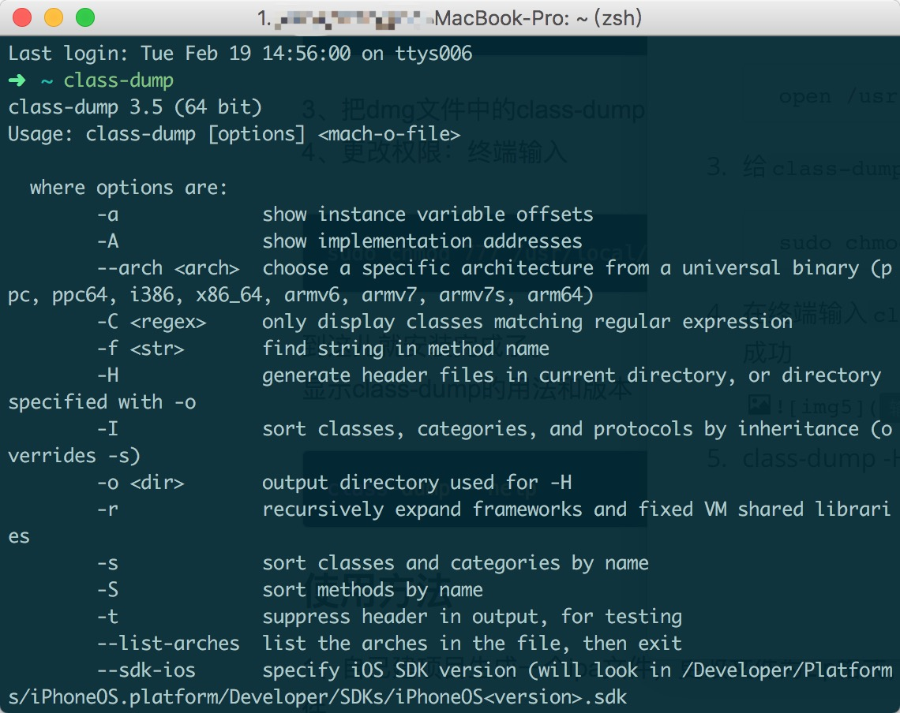
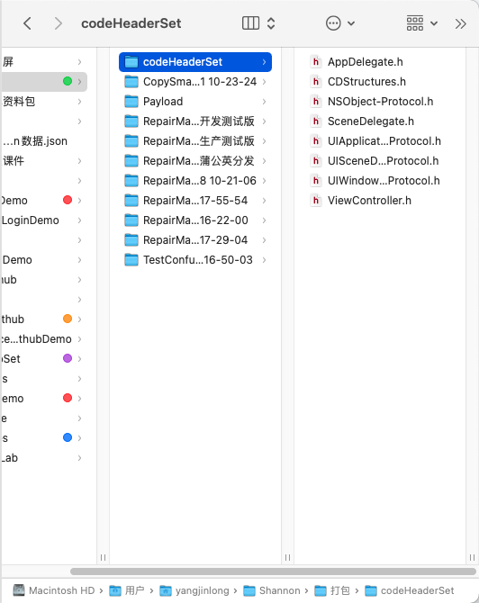

> 写在前面的啰哩啰嗦：
> 最近在做两款差不多一样的App，其实就是相当于要做两个马甲包，毕竟大部分代码和界面，都差不多。所以，在被要求后续做上架后，研究了很久前听闻和看过的代码混淆。
> 这里主要简单介绍，最简单的混淆，以及如何通过逆向工具，进行混淆是否成功的监测。

------

#### 最基础的混淆

> 什么是混淆？网上差不多都说烂了。
> 那我用我自己的话，简单总结一下。就是让你的项目代码在编译打包后，面目全非，它亲爹妈都认不出来，造成阅读困难。但它自己认识，还能运行，这就是混淆。

_最常见的基础混淆_

> 通过宏定义，替换关键方法字符串
> 因为我们都知道，宏定义，在编译之后，就是字符串的替换，所以可以利用这个特性，进行方法的混淆。让本来见名知意的方法，变得乱七八糟、面目全非。

_定义头文件、定义宏_
```objc
#ifndef ConfuseDefine_h
#define ConfuseDefine_h

#define TestFunc wojquiceui

#endif /* ConfuseDefine_h */
```

_在调用的地方使用_
```objc
#import "ViewController.h"

@interface ViewController ()

@end

@implementation ViewController

- (void)viewDidLoad {
    [super viewDidLoad];
    // Do any additional setup after loading the view.
    
    [self TestFunc];
}

- (void)TestFunc
{
    NSLog(@"%s", __func__);
}

@end
```

_.pch文件中引入_
```objc
#ifndef AllNeedUse_pch
#define AllNeedUse_pch

#import "ConfuseDefine.h"

#endif /* AllNeedUse_pch */
```

_.pch文件的路径配置_


_注意点_
> 这种替换方法名的混淆方案会让 App Store 审核被拒，2.3.1 - Performance We discovered that your app contains obfuscated code…，因此，不建议在 App Store 上架的项目中使用。

------

#### class-dump检测混淆

> class-dump 是一个命令行工具，它利用 Objective-C 语言的 runtime 的特性，将存储在 mach-O 文件中的 @interface 和 @protocol 信息提取出来，并生成对应的.h 文件。 它将 xx.app 格式的 iOS 项目文件进行分析，并通过命令生成该 app 源代码中的所有头文件列表，其中就包含了方法名称，可以清晰的查看 dump 出来的方法名是否已经被混淆。

_安装 class-dump_
> 首先需要去这里：[class-dump](http://stevenygard.com/projects/class-dump/)，下载 `class-dump` 压缩包，解压后将文件夹中的 `class-dump` 可执行文件拷贝到 /usr/local/bin 目录下。

_具体操作步骤：_

1. 解压 class-dump 文件，如下图所示：


2. 打开终端，输入如下命令，即可打开 `/usr/local/bin` 目录文件夹，然后将 `class-dump` 文件拷贝到此目录下。
```
open /usr/local/bin
```

3. 给 class-dump 文件更改权限，终端输入如下命令：
```
sudo chmod 777 /usr/local/bin/class-dump
```

4. 在终端输入 class-dump 查看是否安装成功，如显示命令的介绍和版本信息，就说明已经安装成功。


_class-dump 使用方法_
> dump 命令如下：
```
class-dump -H /Users/yangjinlong/Shannon/打包/Payload/TestConfuseCode.app -o /Users/yangjinlong/Shannon/打包/codeHeaderSet
```
其中，-H 是生成头文件的命令，-o 是指定的头文件保存目录，`/Users/yangjinlong/Shannon/打包/Payload/TestConfuseCode.app` 则是 App 文件的路径。

将在 `codeHeaderSet` 文件夹中看到所有 dump 出的头文件。如下示例：


**Tips：如何从打包出来的 xxx.ipa 文件中提取 xxx.app 文件**

先将 xxx.ipa 文件后缀名修改为 xxx.zip ， 然后解压 xxx.zip 文件，会得到一个名为 Payload 的文件夹，文件夹中就放置的咱们需要的 xxx.app 文件，导出即可。

_注意点_

> 不是所有的 xxx.app 文件都可以轻易的 dump 出头文件列表，只有未加密的，自己开发暂未上架 App store 的 app 可以导出，App store 上架的三方应用由于被苹果加过密（加壳），不能直接 dump，需要先进行砸壳（Dumpdecrypted 工具）后，才能 dump 出需要的头文件。

> 从 AppStore 直接下载的 ipa， 苹果公司对其做了 FairPlay DRM 技术进行加密保护，无法直接使用 class-dump 工具获取头文件（会遇到警告：`Warning: This file does not contain any Objective-C runtime information.`）。但是如果是通过 development 打包出来的话的 App 的话，是可以直接使用 class-dump 查看所有头文件的，这里介绍的就是通过此情况来说明如何获取 .h 文件的。
