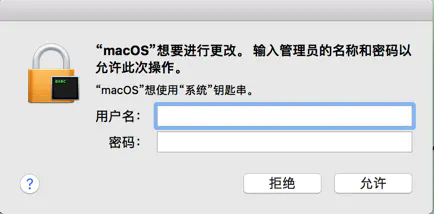
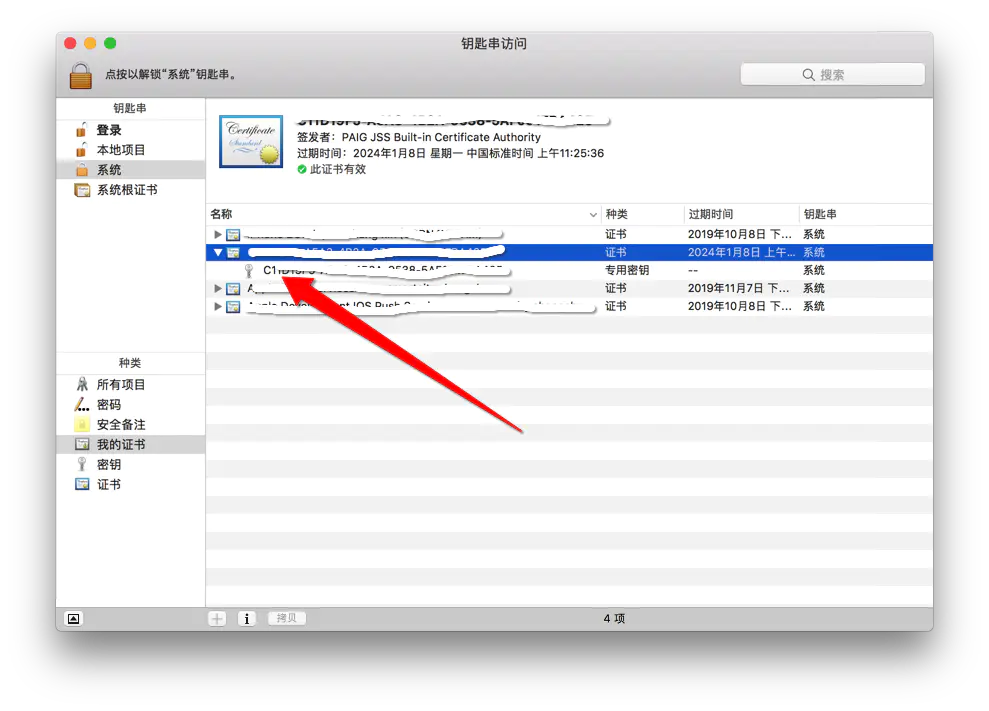
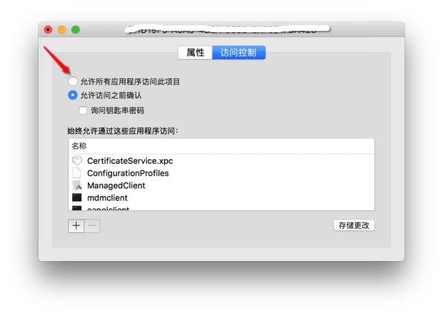

> 最近用Xcode连接真机调试程序，出现了个未曾遇到的问题，一番搜寻下来，得以解决。
>
> 于是，有此记录。

---

#### 弹出框如下图所示

#### 解决方法
> 第一步: 打开钥匙串访问，找到`系统`->`我的证书`，里面有相应的开发和调试证书。双击打开你需要的那个`比如iPhone developer 下的`，选择`访问控制`。

> 第二步：将`访问控制`，改为`允许所有应用程序访问此项目`，输入密码，保存更改即可。

