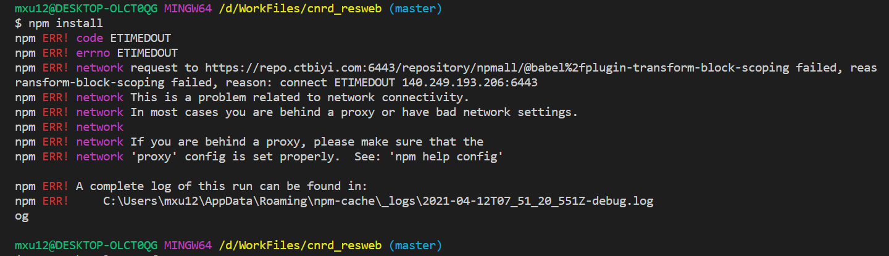

###### Error:
```
extract:vue-qriously: verb lock using C:\Users\Jun\AppData\Roaming\npm-cache_locks\staging-97d0
```
> 建议：检查自己 webpack 是否安装好

------



> Error：运行 `npm install` 等待良久，报错`ETIMEOUT`。
> 运行 `npm cache clean --force` 清理缓存后，仍然报错。
>
> 原因：代理的默认地址为 proxy=http://127.0.0.1:8087 。
> 解决方案：运行 `npm config set proxy null` 代理置为空。

更详细的，可尝试依次执行如下命令：
```
npm config get proxy
npm config get https-proxy
```

两者均返回 null，否则，执行 set null 的命令:
```
npm config get proxy set null
npm config get https-proxy set null
```

再安装淘宝镜像
```
npm config set registry http://registry.cnpmjs.org/
npm install -g cnpm --registry=https://registry.npm.taobao.org
```
之后可以执行 npm install，即可解决问题。

---

> 然而，不知道电信集成公司的破比翼镜像是什么玩意儿，始终还是无效。
>
> 后来发现，是端口号导致的导入依赖错误。
