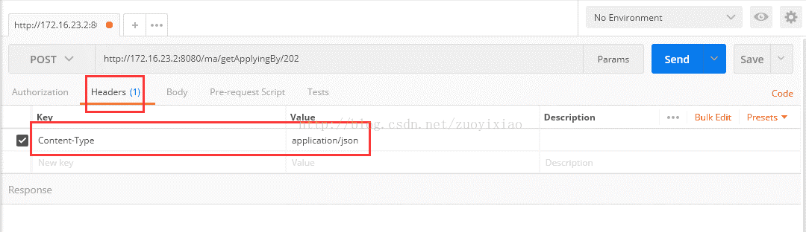
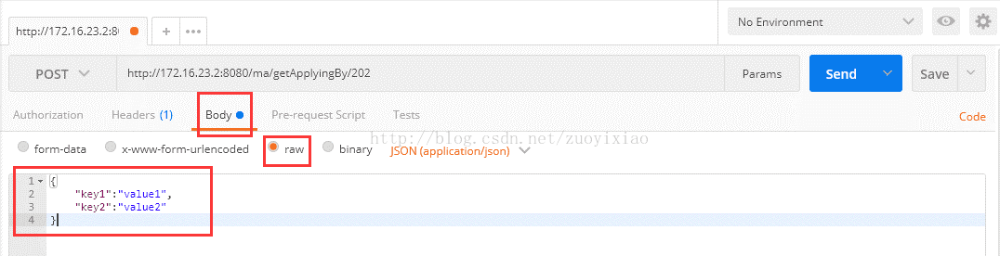
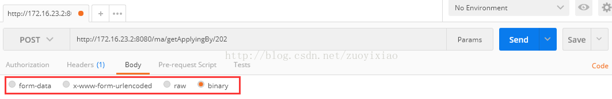

Postman 模拟 Request Payload 发送请求，如下图所示：

 
另外补充下 Postman 中 form-data、x-www-form-urlencoded、raw、binary 的区别

1）form-data 就是 http 请求中的 multipart/form-data, 它会将表单的数据处理为一条消息，以标签为单元，用分隔符分开。既可以上传键值对，也可以上传文件。
2）x-www-form-urlencoded 就是 application/x-www-from-urlencoded, 会将表单内的数据转换为键值对，比如，name=java&age = 23
3）raw 可以上传任意格式的文本，可以上传 text、json、xml、html 等
4）binary 相当于 Content-Type:application/octet-stream, 从字面意思得知，只可以上传二进制数据，通常用来上传文件，由于没有键值，所以，一次只能上传一个文件。
