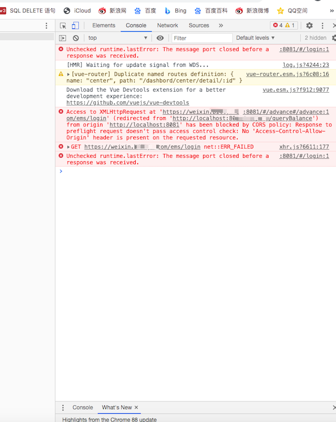
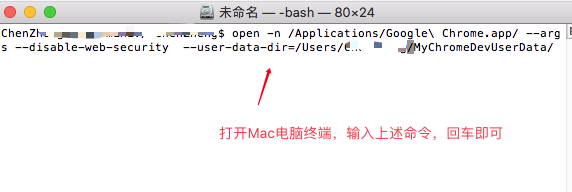
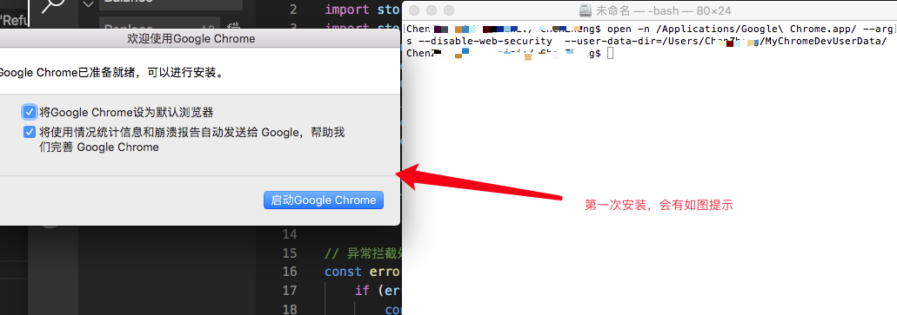
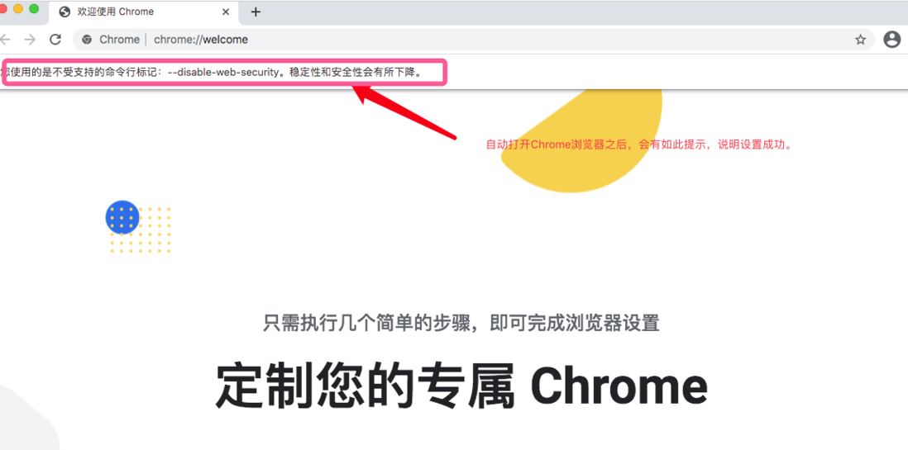
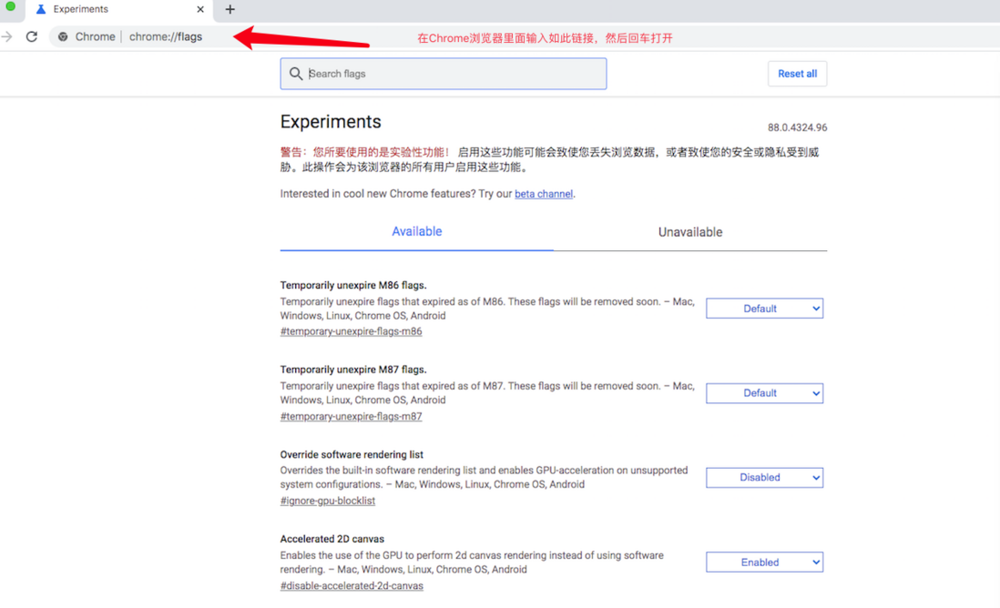
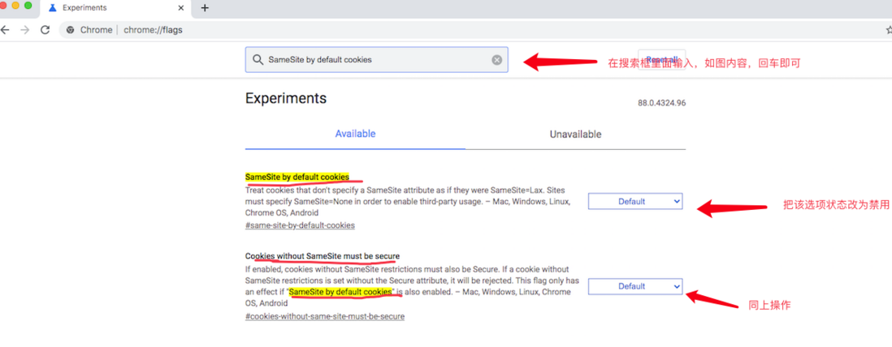
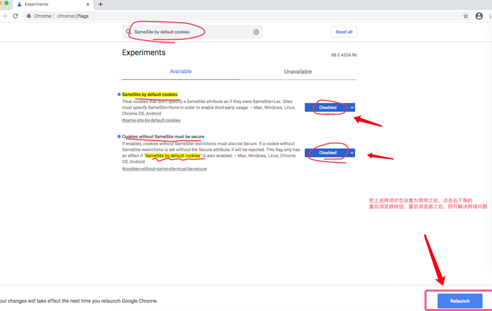
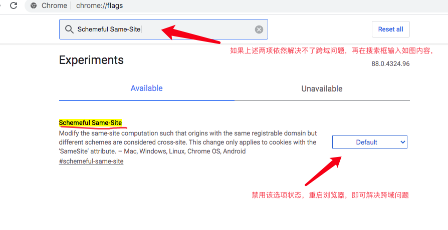
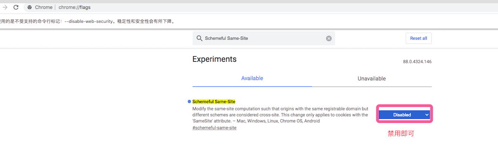

###  [前端开发：Mac 环境的 Chrome 浏览器设置跨域请求的 SameSite 解决方法](https://segmentfault.com/a/1190000039282936)

前段时间在开发项目的时候，遇到一个比较稀奇古怪的跨域问题，不管怎么写就是解决不了，后来通过 Chrome 浏览器的设置，解决了跨域问题，这样就不需要在项目里通过设置代理来解决跨域问题，直接通过设置修改 Chrome 浏览器的设置就可以解决项目跨域问题。具体的跨域问题如下所示：

```pgsql
Access to XMLHttpRequest at 'https://weixin.xxx.com/ems/login' (redirected from 'http://localhost:8081/xxx/queryBalance') from origin 'http://localhost:8081' has been blocked by CORS policy: Response to preflight request doesn't pass access control check: No 'Access-Control-Allow-Origin' header is present on the requested resource.
```


本篇博文就来分享一下上述情况的操作步骤，这里是基于 Mac 环境下来讲解的，其他电脑操作系统（如 Windows 操作系统）的设置方法这里不再过多介绍，如有其他电脑操作系统的设置方法请找度娘。

在通过 Chrome 浏览器设置跨域配置之前，首先要在 Mac 电脑的终端里面输入以下命令行。
1、打开 Mac 电脑终端，输入以下命令行：

```awk
open -n /Applications/Google\ Chrome.app/ --args --disable-web-security  --user-data-dir=/Users/你的Mac用户名/MyChromeDevUserData/    回车，即可。
```




首次打开 Chrome 浏览器会有黄色背景色的 “您使用的是不受支持的命令行标记：--disable-web-security。稳定性和安全性会有所下降。” 的提示，那就说明浏览器设置跨域成功，若再次重复执行上述命令行时，不会再有相关提示了，但是还是可以跨域。通过命令行设置完 Chrome 之后，需要进行其他选项设置，直接打开 Mac 电脑的谷歌浏览器进行操作即可，具体操作步骤如下所示：
2、打开 Chrome 浏览器之后，在浏览器地址栏里面输入 chrome://flags 然后回车键，打开；

3、直接在浏览器搜索栏里面输入以下内容：

```axapta
SameSite by default cookies   然后回车，搜索结果显示以下两项选项，然后直接禁用两项设置，即把状态改为Disabled，然后点击右下角的relaunch重启浏览器即可，如下图所示：
```



4、一般情况下上述操作即可通过浏览器解决跨域问题，但是特殊情况上述步骤依然不能设置跨域问题，那就继续在浏览器搜索框输入以下内容：

```mipsasm
Schemeful Same-Site  回车，同理把该选项禁用，状态设置为Disabled，然后重启浏览器，即可。
```



经过上述步骤，就完美实现通过 Chrome 浏览器设置解决跨域问题，这种方法也为前端开发过程中遇到的跨域问题提供一种非常有效的解决方式，方便又好用。
