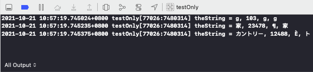

在 Xcode 中，文件以 utf8 格式保存。因此，其中变量对象也是以 utf8 格式保存。不同语言的 utf8 编码不一样，英文的 `utf8 编码` 和 `ascii 码` 一样。

不同语言的每个字符的 utf8 编码的字节数不一样，字节码也不一样。对于英文字符，查看它的 ascii 码，很方便，将字符取出来，就是它的 ascii 码。其实，对于非英文字符，取字符集编码的方式也是这样。这样统称为取 ASCII 码，在很多文档中也是这样描述的。

网上很多这样例子，介绍如何将字符和 ASCII 码相互转化。但是它们都没有提及如何转换中文等其他非英文的字符，使用这个方法都会转成乱码。

**使用英文转换测试，如下所示：**

```objective-c
// NSString to ASCII
NSString *string = @"A";
int asciiCode = [string characterAtIndex:0]; // 65

// ASCII to NSString
int asciiCode = 65;
NSString *string = [NSString stringWithFormat:@"%c", asciiCode]; // A
```

再使用中文测试一下，使用 [NSString stringWithFormat:@"% c", asciiCode] 得到的是乱码字符，就是说根本没识别正确。

再说解决方法之前，先了解一下 stringWithFormat 方法中各种 format。其中将 ascii 码转成字符有两种 format，分别为 % c 和 % C。

```objective-c
/*
 %c
 8-bit unsigned character (unsigned char), printed by NSLog() as an ASCII character, or, if not an ASCII character, in the octal format \\ddd or the Unicode hexadecimal format \\udddd, where d is a digit.
 %C
 16-bit Unicode character (unichar), printed by NSLog() as an ASCII character, or, if not an ASCII character, in the octal format \\ddd or the Unicode hexadecimal format \\udddd, where d is a digit.
 */
```
使用 [NSString stringWithFormat:@"% C", asciiCode] 就可以正常得到所要的字符。

**分别以英文，中文和日文举例。**

```objective-c
NSString *theString = @"g";
unichar theChar = [theString characterAtIndex:0];
NSString *theString1 = [NSString stringWithFormat:@"%c", theChar];
NSString *theString2 = [NSString stringWithFormat:@"%C", theChar];
NSLog(@"theString=%@,%d,%@,%@",theString,theChar,theString1,theString2);

theString = @"家";
theChar = [theString characterAtIndex:0];
theString1 = [NSString stringWithFormat:@"%c", theChar];
theString2 = [NSString stringWithFormat:@"%C", theChar];
NSLog(@"theString=%@,%d,%@,%@",theString,theChar,theString1,theString2);

theString = @"カントリー";
theChar = [theString characterAtIndex:2];
theString1 = [NSString stringWithFormat:@"%c", theChar];
theString2 = [NSString stringWithFormat:@"%C", theChar];
NSLog(@"theString=%@,%d,%@,%@",theString,theChar,theString1,theString2);
```



显示结果表明，这个方法是正确的。对于两个字节组成的字符，是能显示出的。不知道其他语言会怎么样，没有条件去测试。
