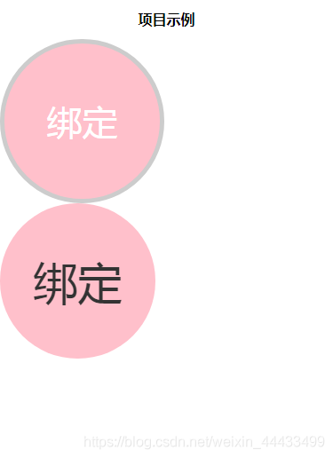

> 记于2021年11月24日。
>
>  题记：最近在做一些uni-app的页面需求，基于能少做就少做的懒惰原因，也基于vue的组件化，决定尽可能多的复用组件。于是，就遇到了这么个需求，要让一些组件根据不同的网络请求返回值，显示出不同的背景色、字体颜色之类的。

---
```vue.js

   	

```

**class支持的语法**
```vue.js
<view class="box" :class="[age>10?class1:'',sex=='女'?class2:'']">box</view>
```

**style支持的语法**
```vue.js
<view class="box" :style="{'color': Color,'font-size': size+'px'}">box</view>
```

**完整例子**
```vue.js
 <template>
    <view>
        <view class="box" :class="[age>10?class1:'',sex=='女'?class2:'']">绑定</view>
        
        <view class="box" :style="{'color': Color,'font-size': size+'px'}">绑定</view>

    </view>
</template>

<script>
    export default {
        data() {
            return {
                class1: "bor",
                class2: "fs",
                age:20,
                sex:'女',
                Color: "#333333",
                size: 50
            }
        },
        methods: {

        }
    }
</script>

<style>
    .box {
        background: pink;
        color: #FFFFFF;
        width: 350upx;
        height: 350upx;
        border-radius: 100%;
        display: flex;
        justify-content: center;
        align-items: center;
        font-size: 50upx;
    }

    .bor {
        border: 10upx solid #CCC;
    }

    .fs {
        font-size: 80upx;
        color: #FFF;
    }
</style>
```



---

> 经过一番测试，最终选择的是class的方式，动态变化样式。

--- 

**参考链接**
[无情搬运工](https://blog.csdn.net/weixin_44433499/article/details/106442636)
