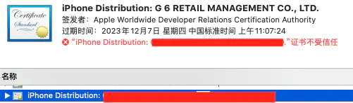
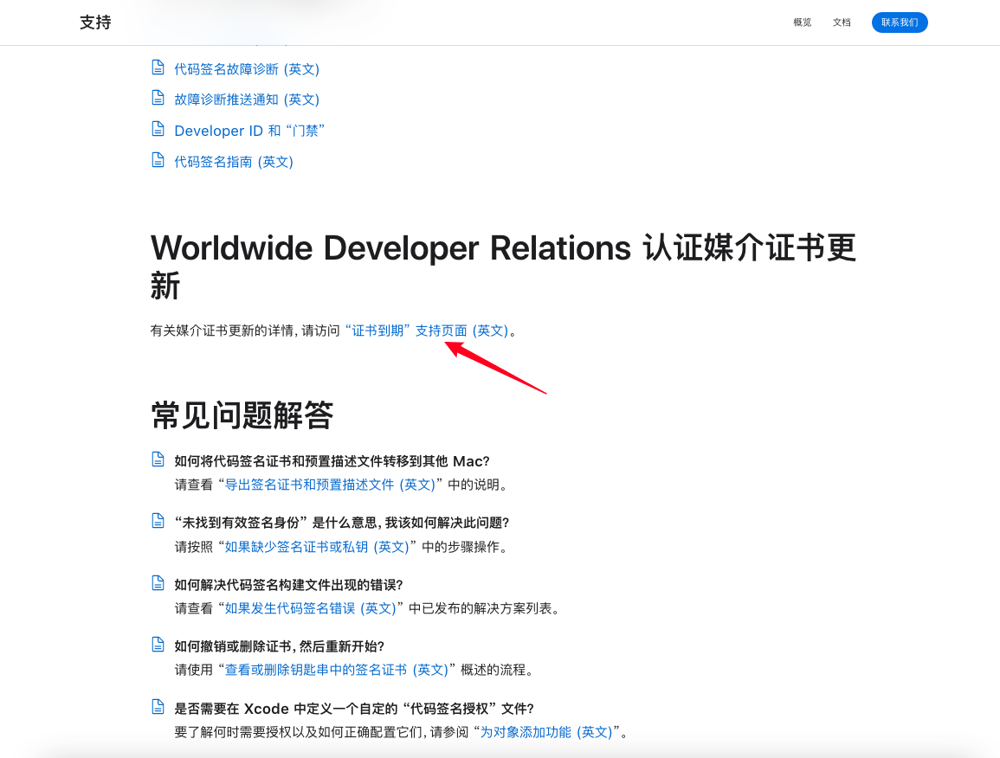
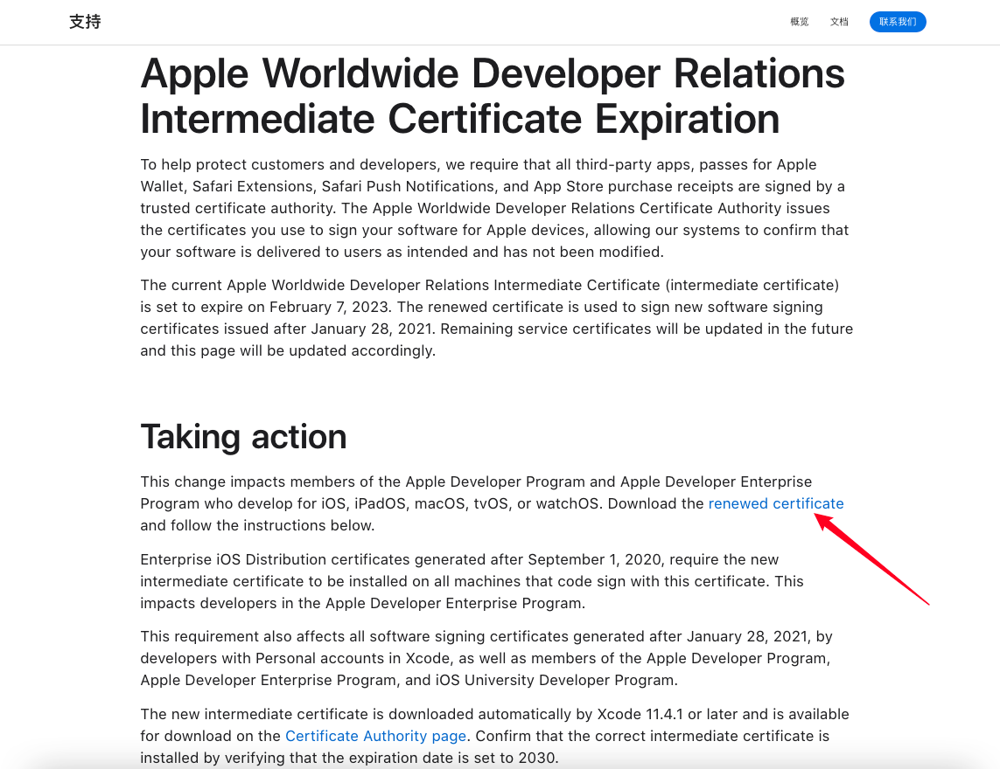
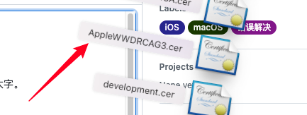
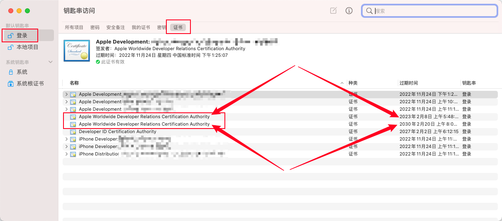

> 记于2021年11月24日。

> 由于之前给电脑重装了系统，所以Xcode之前配置的证书什么的，全都没了。
>
> 今天，要给一个老的app打包，于是，配置完证书，双击安装发现，赫然出现了`「证书不受信任」`几个大字。
> 得，查查吧，看看如何解决。

---------

- ### 错误

- ### 如何解决

解决问题的办法，就是，两个证书都需要安装的。（一个是默认就已经安装好的，另一个，则需要自己手动下载安装。）

[Worldwide Developer Relations 认证媒介证书更新](https://developer.apple.com/cn/support/code-signing/)

[Apple Worldwide Developer Relations Intermediate Certificate Expiration](https://developer.apple.com/cn/support/expiration/)

点击如图箭头指示地方，下载文件；而后，双击安装；

安装后，新旧两款都安装上了。

之后，你再从开发者网站下载你配置好的证书，双击安装，就变成了正常的。

随后，打包就可以一如既往进行了。

---------

**参考链接**

[iOS开发证书不受信任](https://www.jianshu.com/p/04448b2324a4)
