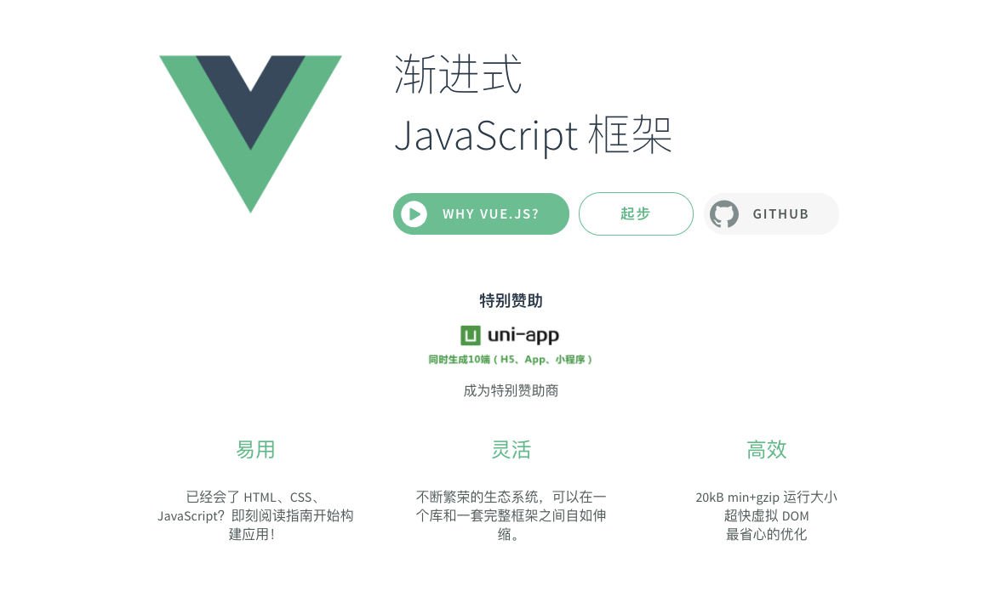

---
---

### 前言少叙

在 19 年 8 月份的时候，vue-cli 更新到了 3.X，新版本的脚手架封装度更高，配置起来简单许多，旨在让用户把精力都放在编写业务代码中，本人从 vue-cli2.X 过渡到 3.X 挺适应的，毕竟 3.X 脚手架已经自动搭建在 webpack4 上，所以不用大家再去从 webpack3 升级到 webpack4, 当然性能也提高了很多，所以推荐大家使用 cli3.X 版本去搭建自己的项目，通过这篇教程帮大家熟悉使用 vue cli3 去搭建 vue 项目。

> 基于 vue cli3 开发的后台管理系统，项目地址 [vue-admin-webapp](https://github.com/gcddblue/vue-admin-webapp) 欢迎 star，fork

---

### 安装

- ##### 卸载旧版本：

如果你之前都是基于 vue-cli2.X, 你需要先卸载它：

```
#卸载vue-cli
npm uninstall -g vue-cli 
```

> Vue CLI 需要 [Node.js](https://nodejs.org/) 8.9 或更高版本 (推荐 8.11.0+)。你可以使用 [nvm](https://github.com/creationix/nvm) 或 [nvm-windows](https://github.com/coreybutler/nvm-windows) 在同一台电脑中管理多个 Node 版本。

- ##### 安装 vue-cli：

```
npm install -g @vue/cli  // 安装cli3.x
vue --version 或者 vue -V  //查看版本是否为3.x
```

Vue CLI >= 3 和旧版使用了相同的 `vue` 命令，所以 Vue CLI 2 (`vue-cli`) 被覆盖了。如果你还是想继续使用 2.x 搭建项目，你可以全局安装一个桥接工具：

```
npm install -g @vue/cli-init
# 然后你就可以继续使用vue init了
npm init webpack my-project
```

### 快速原型开发

你可以使用 `vue serve` 和 `vue build` 命令对单个 `*.vue` 文件进行快速原型开发，不过这需要先额外安装一个全局的扩展：

```
npm install -g @vue/cli-service-global
```

安装完成之后，就新建一个文件夹，并创建一个.vue 文件，执行下面命令就跑起来了

```
vue serve app.vue  // 启动服务
vue build app.vue  //打包出生产环境的包
```

如下图，只要创建一个 app.vue 文件并执行 `vue serve app.vue` 就启动服务了

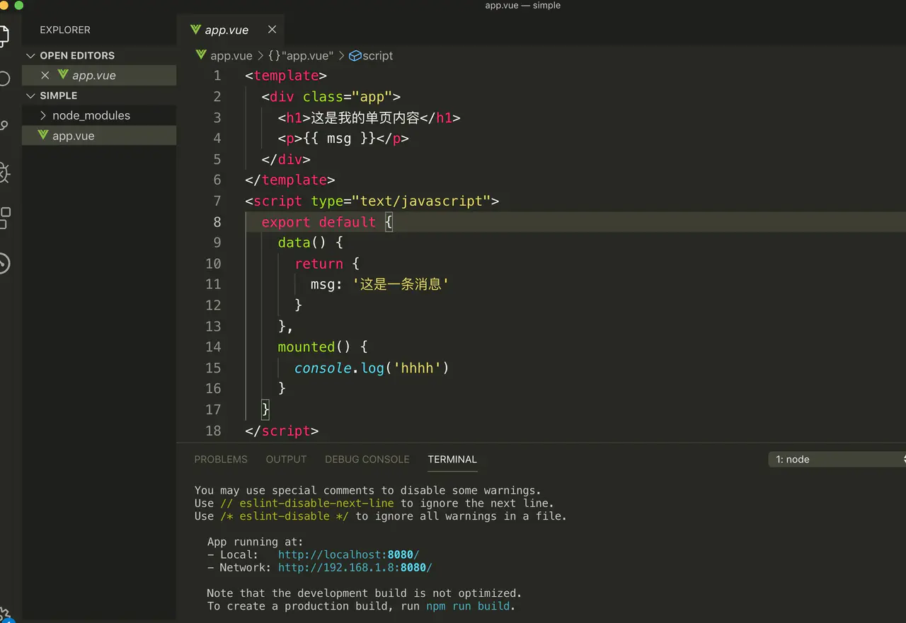

这是一个很棒的功能，用于**开发一个库、组件，做一些小 demo 等都是非常适合的**！

---

### 创建项目

- ##### 初始化：

```
# 创建项目
vue create my-project // 其中my-project为项目目录名称
```

点击回车后，就不断有拦路记者访问你

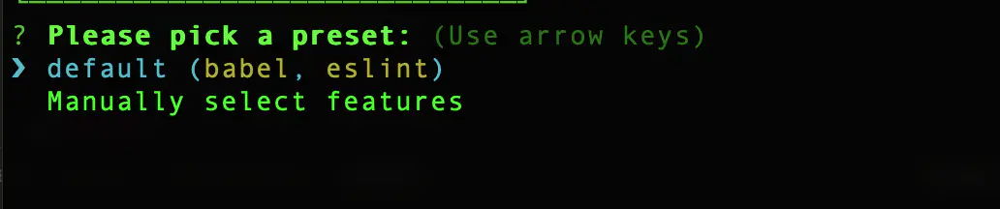

此处有两个选择：

- `default (babel, eslint)` 默认配置 提供 babel 和 eslint 支持
- `Manually select features` 自己手动去选择需要的配置

可以同过上下键，空格来选择，一般会选择手动的配置如下：

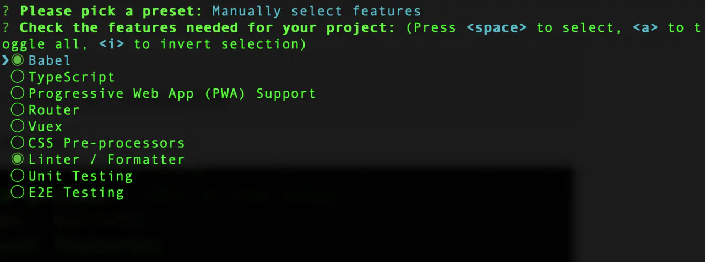

对于每一项的功能，做一下简单阐述：

- `Babel` 主要是对 es6 语法转换成兼容的 js （选上）
- `TypeScript` 支持使用 TypeScript 语法来编写代码
- `PWA` [PWA](https://developers.google.com/web/progressive-web-apps/) 支持
- `Router` 支持 vue 路由配置插件（一般都会选择）
- `Vuex` 支持 vue 程序状态管理模式 (一般都会选择)
- `CSS Pre-processors` 支持 css 预处理器 （一般都会选择）
- `Linter / Formatter` 支持代码风格检查和格式化 （选上）
- `Unit Testing` 单元测试
- `E2E Testing` E2E 测试

那么基于开发常见的项目，一般选择如下：

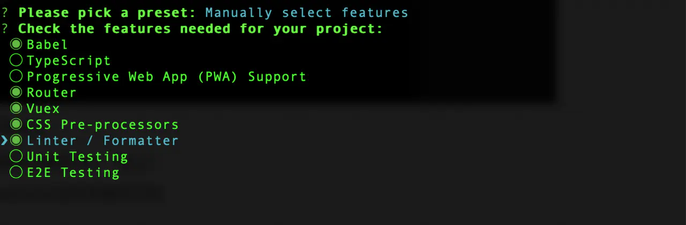

选择完成后回车：

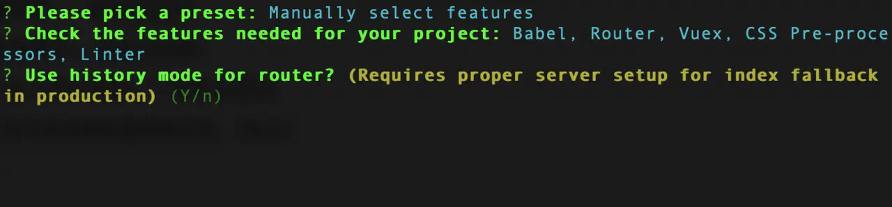

这的意思是问你本次项目是否采用 history 模式，**如果选择 Y, 需要后台配置具体看 [vueRouter](https://router.vuejs.org/zh/guide/essentials/history-mode.html#后端配置例子) 官网解释**，这里我们选择 n

选择完成后回车：

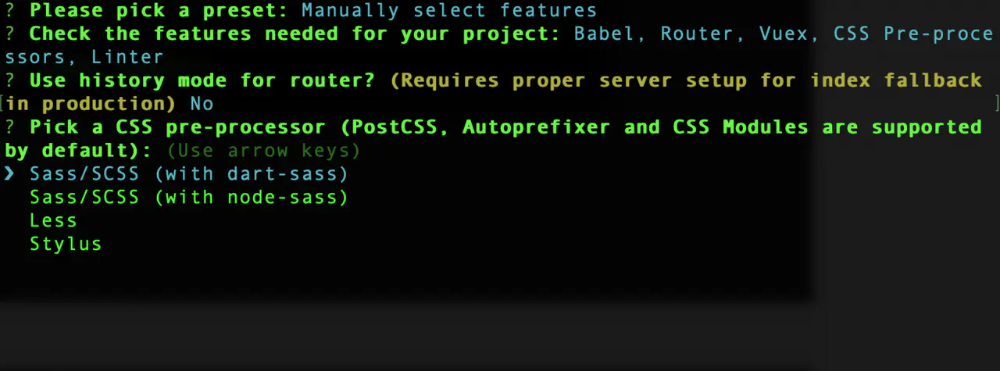

这里是问你选择一种 css 预处理，**我项目一般使用 SCSS，所以这块我选择第一个**，回车后：

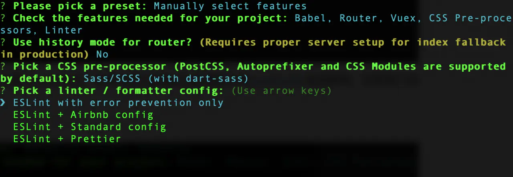

这里是问你选择一种格式化代码方式，**我用 VSCode，所以一般选择 `ESlint + Prettier`**, 选择回车：

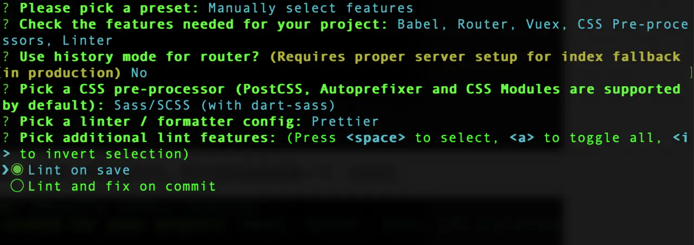

这里问你什么时候进行代码规则检测，**一般会选择保存就检测，也就是 `Lint on save`** 选择回车：

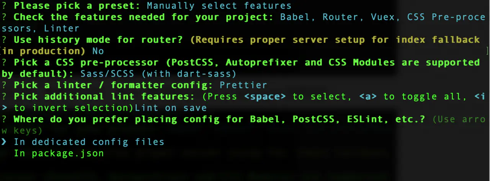

这问将 Babel,PostCSS,ESLint 这些配置文件放哪，**通常我们会选择放到独立位置，让 package.json 文件干净点，所以选择第一个** 点击回车：

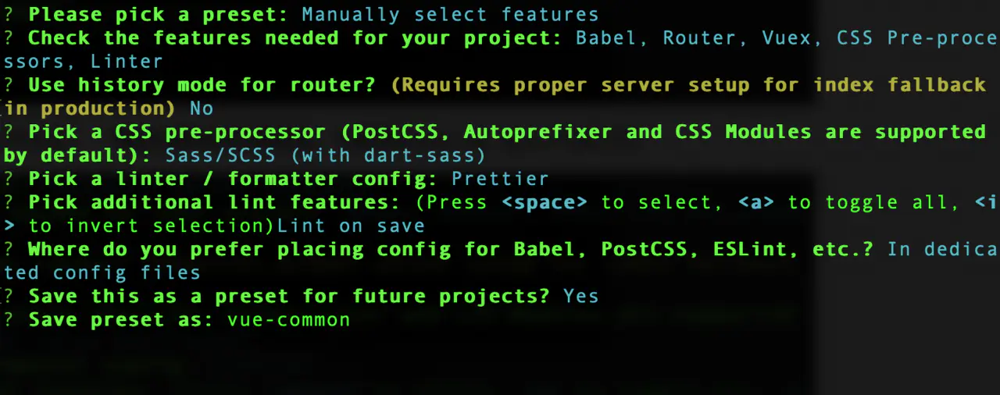

这里是问你是否记录这次配置选择，选择之后会让你为这次配置起一个名字，这样下次可以直接快速配置选择，最后回车后就会初始化项目了，完成后如下图：

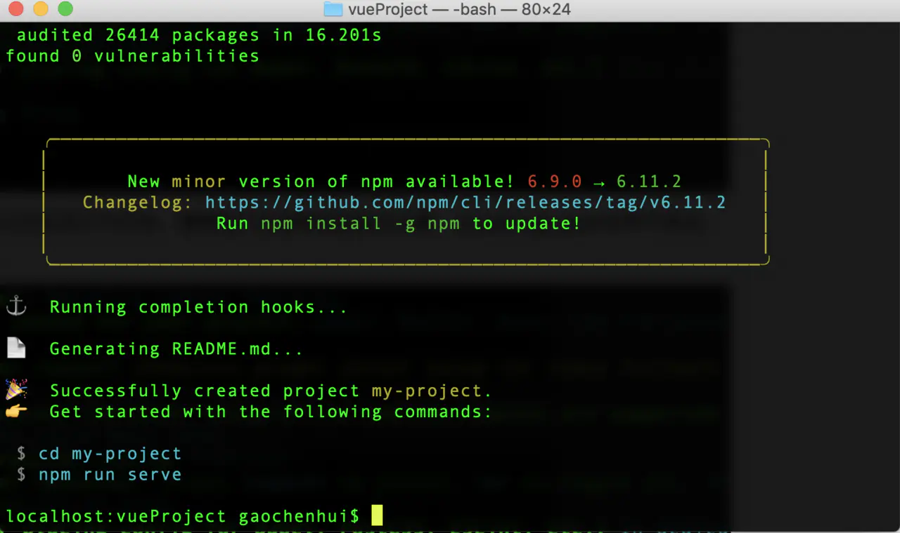

根据提示，我们执行指令 `cd my-project` 然后执行命令 `npm run serve` 这样就开始启动项目了

这是打开 `http://localhost:8080` ：

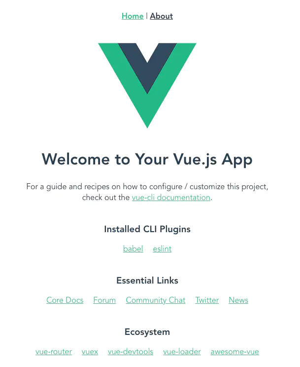

当我们需要自定义 webpack 相关配置的时候需要在项目根目录中创建 `vue.config.js` 文件，它会被 `@vue/cli-server` 自动加载，相关配置内容官网将的很详细，可以[点击查看](https://cli.vuejs.org/zh/config/#全局-cli-配置)

> 当我们需要调整 webpac k 配置的时候，可以通过 chainWebpack 属性进行链式操作，这里有个技巧就是通过 `vue inspect --mode production product.js` 或 `vue inspect > development.js` 来导处生产和开发环境的配置文件，文件里面包含了链式访问的规则，这样我们就可以通过链式操作来修改添加 webpack 配置。

好了整个初始化项目已经完成，接下来就是编写代码了，有关 vue cli3 还有个新功能就是使用图形化界面创建 / 管理 / 运行项目，这里我就不多做介绍了，大家感兴趣的可以去官网看看具体教程。
