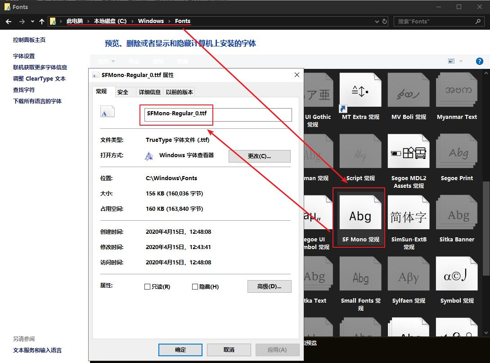
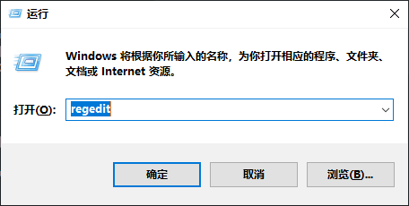
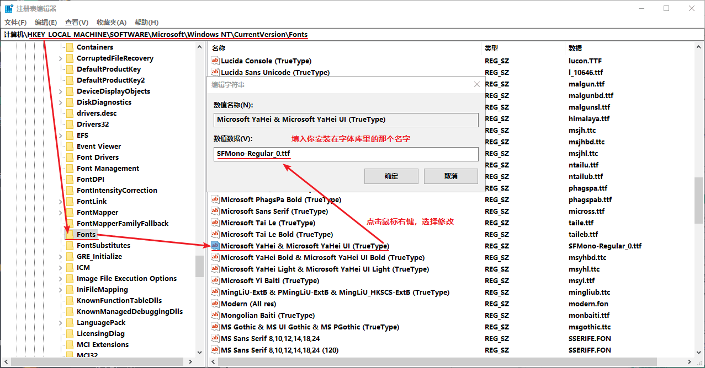

##### 天下苦偶尔用macOS偶尔用Win10的用户久已。

> 由于我是一个工作用`Windows10`操作系统，闲暇用`macOS`操作系统的搬砖民工。
> 所以，每当我看到`Windows10`操作系统自带默认的`微软雅黑`，我简直无力吐槽。尤其是对于我这种搬砖民工来讲，写代码的时候，微软雅黑，简直不能更具备瞎了眼的功力。

> 当然，这不是本文的缘由。一天写代码闲暇时光里，我看到一篇文章，是在说为什么`小米10`不能称为高端机。引出了`成也MIUI，败也MIUI`的话题。其中就说到了`小米兰亭Pro`，说这款是仅次于`San Francisco`的字体。
> 遂，勾起了修改系统默认字体的好奇心。于是，进行了下载和替换字体。

#### 1\. 下载 [San Francisco](https://github.com/ShannonMYang/FontLibrary) 字体

> 从下载好的字体中，选择好你需要的，双击，进行安装

#### 2\. 复制字体名称

> 找到字体库，路径是`C盘->Windows->Fonts`，找到`San Francisco`字体，右键属性，`复制`如图所示框起来的名称；



#### 3\. 修改注册表

> 按下快捷键组合：Win + R ，在输入框中输入regedit



> 看到弹出的窗口，输入如下路径

```
HKEY_LOCAL_MACHINE\SOFTWARE\Microsoft\Windows NT\CurrentVersion\Fonts
```

> 点击鼠标右键，选择 `修改`菜单，将`数值数据` 修改为你拷贝来的名字，然后点击确定按钮。



#### 4\. 重启电脑

> 重启电脑，你就会看到一个全新的世界。
> 上面的截图，即是重启后，字体全面覆盖生效的效果。
> 自此，你告别了Win10的微软雅黑。
