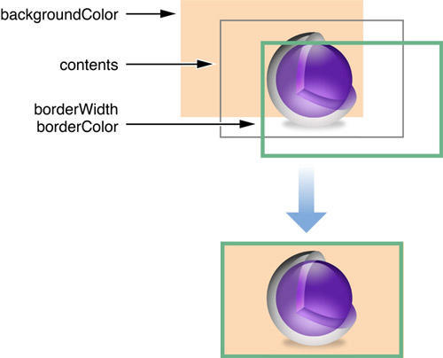

> 最近在做一个小项目的时候，涉及到了 `切圆角问题`。联想到之前看过的 `性能优化分析` 相关文章，遂有了重新对 `离屏渲染` 的小小研究。

> 在 iOS 的应用开发过程中，多多少少的会遇到 `卡顿` 的现象。
> 纵然 iOS 设备的性能日益强大，但是卡顿的现象还是有可能不可避免的出现，而离屏渲染是造成卡顿的原因之一。
> 本文主要分析一下离屏渲染产生的原因及避免的方法，最后介绍一下 Xcode 自带的分析离屏渲染的工具 Instruments 的使用。

---

#### 1\. UIView 和 CALayer 关系

> UIView 继承自 UIResponder，可以处理系统传递过来的事件，如：UIApplication、UIViewController、UIView，以及所有从 UIView 派生出来的 UIKit 类。每个 UIView 内部都有一个 CALayer 提供内容的绘制和显示，并且作为内部 RootLayer 的代理视图。

> CALayer 继承自 NSObject 类，负责显示 UIView 提供的内容 contents。CALayer 有三个视觉元素：背景色、内容和边框，其中，内容的本质是一个 CGImage。

##### `下图为 CALayer 的结构图：`



##### `界面渲染过程`

> RunLoop 有一个 60fps 的回调，即每 16.7ms 绘制一次屏幕，所以 view 的绘制必须在这个时间内完成，view 内容的绘制是 CPU 的工作，然后把绘制的内容交给 GPU 渲染，包括多个 View 的拼接（Compositing）、纹理的渲染 (Texture) 等等，最后显示在屏幕上。但是，如果无法是 16.7ms 内完成绘制，就会出现丢帧的问题，一般情况下，如果帧率保证在 30fps 以上，界面卡顿效果不明显，那么就需要在 33.4ms 内完成 View 的绘制，而低于这个帧率，就会产生卡顿的效果，影响体验。

##### `渲染的过程如下：`

> UIView 的 layer 层有一个 content，指向一块缓存，即 backing store
> UIView 绘制时，会调用 drawRect 方法，通过 context 将数据写入 backing store
> 在 backing store 写完后，通过 render server 交给 GPU 去渲染，将 backing store 中的 bitmap 数据显示在屏幕上

#### 2\. 离屏渲染

> 在使用圆角、阴影和遮罩等视图功能的时候，图层属性的混合体被指定为在未预合成之前不能直接在屏幕中绘制，所有就需要在屏幕外的上下文中渲染，即离屏渲染。

#### 3\. 离屏渲染卡顿原因

> 离屏渲染之所以会特别消耗性能，是因为要创建一个屏幕外的缓冲区，然后从当屏缓冲区切换到屏幕外的缓冲区，然后再完成渲染；其中，创建缓冲区和切换上下文最消耗性能，而绘制其实不是性能损耗的主要原因。

##### `设置了以下属性时，就会触发离屏绘制：`

> -   shouldRasterize（光栅化）
> -   masks（遮罩）
> -   shadows（阴影）
> -   edge antialiasing（抗锯齿）
> -   group opacity（不透明）
> -   复杂形状设置圆角等
> -   渐变π
> -   屏幕渲染类型

##### CPU 计算好显示内容提交到 GPU，GPU 渲染完成后将渲染结果放入帧缓冲区，随后视频控制器会按照 VSync 信号逐行读取帧缓冲区的数据，经过可能的数模转换传递给显示器显示。

##### `屏幕渲染有如下三种：`

> 1、GPU 中的屏幕渲染：On-Screen Rendering
> `意为`当前屏幕渲染，指的是 GPU 的渲染操作是在当前用于显示的屏幕缓冲区中进行

> 2、GPU 中的屏幕渲染：Off-Screen Rendering
> `意为`离屏渲染，指的是 GPU 在当前屏幕缓冲区以外新开辟一个缓冲区进行渲染操作

> 3、CPU 中的离屏渲染（特殊离屏渲染，即不在 GPU 中的渲染）
> 如果我们重写了 drawRect 方法，并且使用任何 Core Graphics 的技术进行了绘制操作，就涉及到了 CPU 渲染。
> CoreGraphic 通常是线程安全的，所以可以进行异步绘制，显示的时候再放回主线程

#### 4\. 切圆角优化

> 切圆角是开发 app 过程中经常会用到的功能，但是使用不同的方式，性能损耗也会不同，下面会介绍 3 种切圆角的方法；其中，方法三的性能相对最好。

-   #### 方法一

> 使用 cornerRadius 进行切圆角，在 iOS9 之前会产生离屏渲染，比较消耗性能，而之后系统做了优化，则不会产生离屏渲染，但是操作最简单

```Objective-C
iv.layer.cornerRadius = 30;
iv.layer.masksToBounds = YES;
```

-   #### 方法二

> 利用 mask 设置圆角，利用的是 UIBezierPath 和 CAShapeLayer 来完成

```Objective-C
CAShapeLayer *mask1 = [[CAShapeLayer alloc] init];
mask1.opacity = 0.5;
mask1.path = [UIBezierPath bezierPathWithOvalInRect:iv.bounds].CGPath;
iv.layer.mask = mask1;
```

-   #### 方法三

> 利用 CoreGraphics 画一个圆形上下文，然后把图片绘制上去，得到一个圆形的图片，达到切圆角的目的。

```Objective-C
- (UIImage *)drawCircleImage:(UIImage*)image
{
    CGFloat side = MIN(image.size.width, image.size.height);

    UIGraphicsBeginImageContextWithOptions(CGSizeMake(side, side), false, [UIScreen mainScreen].scale);
    CGContextAddPath(UIGraphicsGetCurrentContext(), [UIBezierPath bezierPathWithOvalInRect:CGRectMake(0, 0, side, side)].CGPath);
    CGContextClip(UIGraphicsGetCurrentContext());

    CGFloat marginX = -(image.size.width - side) * 0.5;
    CGFloat marginY = -(image.size.height - side) * 0.5;
    [image drawInRect:CGRectMake(marginX, marginY, image.size.width, image.size.height)];

    CGContextDrawPath(UIGraphicsGetCurrentContext(), kCGPathFillStroke);

    UIImage *newImage = UIGraphicsGetImageFromCurrentImageContext();
    UIGraphicsEndImageContext();

    return newImage;
}
```
