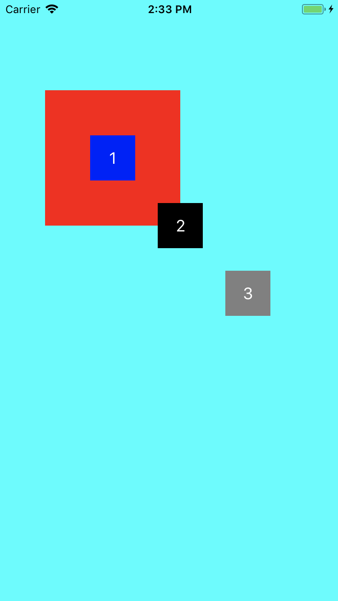
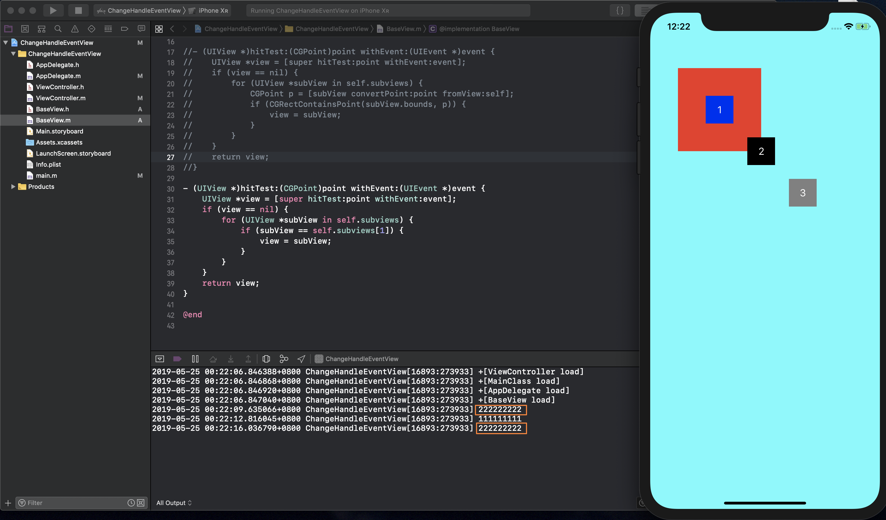

> 写这篇笔记是源于最近有朋友问到的一个问题：在 UIView 上添加若干子视图，子视图之间互为兄弟视图，如何让那些在父视图外面的子视图响应事件？

> 认真想了下，这应该是 iOS 中的一个基础知识点：事件的传递和响应 ，而我们要做的是，拦截下这个事件。

##### 那么，来简单分析下，按照时间轴来划分，事件的生命周期大概是这样：

> 1、 `事件的产生与传递`（事件是怎么从父级 UI 控件传递到子级 UI 控件并找到最合适 view 的、寻找最合适的 view 的底层是如何实现的、咋进行拦截事件的处理）
> 2、 `找到最合适的 view 后事件的处理`（将 touches 方法重写，也就是所谓的事件的响应）

---

##### 事件的传递已经被很多人讲过了，有需要的可自行搜索查看，在此，一笔带过。

> 传递过程大致如下：
> UIApplication -> UIWindow -> UI控件(Father) -> UI控件(Son)

##### 这里主要记录了如何拦截。

> 子视图响应事件是有一个范围的

> 子视图被添加到父视图以后，每次在屏幕上的点击事件都会触发一条响应链来逐层判断该由哪个视图来响应事件。当一个自视图添加到父视图以后其响应事件的范围就是父视图的 bounds，如果子视图的 bounds 超出了父视图则超出的部分就会被响应链判断为不能响应事件而被抛弃。

> 写一个 Demo，如图所示。父视图，红色区域，是 UIView，我们下文称为大红；子视图均为兄弟视图，是 UIButton；1 号称为小蓝；2 号称为小黑；3 号称为小灰。
> Ps:1、2、3 号按钮，是依次添加到父视图 大红 上的。每个 UIButton 都对应着一个点击事件响应方法，均做 NSLog 打印。



##### 在默认情况下，点击 UIButton 就会触发其对应的方法，做打印。

```Objective-C
//类似这样
- (void)firstLog:(UIButton *)button
{
    NSLog(@"111111111");
}
```

##### 然而，实际的情况却是，分别点击三个按钮发现:

> 内部的 1 号按钮即 小蓝 每次的按钮点击事件 都能响应 ；而接近于边上的 2 号按钮 小黑 则 有时响应 ， 有时不会 ；至于外部的 3 号按钮 小灰 ，则 完全不响应 。
> 这是因为，虽然三个按钮都可见，但是只要不是在父视图的 bounds 内的部分便无法响应点击，边界上的按钮只有部分在其父视图之内，所以不是每次点击都会响应，只有点击其在父视图之内的部分（即交叉部分）才能响应点击。

##### 如果要实现点击 2号按钮 小黑 的任意区域均可打印，点击 3号按钮 小灰 也可打印。

##### 则需要在 大红 也就是父视图重写 - (UIView \*)hitTest:(CGPoint)point withEvent:(UIEvent \*)event 方法。

> 因为– hitTest:withEvent: 是通过 - pointInside:withEvent: 来判断点击的点是否在视图中。然后判断这个视图是否接受当前事件，关于 - pointInside:withEvent: 这个方法在官方文档中说明了，正是通过 bounds 判断的。
> 所以，超出父视图的子视图响应事件，该这么做。
> 在父视图添加如下代码。其思路是：遍历父视图的所有子视图，并判断触发事件的点是否在子视图的 bounds 内。如果在，就返回这个子视图。

```Objective-C
- (UIView *)hitTest:(CGPoint)point withEvent:(UIEvent *)event {
    UIView *view = [super hitTest:point withEvent:event];
    if (view == nil) {
        for (UIView *subView in self.subviews) {
            CGPoint p = [subView convertPoint:point fromView:self];
            if (CGRectContainsPoint(subView.bounds, p)) {
                view = subView;
            }
        }
    }
    return view;
}
```

##### 如果要实现，点击 3号按钮 小灰，却让 2号按钮 小黑 响应，打印出来。

> 也需要在 大红 也就是父视图重写 - (UIView \*)hitTest:(CGPoint)point withEvent:(UIEvent \*)event 方法，并在其中拦截，让 2 号按钮小黑响应点击事件。

```Objective-C
- (UIView *)hitTest:(CGPoint)point withEvent:(UIEvent *)event {
    UIView *view = [super hitTest:point withEvent:event];
    if (view == nil) {
        for (UIView *subView in self.subviews) {
            if (subView == self.subviews[1]) {
                view = subView;
            }
        }
    }
    return view;
}
```


