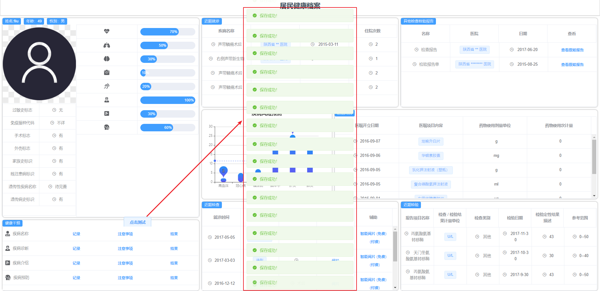
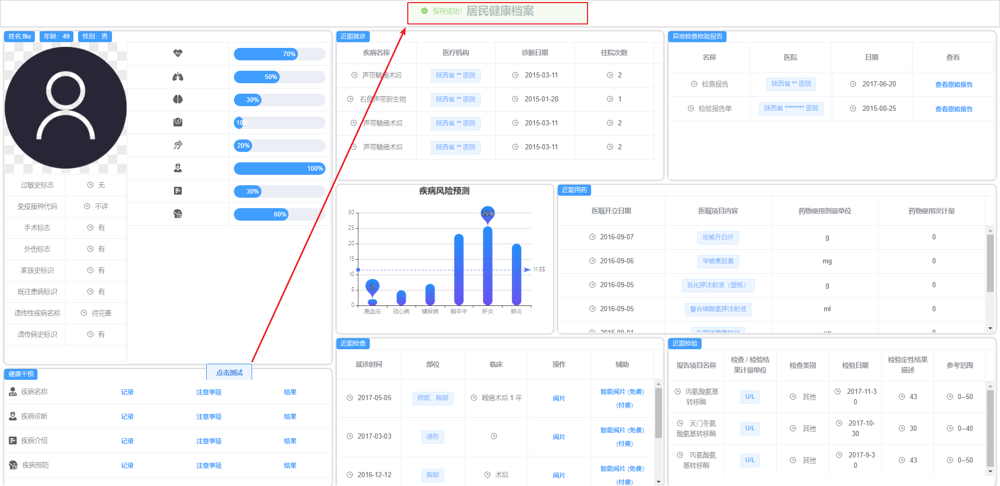

> 在当前版本的 element 中，**message 消息提示** 的一个请求对应一个浮窗提示，这就会导致多条消息提示共存的问题，更多的时候，甚至可以占满一屏。而很多情况下，这多条消息提示的内容是一样的，从用户的体验来说，并不友好。

**类似于这样：**


#### 如何解决？

> 在 `src` 目录下，创建一个文件夹 `common`，在 `common` 文件夹内创建一个 `resetMessage.js` 。

###### 代码如下：

```JavaScript
import {
    Message
} from 'element-ui';
let messageInstance = null;
const resetMessage = (options) => {
    if(messageInstance) {
        messageInstance.close()
    }
    messageInstance = Message(options)
};
['error','success','info','warning'].forEach(type => {
    resetMessage[type] = options => {
        if(typeof options === 'string') {
            options = {
                message:options
            }
        }
        options.type = type
        return resetMessage(options)
    }
})
export const message = resetMessage
```

###### 在 `main.js` 中引用

```javascript
// 务必要放在Vue.use(ElementUI)之后，因为重写的是element-ui的提示框
import {
  message
} from '@/common/resetMessage.js';
Vue.prototype.$message = message; //重写message提示框
```

###### Vue组件中代码的调用

```javascript
methods: {
    click() {
      this.$message({
        message: "保存成功！",
        type: "success",
      });
    },
}
```

###### 此刻，再点击 `组件内` 之前的 `提示框调用`，效果如图：



###### 尾声

> 至此，多条消息提示共同存在的问题，得以解决，页面只会显示和存在一个消息提示
