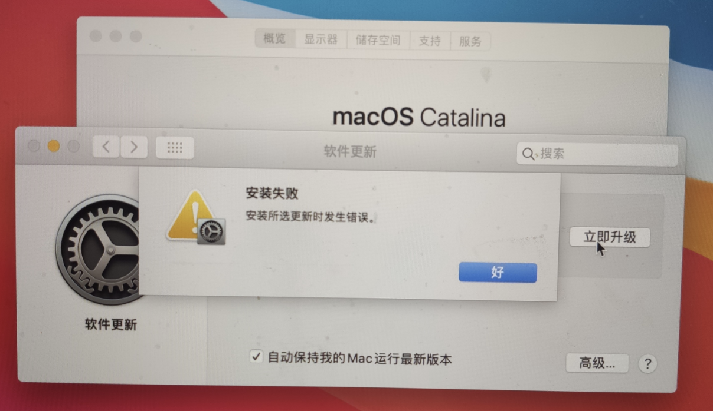

> 盼星星盼月亮，终于等到了Big Sur的正式更新，结果，发生错误，于是，查询、解决、记录如下。

---

网上搜罗了一圈，发现都在说 `csrutil enable` 这个命令。

> 注意！若是 `融合磁盘` 的 Mac 请不要使用此方法，因为 csrutil enable 命令会格式化融合磁盘。届时，电脑上的资料会全部被清空，无法恢复。
> 若是 `闪存` 的 Mac 则可以使用以下方法。

遂试了下，但依旧如大多数网友反映的那样，没有什么用处。
后来，无奈之下，就想着会不会是苹果服务器访问量太大，导致的网络波段？
于是，疯狂点击了几次立即升级，切换了几次WI-FI，居然就开始稳定更新下载了。而后，就顺风顺水的更新成功了。

---

#### 疑问来了

> `csrutil enable` 这个命令，干嘛用的？

###### 经过一番查询，发现这个命令，是Mac开启和关闭 系统完整性保护 权限 用的。

---

#### Mac 开启关闭 SIP（系统完整性保护）

> 在我们开发过程中，有时候我们安装一些工具软件需要将文件拷贝到系统限制更改的文件夹中，甚至有时需要更改系统限制的文件，而这时 Mac 会提示系统文件不能修改之类的内容，而这时我们想要继续操作必须关闭 Mac 电脑的 “系统完整性保护” 机制（SIP）

##### 1\. 查看 SIP 状态

在终端中输入 csrutil status，就可以看到是 enabled 还是 disabled。

##### 2\. 关闭 SIP

###### \- 重启 Mac，按住 cmd+R 直到屏幕上出现苹果的标志和进度条，进入 Recovery 模式；

###### \- 在屏幕最上方的工具栏找到实用工具（左数第 3 个），打开终端，输入：csrutil disable；

###### \- 关掉终端，重启 Mac；

###### \- 重启以后可以在终端中查看状态确认。

##### 3\. 开启 SIP

与关闭的步骤类似，只是在 第二步中的第二小步 终端中 输入 `csrutil enable` 即可。
