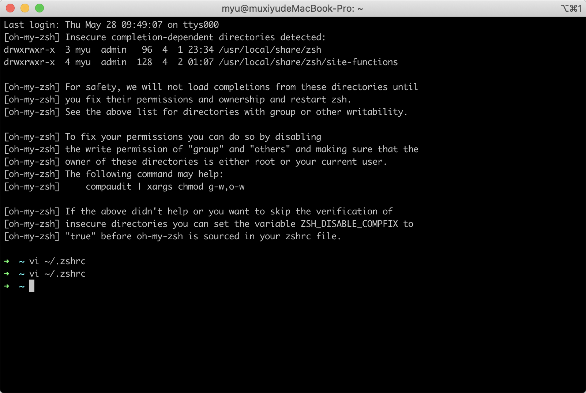
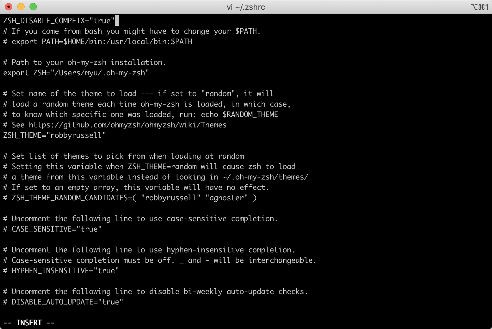
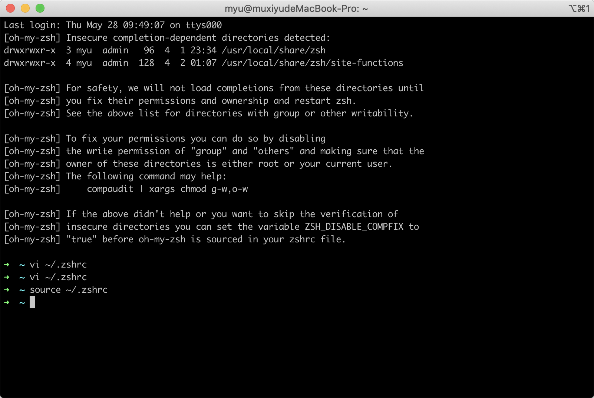
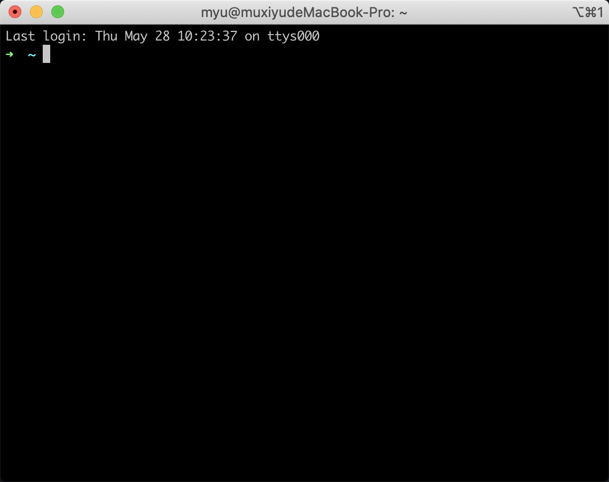

> 在安装完 `oh-my-zsh` 之后，打开 `iTerm` 会冒出如下的一堆提示信息：

```
[oh-my-zsh] Insecure completion-dependent directories detected:
drwxr-xr-x    3 myu  admin    96  4   1   11:33  /usr/local/share/zsh
drwxr-xr-x    4 myu  admin   128  4   2  10:04  /usr/local/share/zsh/site-functions

[oh-my-zsh] For safety, we will not load completions from these directories until
[oh-my-zsh] you fix their permissions and ownership and restart zsh.
[oh-my-zsh] See the above list for directories with group or other writability.

[oh-my-zsh] To fix your permissions you can do so by disabling
[oh-my-zsh] the write permission of "group" and "others" and making sure that the
[oh-my-zsh] owner of these directories is either root or your current user.
[oh-my-zsh] The following command may help:
[oh-my-zsh]     compaudit | xargs chmod g-w,o-w

[oh-my-zsh] If the above didn't help or you want to skip the verification of
[oh-my-zsh] insecure directories you can set the variable ZSH_DISABLE_COMPFIX to
[oh-my-zsh] "true" before oh-my-zsh is sourced in your zshrc file.
```



#### 解决问题：

> 我们可以看到下面的提示信息，都是可以帮助我们去解决的。
> 有两种解决方案。笔者采用的方案是第二种。

##### 1\. 按照所有的提示去修改权限即可

```
chmod 755 /Users/myu/.oh-my-zsh
chmod 755 /Users/myu/.oh-my-zsh/plugins
chmod 755 /Users/myu/.oh-my-zsh/plugins/git
chmod 755 /usr/local/share/zsh
chmod 755 /usr/local/share/zsh/site-functions
```

##### 2\. 设置变量 `ZSH_DISABLE_COMPFIX="true"`

> 运行命令 `vi ~/.zshrc` ，点击 `i` 键，进行编辑。
> 在 `.zshrc` 文件的第一行添加 `ZSH_DISABLE_COMPFIX="true"`。



> 运行 `source` 命令，重新加载 `.zshrc` 文件。

```
source ~/.zshrc
```



#### 尾声：

> 按下组合键 `command + q`，退出 `iTerm` ，重新打开，发现，清清爽爽，提示信息不见了。
> 问题解决。


