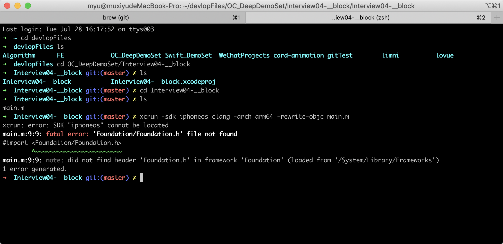
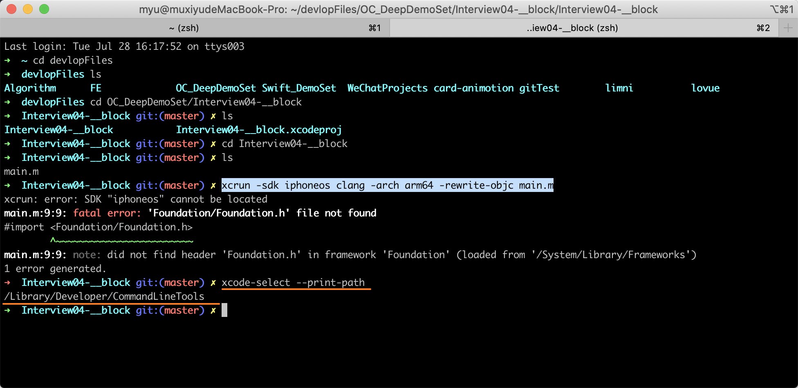
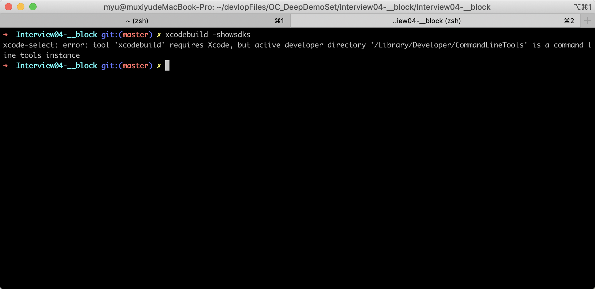
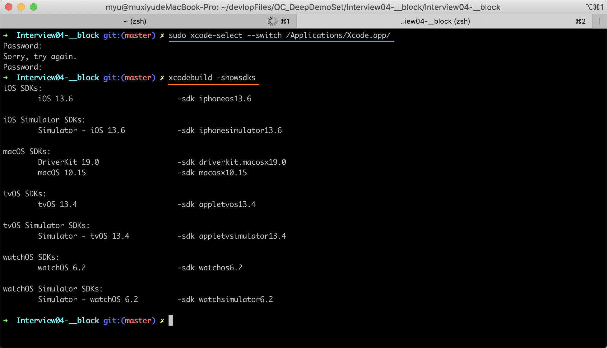
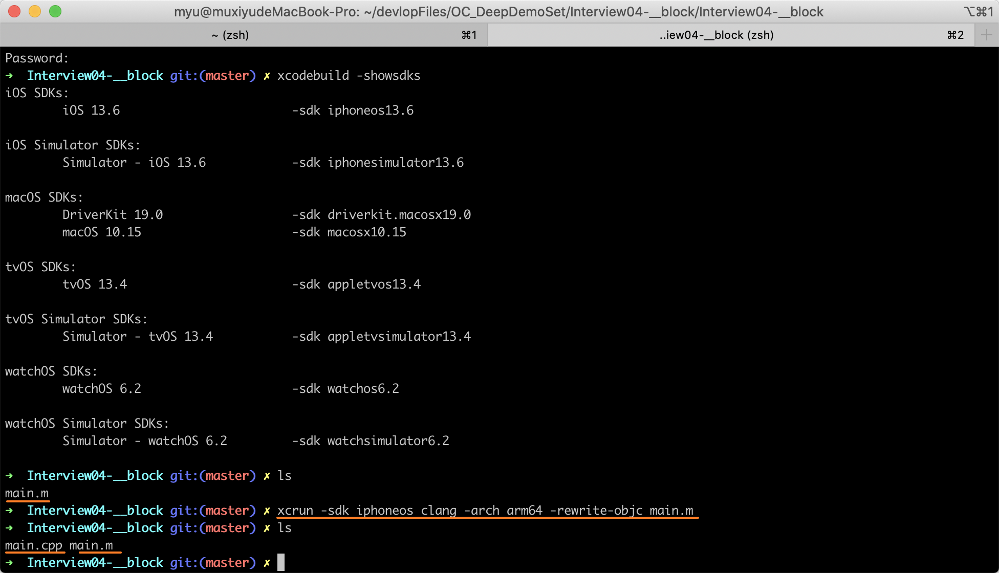

> 近期在研究 `block`，探究底层的一些东西，遂用到了 `xcrun` 命令，但是莫名报错，于是就有了如下记录。

#### 在 `main.m` 所在的文件目录下，输入如下命令行

```
xcrun -sdk iphoneos clang -arch arm64 -rewrite-objc main.m
```

#### 报错如下：



#### 分析：

> 由报错可知，在当前路径下，找不到文件。那应该是 `Xcode` 的路径的问题，输入如下命令，

```
xcode-select --print-path
```

> 见打印。



> 输入如下命令，验证路径是否正确

```
xcodebuild -showsdks
```

> 果然错误



> 输入命令，更改错误路径

```
sudo xcode-select --switch /Applications/Xcode.app/
```

> 再做路径正确与否的验证，输入命令

```
xcodebuild -showsdks
```

> 验证结果



> 再运行 `xcrun` 命令，成功无错误


