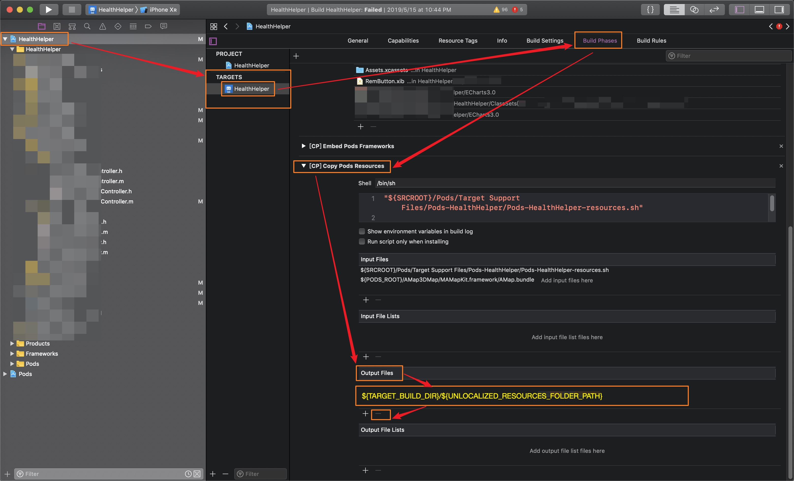
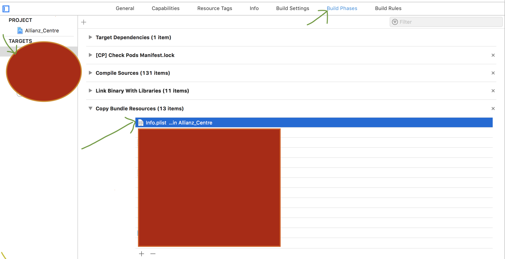
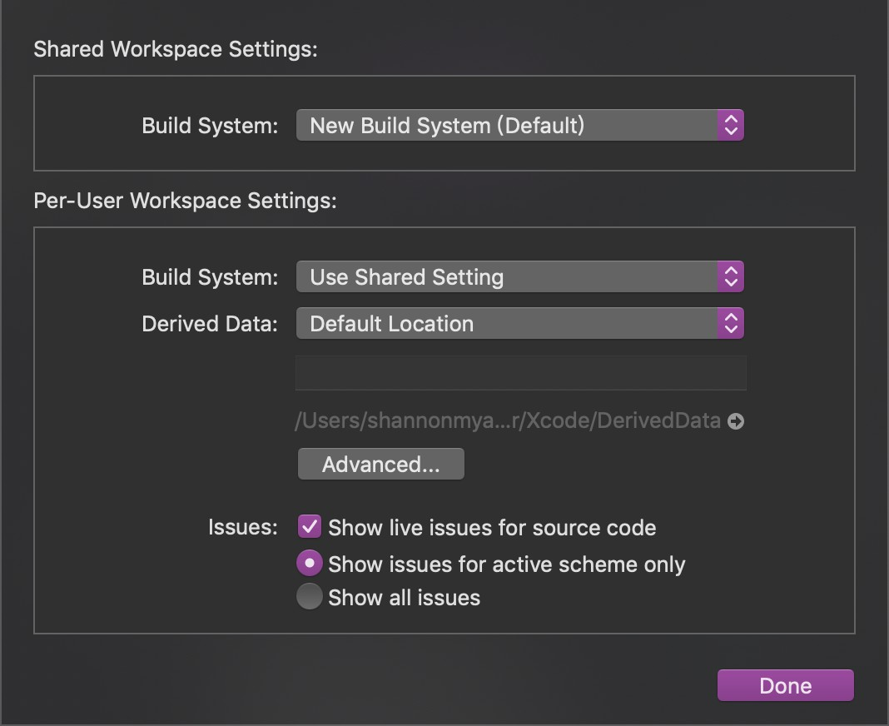

> 之前一直没有更新 Xcode，最近 2019WWDC 也结束了，SwiftUI 刷爆了 iOS 圈。
> 遂，更新了 Xcode ，然后，再打开自己的项目，点击 Command+R，华丽丽得扑街。
> 于是，Google 搜索一番，解决了问题，顺带记录一下。

#### Error如下

```
Multiple commands produce '.../.../.../.../.../info.plist'
//或者是
Multiple commands produce '.../.../.../.../.../xxx.app'
```

#### 原因如下

> Apple 在 Xcode 10 默认使用的 Build system 是 New Build System，与 Xcode9 使用的 Legacy Build System 不同而导致的。

#### 解决办法

##### 1\. 不修改 Build System

> Solution -> Open target -> Build phases > Copy Bundle Resources and remove info.plist from there.

##### `.../.../xxx.app 类型错误`

> target -> Build phase -> Copy Pods Resources -> Output Files -> 移除 TARGETBUILDDIR/{TARGET\_BUILD\_DIR}/TARGETB​UILDD​IR/{UNLOCALIZED\_RESOURCES\_FOLDER\_PATH} -> clean -> 重新编译



###### `'.../.../info.plist' 类型错误`

> target -> 'Build phases' -> 'Copy Bundle Resources' -> 移除 info.plist -> clean -> 重新编译



##### 2\. 修改 \`Build System'

> Xcode 菜单栏 -> File -> Workspace Setting，将 build system 修改为 legacy build system，先 clean，然后重新编译。


