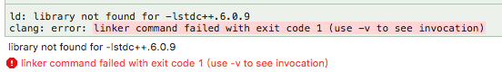
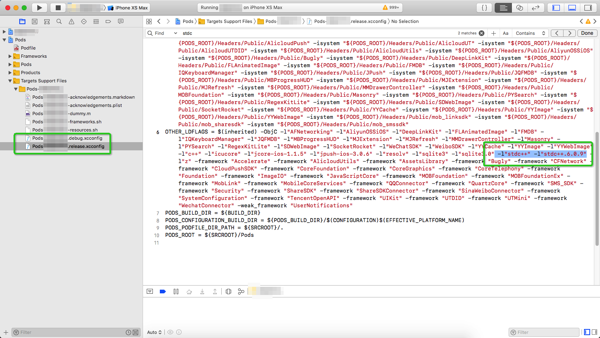

> 最近升级了 `Xcode 10` 版本，运行起之前的项目，各种问题一并爆发。

> 查了下，是 `Xcode` `升级导致`的 ，Apple早在 `Xcode 8` 中就`废弃`了 `libstdc++`, 给了开发者两年时间过渡，如今在 `Xcode 10` 中已`不再支持`。在 `Build Phases > Link Binary With Libraries` 中已经搜不到 `libstdc++` 的`库`了，Apple给出的`原因`是 `std 库`比较`旧`了，`建议`使用`新版本替换`，比如用 `libc++.tbd` 替换 `libstdc++6.0.9.tbd`。

---

> 没错，上述就是问题报错的所在。
> 导致之前依赖 libstdc++6.0.9.tbd 的工程，在升级到 Xcode10 后出现编译错误。

##### `错误的具体信息如图所示：`



> 出现这个问题的原因之一，是因为在开发中使用了第三方库，并且第三方库的 podspec 中 libraries 指定了 stdc++6.0.9，Cocoapods 在安装依赖过程中，会在指定 target 下的 other link flag 中加入 -l "stdc++6.0.9" 导致编译不能通过。
> 由于每个人出现问题的不同，所以此处列举出三种方式。
>
> ##### 笔者用的第二种方式解决的自己遇到的编译不通过的问题。

---

#### 1\. 解决方式 1⃣️：处理 pod 的依赖

> 可以通过使用 Cocoapods 的 post\_install hooks 来解决，解决的方法是在 podfile 中加入下面的代码，去掉所有 pod 对 stdc++6.0.9 的依赖：

```Objective-C
#该方法会移除 所有pod 对stdc++.6.0.9库的依赖，建议仅在Xcode10上使用
post_install do |installer|
    installer.pods_project.targets.each do |target|
        target.build_configurations.each do |config|
            puts config.build_settings
            xcconfig_path = config.base_configuration_reference.real_path
            build_settings = Hash[*File.read(xcconfig_path).lines.map{|x| x.split(/\s*=\s*/, 2)}.flatten]
            build_settings['OTHER_LDFLAGS'][' -l"stdc++.6.0.9"'] = ''
            File.open(xcconfig_path, "w") do |file|
                build_settings.each do |key,value|
                    file.puts "#{key} = #{value}"
                end
            end
        end
    end
end
```

> Ps:
> 这段 hooks 的原理是：找到所有的 target 的 Pods-TargetName.debug.xcconfig 和 Pods-TargetName.release.xcconfig 这两个文件（在 Pod/Targets Support Files/TargetName 目录下），然后将其中的 OTHER\_LDFLAGS 字段中的 - l "stdc++.6.0.9" 去掉。

---

#### 2\. 解决方式 2⃣️：删除 libstdc++(libstdc++.6、libstdc++6.0.9) 库，然后添加 libc++ 库

> 步骤：TARGETS—>Build Phases—>Link Binary With Libraries，删除 libstdc++(libstdc++.6、libstdc++6.0.9) ，添加 libc++；

---

#### 3\. 解决方式 3⃣️：删除掉第三方库中对 libstdc++ 的依赖

> a. Pods —> Targets Support Files —> Pods-XXXX.debug.xcconfig，查找 libstdc++(libstdc++.6、libstdc++6.0.9)，将其删除；
> b. Pods —> Targets Support Files —> Pods-XXXX.release.xcconfig，查找 libstdc++(libstdc++.6、libstdc++6.0.9)，将其删除；

##### `如图所示`:


